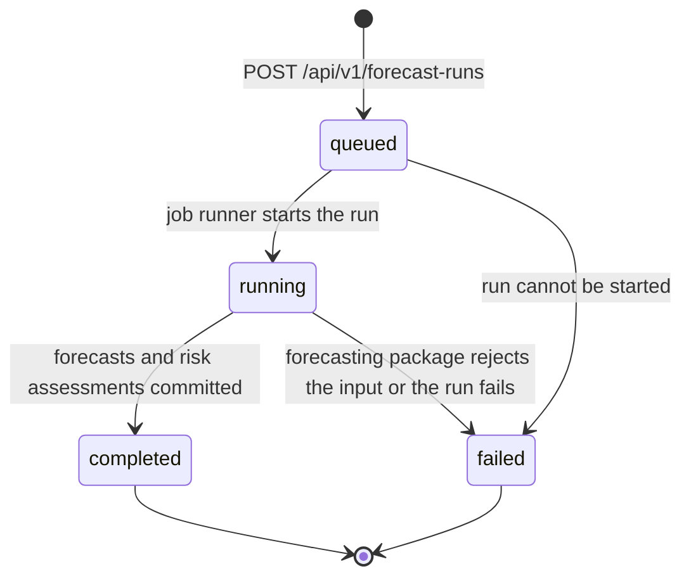

# PharmaStock — REST API contract (v1 draft)

_PHA2-17 · Primary author: Abzal Bakhytov · Status: draft for review · Last updated: 2026-10-19_

This document is the contract of REST API v1 of PharmaStock, the prototype developed in the
diploma project "Development of smart supply chain analytics system for forecasting
pharmaceutical inventory and preventing medicine shortages in healthcare organizations"
(Astana IT University, group SE-2414, 2026–2027). The backend (`backend/`, FastAPI) implements
it, the web interface (`frontend/`, Vue 3) consumes it, and the forecasting package
(`forecasting/`) is called by the backend behind `POST /api/v1/forecast-runs`. Frontend and
backend are developed in parallel against this document: the OpenAPI schema that FastAPI
produces must match it, and a code change that alters the API is merged only together with the
corresponding change here (`docs/requirements.md`, section 5.5.2).

| Related document | Content |
|---|---|
| `docs/requirements.md` | FR/NFR requirements; data and API constraints (section 5.5); forecasting requirements FQ-01…FQ-15 (section 5.6); acceptance scenarios that name the fields used below |
| `docs/architecture/architecture.md` | Components, import and forecast flows, decisions ADR-1…ADR-5 |
| `docs/architecture/database-schema.md` | Tables and the JSON payload shapes (`summary_json`, `config_json`, `projected_stock_json`) that the responses expose |
| `docs/data/data-specification.md` | Import file formats and validation rules (planned) |
| `docs/ux/use-cases.md` | Use cases UC-01…UC-14 that call the endpoints |
| `backend/README.md` | How to run the backend and open the generated OpenAPI documentation |

Task tracking: [Linear project PharmaStock](https://linear.app/pharmacy-kz/project/pharmastock-03a3f33ce30b).

Contents: 1 Conventions · 2 Endpoint overview · 3 Endpoints · 4 Proposed additions ·
5 Open points · 6 Revision history.

## 1. Conventions

### 1.1 Base path, versioning and documentation

- Every endpoint is served under the prefix `/api/v1`. Paths in this document are written in
  full; the backend mounts its routers under the prefix from `backend/app/core/config.py`
  (`api_prefix`).
- The OpenAPI document that FastAPI serves is available at `/api/v1/openapi.json`; the
  interactive documentation (Swagger UI and ReDoc) is mounted by the backend, see
  `backend/README.md`.
- Within `v1` only backward-compatible changes are allowed: adding endpoints, adding optional
  request fields, adding response fields. Removing or renaming a field, changing a type or
  changing semantics requires a new prefix, which is not planned for this project.
- `GET /api/v1/health` and `POST /api/v1/auth/login` are public; every other endpoint requires
  a bearer token (section 1.4).

### 1.2 Content types and encoding

| Direction | Content type | Used by |
|---|---|---|
| Request body | `application/json` (UTF-8) | All endpoints with a body except the file upload |
| Request body | `multipart/form-data` | `POST /api/v1/imports` (file upload) |
| Response body | `application/json` (UTF-8) | All endpoints except report downloads |
| Response body | `text/csv` (UTF-8, header row, comma separated) | `GET /api/v1/reports/risks.csv` |

Clients do not need to send an `Accept` header. Responses are not compressed by the
application; compression, TLS and caching headers are the job of the reverse proxy in
deployment (`docs/architecture/architecture.md`, section 7).

### 1.3 Data types and naming

| Kind | Representation | Example |
|---|---|---|
| Identifier | JSON integer, the `id` column of the entity | `17` |
| Timestamp | ISO 8601 in UTC with the `Z` suffix | `"2026-10-19T09:15:42Z"` |
| Date | ISO 8601 calendar date | `"2026-10-12"` |
| Week | `period_start`, the Monday of the ISO week, as a date | `"2026-10-12"` |
| Quantity | JSON number with at most three decimals, never a string; non-negative; in the unit of the item (`medicine_item.unit`) | `35`, `12.5` |
| Enumeration | Lower-case string with the values listed at the field | `"high"` |
| Absent optional value | `null` (the key is present) | `"finished_at": null` |

- Field names are `snake_case` and reuse the entity and column names of
  `docs/architecture/database-schema.md` verbatim (`medicine_item.code` is returned as `code`,
  `stock_snapshot.quantity_on_hand` as `quantity_on_hand`, and so on). Nested objects are named
  after the entity they represent (`item`, `run`, `supplier`).
- Unknown fields in a request body are rejected with `422 VALIDATION_ERROR`, so that a typo in
  the frontend is noticed immediately.
- Responses never contain `password_hash` or any other secret, and never contain stack traces.
- Rounding to whole units happens only in the interface; the API returns the stored values
  (`numeric(14, 3)`).

### 1.4 Authentication and roles

- `POST /api/v1/auth/login` with e-mail and password returns a signed bearer token (JWT) that
  carries the user id and role. Every other request sends it as
  `Authorization: Bearer <token>`.
- Token lifetime is a backend setting; the initial value is 12 hours. There is no refresh
  endpoint in v1: an expired token is answered with `401 UNAUTHENTICATED` and the interface
  returns to the login page.
- Roles (`app_user.role`, FR-14): `administrator`, `pharmacist`, `viewer`. The permission
  matrix of `docs/requirements.md` (section 6.11) is applied per endpoint; the column "Roles"
  in section 2 lists who may call each endpoint. A request by an authenticated user whose role
  is not allowed is answered with `403 FORBIDDEN`; a request without a valid token, with an
  expired token or from a deactivated user (`is_active = false`) with `401 UNAUTHENTICATED`.
- Permission checks are FastAPI dependencies on each router
  (`docs/architecture/architecture.md`, section 8.1). The frontend hides actions a role cannot
  perform, but security is enforced only by the backend.
- Passwords are stored as salted hashes (NFR-03) and travel only in the login request body
  over HTTPS in deployment.

### 1.5 Error envelope

Every error response, whatever the status code, has the same body:

```json
{
  "error": {
    "code": "IMPORT_VALIDATION_FAILED",
    "message": "Import rejected: 3 validation errors",
    "details": [
      {"row": 15, "column": "quantity", "value": "-3", "code": "negative_quantity", "message": "quantity must be >= 0"}
    ]
  }
}
```

- `code` is a stable upper-snake-case identifier that clients may branch on.
- `message` is a human-readable summary in English.
- `details` is optional; when present it is a list of structured items. For request validation
  each item has `field` and `message` (`field` uses dotted paths for nested fields, for example
  `model.params.window`); for import validation each item has `row` (1-based data row,
  `null` for file-level errors), `column`, `value`, `code` and `message`. Import validation
  reports at most the first 100 errors in `details` and states the total in `message`
  (FR-02-S7).
- FastAPI's default `{"detail": ...}` body is replaced by this envelope through application-wide
  exception handlers, so that request validation errors (422) and HTTP errors share the shape.

HTTP status codes and the codes used with them:

| Status | Used for | `code` values |
|---|---|---|
| 400 | Malformed request that cannot be processed: unsupported file type, file too large, bad query parameter | `BAD_REQUEST`, `UNSUPPORTED_FILE_TYPE`, `FILE_TOO_LARGE` |
| 401 | Missing, invalid or expired token; deactivated user; failed login | `UNAUTHENTICATED`, `INVALID_CREDENTIALS` |
| 403 | Authenticated user lacks the role for the action | `FORBIDDEN` |
| 404 | Entity not found (item, import batch, forecast run) | `NOT_FOUND` |
| 409 | Conflict with existing data | `ITEM_CODE_EXISTS`, `RUN_IN_PROGRESS` |
| 422 | Request body or query parameters fail validation; import file fails validation | `VALIDATION_ERROR`, `IMPORT_VALIDATION_FAILED` |
| 500 | Unexpected server error | `INTERNAL_ERROR` |

Successful responses use `200 OK` for reads and updates, `201 Created` for created entities,
and `202 Accepted` for a forecast run that has been queued (section 1.7).

### 1.6 Pagination and ordering

- List endpoints accept `limit` (integer, default 50, maximum 500) and `offset` (integer,
  default 0) as query parameters and return the envelope

  ```json
  {"items": [], "total": 0, "limit": 50, "offset": 0}
  ```

  where `total` is the number of rows matching the filters regardless of `limit`. Endpoints
  may add further top-level fields next to the envelope (for example `run` and `counts` in
  `GET /api/v1/risks`).
- A `limit` above 500 or a negative `offset` is answered with `400 BAD_REQUEST`.
- Every list has a fixed default order stated in its section. A `sort` parameter is not part of
  the draft; it will be added only if the interface needs server-side sorting to meet NFR-02.
- Filters are query parameters; an unknown value of an enumerated filter (for example
  `level=critical`) is answered with `400 BAD_REQUEST`.

### 1.7 Long-running operations

A forecast run can take minutes (NFR-01), so it is modelled as a resource rather than as a
request that waits for the result (ADR-3, ADR-5): `POST /api/v1/forecast-runs` creates a
`forecast_run` with status `queued` and returns `202 Accepted` immediately; the client polls
`GET /api/v1/forecast-runs/{id}` until the status is `completed` or `failed`. Forecasts and
risk assessments are committed only when a run completes, so readers never see a partial run.
Imports are processed synchronously inside the request (files are limited to 20 MB).

### 1.8 Side effects and audit log

Endpoints that change data write an `audit_log` entry in the same transaction (FR-15):
`POST /api/v1/imports`, `POST /api/v1/items`, `POST /api/v1/forecast-runs` (creation; the job
runner adds the completion or failure entry), `PUT /api/v1/config/thresholds`, and
`POST /api/v1/auth/login` (successful and failed logins). The action names are listed in
`docs/architecture/database-schema.md`, section 4.14. Read endpoints write no audit entries.

## 2. Endpoint overview

Roles: "public" needs no token; "any" is any authenticated user (`administrator`, `pharmacist`
or `viewer`); "pharmacist" means `pharmacist` and `administrator`.

| # | Method | Path | Purpose | Roles | Requirements | Section |
|---|---|---|---|---|---|---|
| 1 | GET | `/api/v1/health` | Liveness of the service | public | NFR-07 | 3.1 |
| 2 | POST | `/api/v1/auth/login` | Obtain a bearer token | public | FR-14, NFR-03 | 3.2 |
| 3 | GET | `/api/v1/items` | List and search the medicine catalogue | any | FR-03 | 3.3 |
| 4 | POST | `/api/v1/items` | Create a catalogue item | pharmacist | FR-03, FR-15 | 3.4 |
| 5 | GET | `/api/v1/items/{id}/history` | Weekly consumption and stock history of an item | any | FR-05, FR-17 | 3.5 |
| 6 | POST | `/api/v1/imports` | Upload and validate a CSV/XLSX file | pharmacist | FR-01, FR-02, FR-10, FR-17, FR-18 | 3.6 |
| 7 | GET | `/api/v1/imports/{id}` | Status, validation report and data-quality summary of an import | any | FR-02, FR-18 | 3.7 |
| 8 | POST | `/api/v1/forecast-runs` | Start a forecast run | pharmacist | FR-06, FR-08, FR-12, NFR-05 | 3.8 |
| 9 | GET | `/api/v1/forecast-runs/{id}` | Status, progress and summary of a run | any | FR-06 | 3.9 |
| 10 | GET | `/api/v1/items/{id}/forecast` | Forecast of an item with history and model information | any | FR-07, FR-16 | 3.10 |
| 11 | GET | `/api/v1/risks` | Prioritised list of items at risk | any | FR-08, FR-09 | 3.11 |
| 12 | GET | `/api/v1/notifications` | In-app notifications of the current user | any | FR-12 | 3.12 |
| 13 | GET | `/api/v1/config/thresholds` | Read risk thresholds and safety-stock parameters | any | FR-11 | 3.13 |
| 14 | PUT | `/api/v1/config/thresholds` | Change thresholds | pharmacist | FR-11, FR-15 | 3.14 |
| 15 | GET | `/api/v1/reports/risks.csv` | Download the risk list as CSV | any | FR-13 | 3.15 |

Endpoints that other documents ask for but that are not part of the draft (single planned
receipts, suppliers, users, audit log, model comparison) are collected in section 4.

## 3. Endpoints

Examples use the item `A10BA02 Metformin 500 mg tab` with a current stock of 120 tablets, a
weekly consumption of about 35 tablets, a primary supplier with a lead time of 21 days, and the
default thresholds (`safety_stock_weeks = 2`, `forecast_horizon_weeks = 12`). Values are
illustrative; they are not results of an experiment.

### 3.1 GET /api/v1/health

Liveness information for monitoring, smoke tests and the Docker Compose health check. The
endpoint does not touch the database on purpose, so that a database outage and a backend
outage can be told apart. Implemented in `backend/app/api/routes/health.py`.

Response `200`:

```json
{"status": "ok", "app_name": "PharmaStock", "version": "0.1.0", "environment": "development"}
```

A readiness check that also verifies the database connection is proposed (section 4).

### 3.2 POST /api/v1/auth/login

Authenticates a user by e-mail and password and returns a bearer token (FR-14).

Request:

```json
{"email": "pharmacist@example.org", "password": "<password>"}
```

| Field | Type | Rules |
|---|---|---|
| `email` | string | Required; matched case-insensitively against `app_user.email` |
| `password` | string | Required; compared with `app_user.password_hash` |

Response `200`:

```json
{
  "access_token": "<token>",
  "token_type": "bearer",
  "expires_at": "2026-10-19T21:15:42Z",
  "user": {"id": 2, "email": "pharmacist@example.org", "full_name": "Demo Pharmacist", "role": "pharmacist"}
}
```

Errors:

| Status | `code` | When |
|---|---|---|
| 401 | `INVALID_CREDENTIALS` | Wrong password, unknown e-mail or deactivated user; the message is the same in all three cases so that the endpoint does not reveal whether an e-mail exists (FR-14-S2) |
| 422 | `VALIDATION_ERROR` | Missing or malformed field |

Successful and failed logins are written to the audit log.

### 3.3 GET /api/v1/items

Lists the medicine catalogue (FR-03) with search and filters. Default order: `code` ascending.

Query parameters:

| Parameter | Type | Default | Meaning |
|---|---|---|---|
| `search` | string | – | Case-insensitive substring of `code` or `name` |
| `group` | string | – | Exact match of `group` |
| `is_active` | boolean | – | `true` or `false`; omitted means both |
| `limit`, `offset` | integer | 50, 0 | Pagination (section 1.6) |

Example: `GET /api/v1/items?search=metf&group=A10&is_active=true`

Response `200`:

```json
{
  "items": [
    {"id": 17, "code": "A10BA02", "name": "Metformin 500 mg tab", "unit": "tab", "group": "A10", "is_active": true}
  ],
  "total": 1,
  "limit": 50,
  "offset": 0
}
```

The object is the `medicine_item` entity: `id`, `code`, `name`, `unit`, `group` (nullable),
`is_active`.

### 3.4 POST /api/v1/items

Creates a catalogue item (FR-03). Role `pharmacist` or `administrator`.

Request:

```json
{"code": "A10BA02", "name": "Metformin 500 mg tab", "unit": "tab", "group": "A10"}
```

| Field | Type | Rules |
|---|---|---|
| `code` | string | Required, 1–64 characters, unique in the catalogue; the key used in import files |
| `name` | string | Required, 1–255 characters |
| `unit` | string | Required, 1–32 characters, for example `tab`, `vial`, `ml` |
| `group` | string or null | Optional, up to 128 characters; medicine group used for filters and error analysis |
| `is_active` | boolean | Optional, default `true` |

Response `201`: the created `medicine_item` object as in section 3.3.

Errors: `409 ITEM_CODE_EXISTS` when `code` is already used; `422 VALIDATION_ERROR` with a
detail per field (for example `{"field": "unit", "message": "field required"}`);
`403 FORBIDDEN` for a viewer. An audit entry is written. Editing and deactivating an item
(`PUT /api/v1/items/{id}`) is proposed in section 4.

### 3.5 GET /api/v1/items/{id}/history

Weekly consumption and stock history of one item as the item page shows it in a table and a
chart (FR-05), with stock-out weeks marked (FR-17). Weeks are contiguous from `period_from` to
`period_to`: a week without a `consumption_record` is returned with `quantity = 0` (FQ-02), a
week without a `stock_snapshot` with `quantity_on_hand = null` and `is_stock_out = false`.
Order: `period_start` ascending.

Query parameters:

| Parameter | Type | Default | Meaning |
|---|---|---|---|
| `weeks` | integer 1–520 | 52 | Number of most recent weeks to return (26, 52 and all are the ranges offered by the interface) |
| `from`, `to` | date | – | Explicit range of `period_start`; when `from` is given, `weeks` is ignored |

Response `200`:

```json
{
  "item": {"id": 17, "code": "A10BA02", "name": "Metformin 500 mg tab", "unit": "tab", "group": "A10", "is_active": true},
  "current_stock": {"period_start": "2026-10-12", "quantity_on_hand": 120, "is_stock_out": false},
  "lead_time_days": 21,
  "lead_time_source": "supplier",
  "period_from": "2026-09-21",
  "period_to": "2026-10-12",
  "weeks": [
    {"period_start": "2026-09-21", "quantity": 0, "quantity_on_hand": 0, "is_stock_out": true, "receipts": 200},
    {"period_start": "2026-09-28", "quantity": 42, "quantity_on_hand": 200, "is_stock_out": false, "receipts": 0},
    {"period_start": "2026-10-05", "quantity": 38, "quantity_on_hand": 158, "is_stock_out": false, "receipts": 0},
    {"period_start": "2026-10-12", "quantity": 38, "quantity_on_hand": 120, "is_stock_out": false, "receipts": 0}
  ],
  "planned_receipts": [
    {"id": 5, "expected_on": "2026-11-30", "quantity": 60, "supplier": "SK-Pharmacy", "status": "planned"}
  ]
}
```

| Field | Meaning |
|---|---|
| `current_stock` | Latest `stock_snapshot` of the item; `null` when the item has no stock data |
| `lead_time_days`, `lead_time_source` | Lead time of the primary supplier (`"supplier"`) or `threshold_config.default_lead_time_days` (`"default"`) |
| `weeks[].quantity` | `consumption_record.quantity` of the week |
| `weeks[].quantity_on_hand`, `weeks[].is_stock_out` | `stock_snapshot` of the week; `is_stock_out = true` marks censored demand (FR-17) |
| `weeks[].receipts` | Sum of `receipt.quantity` received in that week |
| `planned_receipts` | `planned_receipt` rows of the item with status `planned`, ordered by `expected_on` |

Errors: `404 NOT_FOUND` for an unknown item; `400 BAD_REQUEST` for an invalid range.

### 3.6 POST /api/v1/imports

Uploads one export file, validates it and stores its rows (FR-01, FR-02, FR-17, FR-18;
UC-01). Role `pharmacist` or `administrator`. Validation is all-or-nothing per file: if any
blocking error is found, no rows are stored.

Request `multipart/form-data`:

| Form field | Type | Rules |
|---|---|---|
| `file` | file | Required; `.csv` (UTF-8, comma separated, header row) or `.xlsx` (first sheet, header in the first row); at most 20 MB |
| `source_type` | string | Required; `consumption`, `stock`, `receipts` or `planned_receipts`; selects the expected columns (`docs/requirements.md`, section 5.5.1) |
| `validate_only` | boolean | Optional, default `false`; when `true` the file is validated and the report returned, but no batch and no rows are stored (validation-only mode of UC-01) |

Example:

```bash
curl -X POST http://localhost:8000/api/v1/imports \
  -H "Authorization: Bearer <token>" \
  -F "source_type=consumption" \
  -F "file=@consumption.csv;type=text/csv"
```

Response `201` (file accepted and stored): the `import_batch` entity with its summary.

```json
{
  "id": 42,
  "file_name": "consumption.csv",
  "source_type": "consumption",
  "imported_at": "2026-10-19T08:40:11Z",
  "user_id": 2,
  "status": "completed",
  "summary_json": {
    "rows_total": 1240,
    "rows_imported": 1240,
    "rows_replaced": 52,
    "errors_total": 0,
    "errors": [],
    "warnings": [
      {"row": null, "column": "comment", "value": null, "code": "extra_column", "message": "column ignored"}
    ],
    "items_affected": 310,
    "period_from": "2024-01-01",
    "period_to": "2026-10-12",
    "weeks_total": 146,
    "items_with_gaps": 12,
    "gap_weeks_total": 37,
    "gaps": [{"item_code": "A10BA02", "weeks": ["2025-03-03", "2025-03-10"]}],
    "stock_out_weeks": 41,
    "items_with_stock_out": 9,
    "outliers_total": 1,
    "outliers": [{"item_code": "J01CA04", "period_start": "2025-11-17", "quantity": 480, "median_nonzero": 40}],
    "items_without_consumption": 3
  }
}
```

Response `200` with `validate_only=true` and a valid file:

```json
{"valid": true, "file_name": "consumption.csv", "source_type": "consumption", "summary_json": {"rows_total": 1240, "errors_total": 0, "errors": [], "warnings": []}}
```

| Field of `summary_json` | Meaning |
|---|---|
| `rows_total`, `rows_imported`, `rows_replaced` | Data rows read, stored, and stored in place of earlier rows for the same (`item_code`, `period_start`) pair (section 5.5.1 of the requirements) |
| `errors_total`, `errors` | Blocking errors; `errors` holds up to 1,000 items of the shape `{row, column, value, code, message}` with `code` in `missing_column`, `negative_quantity`, `unknown_item`, `unknown_supplier`, `duplicate_period`, `invalid_period` (not a Monday), `invalid_date`, `invalid_number` |
| `warnings` | Non-blocking findings in the same shape, for example `extra_column` |
| `items_affected`, `period_from`, `period_to`, `weeks_total` | Coverage of the file (FR-18) |
| `items_with_gaps`, `gap_weeks_total`, `gaps` | Weeks between an item's first and last week that have no row (FR-18; stored as zero consumption per FQ-02); `gaps` is limited to 100 items |
| `stock_out_weeks`, `items_with_stock_out` | Weeks flagged `is_stock_out` (FR-17); for `consumption` files computed over the weeks that have stock snapshots |
| `outliers_total`, `outliers` | Weekly quantities above `threshold_config.outlier_factor` times the item's median non-zero weekly quantity, evaluated only for items with at least 8 non-zero weeks (FR-18 definitions); flagged, not rejected; `outliers` is limited to 100 entries; empty for `stock`, `receipts` and `planned_receipts` files |
| `items_without_consumption` | Items whose rows in the file are all zero |

Keys may be added to `summary_json`; existing keys are not renamed.

Errors:

| Status | `code` | When | Batch stored? |
|---|---|---|---|
| 400 | `UNSUPPORTED_FILE_TYPE` | Extension other than `.csv` or `.xlsx`, or unreadable file | Yes, with `status = "failed"` and the error in `summary_json` (FR-01-S4); not in validation-only mode |
| 400 | `FILE_TOO_LARGE` | File larger than 20 MB; rejected before parsing | No |
| 403 | `FORBIDDEN` | Viewer | No |
| 422 | `IMPORT_VALIDATION_FAILED` | Missing column, negative quantity, unknown item code or supplier, duplicate period, `period_start` not a Monday, invalid date or number | Yes, with `status = "failed"` and the full report in `summary_json`; the response carries `Location: /api/v1/imports/{id}` so that the client can open it; not in validation-only mode |
| 422 | `VALIDATION_ERROR` | Missing `file` or `source_type`, unknown `source_type` | No |

The batch status passes through `pending` and `processing` inside the request; a client only
sees `completed` or `failed`. The `details` list of a 422 response holds the first 100 errors
(FR-02-S7); the complete list is in `summary_json.errors`. The validation report format is
shared with `docs/data/data-specification.md`.

### 3.7 GET /api/v1/imports/{id}

Returns one `import_batch` with its status, validation report and data-quality summary
(FR-02, FR-18; UC-02). Any authenticated user.

Response `200` for a failed batch:

```json
{
  "id": 43,
  "file_name": "stock_2026-10.csv",
  "source_type": "stock",
  "imported_at": "2026-10-19T08:52:03Z",
  "user_id": 2,
  "status": "failed",
  "summary_json": {
    "rows_total": 310,
    "rows_imported": 0,
    "rows_replaced": 0,
    "errors_total": 2,
    "errors": [
      {"row": null, "column": "quantity_on_hand", "value": null, "code": "missing_column", "message": "required column is missing"},
      {"row": 15, "column": "period_start", "value": "2026-03-04", "code": "invalid_period", "message": "period_start must be a Monday"}
    ],
    "warnings": []
  }
}
```

`status` is one of `pending`, `processing`, `completed`, `failed`. For a completed batch
`summary_json` has the full shape of section 3.6. Errors: `404 NOT_FOUND`. A paginated list of
batches for the import history page is proposed in section 4.

### 3.8 POST /api/v1/forecast-runs

Starts a forecast run for all active items or for a selection (FR-06; UC-06). Role
`pharmacist` or `administrator`. The run is executed in the background (section 1.7): the
backend builds the weekly history per item with stock-out weeks marked (FQ-02), calls
`forecasting.api.forecast_items(history, horizon, config)`, stores one `forecast` row per item
and week, computes the `risk_assessment` per item (FR-08) and creates notifications for
high-risk items (FR-12).

> Payload to be confirmed with the forecasting module. The fields below are the part of the
> request that the backend owns (horizon and item selection). The model selection and
> parameter fields of the request, and the keys of `config_json`, are agreed with Evelina
> Penkova against `forecasting.api.forecast_items` and added in the next revision of this
> document.

Request:

```json
{"horizon_weeks": 12, "item_ids": [17, 42]}
```

| Field | Type | Rules |
|---|---|---|
| `horizon_weeks` | integer 1–52 | Optional; default `threshold_config.forecast_horizon_weeks` (12). Out of range: `422` with a detail for `horizon_weeks` ("must be between 1 and 52") |
| `item_ids` | list of integers | Optional; when absent, all active items are forecast. Explicitly listed inactive items are included (FR-06-S2). An unknown id: `422` before the run is created |
| `groups` | list of strings | Optional; restricts the run to items of these `group` values; combined with `item_ids` as a union |
| model selection and parameters | – | To be confirmed with the forecasting module |

Response `202 Accepted`: the created `forecast_run`.

```json
{
  "id": 7,
  "status": "queued",
  "started_at": "2026-10-19T09:00:00Z",
  "finished_at": null,
  "horizon_weeks": 12,
  "model_name": "croston",
  "config_json": {"horizon_weeks": 12, "items": [17, 42], "seed": 42},
  "user_id": 2
}
```

`started_at` is the time the run was accepted (`forecast_run.started_at`); `config_json` is the
complete, reproducible configuration of the run (NFR-05), whose remaining keys are to be
confirmed with the forecasting module.

Errors: `409 RUN_IN_PROGRESS` when a run with status `queued` or `running` exists (one run at a
time, FR-06-S6); `422 VALIDATION_ERROR`; `403 FORBIDDEN`.

Lifecycle of `forecast_run.status`:



### 3.9 GET /api/v1/forecast-runs/{id}

Status, progress and summary of a run (FR-06). Any authenticated user. The interface polls this
endpoint every few seconds while the status is `queued` or `running` (FR-06-S8).

> Payload to be confirmed with the forecasting module: the content of `summary` (per-item model
> information, insufficient-history flags) depends on the result object of
> `forecasting.api.forecast_items`.

Response `200` for a running run:

```json
{
  "id": 7,
  "status": "running",
  "started_at": "2026-10-19T09:00:00Z",
  "finished_at": null,
  "horizon_weeks": 12,
  "model_name": "croston",
  "config_json": {"horizon_weeks": 12, "items": "all", "seed": 42},
  "user_id": 2,
  "progress": {"items_total": 310, "items_done": 120},
  "summary": null,
  "error": null
}
```

Response `200` for a completed run:

```json
{
  "id": 7,
  "status": "completed",
  "started_at": "2026-10-19T09:00:00Z",
  "finished_at": "2026-10-19T09:01:23Z",
  "horizon_weeks": 12,
  "model_name": "croston",
  "config_json": {"horizon_weeks": 12, "items": "all", "seed": 42},
  "user_id": 2,
  "progress": {"items_total": 310, "items_done": 310},
  "summary": {
    "items_forecast": 310,
    "insufficient_history": [{"item_id": 58, "item_code": "N02BE01", "weeks_available": 6}],
    "no_stock_data": [{"item_id": 91, "item_code": "B01AC06"}],
    "risk_counts": {"high": 4, "medium": 11, "low": 294},
    "notifications_created": 8,
    "duration_seconds": 83.4
  },
  "error": null
}
```

| Field | Meaning |
|---|---|
| `status` | `queued`, `running`, `completed` or `failed` (section 3.8) |
| `progress` | Items processed so far; `null` while queued |
| `summary` | Present when `status = "completed"`: items forecast; items forecast with the fallback baseline because they have fewer than `min_history_weeks` non-censored weeks (FQ-04, FR-06-S4); items without stock data, which receive no risk level (FR-08); counts per risk level; notifications created; wall-clock duration for NFR-01 |
| `error` | Present when `status = "failed"`: the error envelope content `{code, message, details}` as stored for the run; `FORECAST_VALIDATION_FAILED` when the forecasting package rejected the input (NFR-06), `FORECAST_ERROR` otherwise. No forecasts or risk assessments of a failed run are stored; the previous completed run remains the current one (FR-06-S5) |

Errors: `404 NOT_FOUND`.

### 3.10 GET /api/v1/items/{id}/forecast

Forecast of one item from a completed run together with its history, the interval and the
model information, as the item page charts it (FR-07; UC-07). Any authenticated user.

> Payload to be confirmed with the forecasting module: the interval fields, the per-item model
> name and the flags are taken from the result object of `forecasting.api.forecast_items` and
> are finalised in the next revision.

Query parameters:

| Parameter | Type | Default | Meaning |
|---|---|---|---|
| `run_id` | integer | latest completed run that contains the item | Show the forecast of an earlier run (FR-07-S3) |
| `weeks` | integer 1–520 | 52 | Number of history weeks returned |

Response `200`:

```json
{
  "item": {"id": 17, "code": "A10BA02", "name": "Metformin 500 mg tab", "unit": "tab", "group": "A10", "is_active": true},
  "run": {"id": 7, "model_name": "croston", "started_at": "2026-10-19T09:00:00Z", "finished_at": "2026-10-19T09:01:23Z", "horizon_weeks": 12},
  "item_model_name": "croston",
  "history": [
    {"period_start": "2026-09-21", "quantity": 0, "is_stock_out": true},
    {"period_start": "2026-09-28", "quantity": 42, "is_stock_out": false},
    {"period_start": "2026-10-05", "quantity": 38, "is_stock_out": false},
    {"period_start": "2026-10-12", "quantity": 38, "is_stock_out": false}
  ],
  "forecast": [
    {"period_start": "2026-10-19", "point": 35.2, "lower": 21.0, "upper": 52.4},
    {"period_start": "2026-10-26", "point": 35.2, "lower": 21.0, "upper": 52.4}
  ]
}
```

| Field | Meaning |
|---|---|
| `run` | Metadata of the `forecast_run`; `null` when the item has no forecast in any completed run, in which case `forecast` is empty and `history` is still populated (FR-07-S4) |
| `item_model_name` | Model used for this item, which may be the fallback baseline (FQ-04) |
| `history` | Last `weeks` weeks of `{period_start, quantity, is_stock_out}` in ascending order, same source as section 3.5 |
| `forecast` | Exactly `horizon_weeks` entries in ascending order with `point ≥ 0`, `lower ≥ 0`, `upper ≥ point` (FQ-07); the first `period_start` is the Monday after the last history week |

Errors: `404 NOT_FOUND` for an unknown item or run.

### 3.11 GET /api/v1/risks

Prioritised list of items at risk from the latest completed forecast run (FR-08, FR-09;
UC-08). Any authenticated user. Default order: `risk_level` (`high`, `medium`, `low`), then
`expected_stockout_date` ascending with `null` last, then `code`.

Query parameters:

| Parameter | Type | Default | Meaning |
|---|---|---|---|
| `level` | string | – | `high`, `medium` or `low`; other values: `400 BAD_REQUEST` (FR-09-S2) |
| `run_id` | integer | latest completed run | Risk assessments of an earlier run |
| `group` | string | – | Exact match of `medicine_item.group` |
| `search` | string | – | Case-insensitive substring of `code` or `name` |
| `include_inactive` | boolean | `false` | Include inactive items (FR-09-S5) |
| `limit`, `offset` | integer | 50, 0 | Pagination (section 1.6) |

Response `200`:

```json
{
  "run": {"id": 7, "finished_at": "2026-10-19T09:01:23Z", "horizon_weeks": 12},
  "counts": {"high": 4, "medium": 11, "low": 294, "no_stock_data": 1},
  "items": [
    {
      "risk_assessment_id": 1203,
      "item": {"id": 17, "code": "A10BA02", "name": "Metformin 500 mg tab", "unit": "tab", "group": "A10"},
      "risk_level": "high",
      "expected_stockout_date": "2026-10-26",
      "current_stock": 120,
      "current_stock_date": "2026-10-12",
      "safety_stock": 70.4,
      "lead_time_days": 21,
      "lead_time_source": "supplier",
      "planned_receipts_in_horizon": 60,
      "forecast_over_lead_time": 105.6,
      "computed_at": "2026-10-19T09:01:20Z"
    }
  ],
  "total": 309,
  "limit": 50,
  "offset": 0
}
```

| Field | Meaning |
|---|---|
| `run` | The `forecast_run` the assessments belong to; `null` with empty `items` when no run has completed yet (UC-08 A1) |
| `counts` | Number of items per level in the run, before filters; `no_stock_data` counts items of the run without a stock snapshot, which have no assessment and are not listed (FR-08) |
| `risk_level` | `high` if the stock-out is expected within the item's lead time, `medium` if within the horizon, `low` otherwise |
| `expected_stockout_date` | First `period_start` where projected stock ≤ safety stock; `null` for `low` |
| `current_stock`, `current_stock_date` | Latest `stock_snapshot` used by the calculation |
| `safety_stock` | Average weekly point forecast × `threshold_config.safety_stock_weeks` |
| `lead_time_days`, `lead_time_source` | As in section 3.5; the interface shows a "default" marker when the source is `default` (FR-09-S4) |
| `planned_receipts_in_horizon` | Sum of `planned_receipt.quantity` with status `planned` due within the horizon |
| `forecast_over_lead_time` | Sum of the point forecast over the lead time |
| `computed_at` | `risk_assessment.computed_at`; changes when thresholds or planned receipts trigger a recalculation (UC-08 A4) |

The projected stock per week of one item is served with the item forecast (section 3.10,
to be completed with the forecasting payloads). Errors: `400 BAD_REQUEST` for an unknown
`level`; `404 NOT_FOUND` for an unknown `run_id`.

### 3.12 GET /api/v1/notifications

In-app notifications of the authenticated user, newest first (FR-12; UC-11). A notification
is created for every item that reaches a level listed in `threshold_config.notification_levels`
when a run completes, once per `risk_assessment` and user.

Query parameters:

| Parameter | Type | Default | Meaning |
|---|---|---|---|
| `unread_only` | boolean | `false` | Only notifications with `read_at = null` |
| `limit`, `offset` | integer | 50, 0 | Pagination (section 1.6) |

Response `200`:

```json
{
  "unread_total": 3,
  "items": [
    {
      "id": 501,
      "created_at": "2026-10-19T09:01:22Z",
      "read_at": null,
      "item": {"id": 17, "code": "A10BA02", "name": "Metformin 500 mg tab"},
      "risk_assessment": {"id": 1203, "run_id": 7, "risk_level": "high", "expected_stockout_date": "2026-10-26"}
    }
  ],
  "total": 8,
  "limit": 50,
  "offset": 0
}
```

`unread_total` feeds the counter in the navigation bar. Marking a notification as read
(`POST /api/v1/notifications/{id}/read`) is proposed in section 4.

### 3.13 GET /api/v1/config/thresholds

Risk thresholds and safety-stock parameters (FR-11) stored in `threshold_config`. Any
authenticated user may read them (the item page explains the safety stock with them).

Response `200`:

```json
{
  "items": [
    {"key": "safety_stock_weeks", "value": 2, "updated_at": "2026-10-12T10:00:00Z", "updated_by": null},
    {"key": "default_lead_time_days", "value": 30, "updated_at": "2026-10-12T10:00:00Z", "updated_by": null},
    {"key": "forecast_horizon_weeks", "value": 12, "updated_at": "2026-10-12T10:00:00Z", "updated_by": null},
    {"key": "notification_levels", "value": ["high"], "updated_at": "2026-10-12T10:00:00Z", "updated_by": null},
    {"key": "outlier_factor", "value": 5, "updated_at": "2026-10-12T10:00:00Z", "updated_by": null}
  ]
}
```

| Key | Type and range | Used by |
|---|---|---|
| `safety_stock_weeks` | number ≥ 0 | Safety stock of an item = average weekly forecast × this number of weeks (FR-08) |
| `default_lead_time_days` | integer ≥ 0 | Lead time of items without a primary supplier (FR-04-S5) |
| `forecast_horizon_weeks` | integer 1–52 | Default `horizon_weeks` of new runs (FQ-03) |
| `notification_levels` | list of `high`, `medium`, `low` | Risk levels that create notifications (FR-12) |
| `outlier_factor` | number > 1 | Outlier rule of the data-quality summary (FR-18) |

`updated_by` is the `id` of the user who last changed the key, `null` for values set by the
initial migration.

### 3.14 PUT /api/v1/config/thresholds

Changes one or more thresholds (FR-11). Role `pharmacist` or `administrator`. Keys that are not
in the request keep their values; unknown keys and values outside the ranges of section 3.13
are rejected with `422` and nothing is changed.

Request:

```json
{"values": {"safety_stock_weeks": 3, "notification_levels": ["high", "medium"]}}
```

Response `200`: the full list as in section 3.13 with the new values, `updated_at` and
`updated_by`.

Side effects: one audit entry per changed key with the old and the new value (FR-15-S3);
when `safety_stock_weeks` or `default_lead_time_days` changes, the risk assessments of the
latest completed run are recomputed from the stored forecasts and their `computed_at` is
updated (UC-10, UC-08 A4). Forecasts themselves are not recomputed.

### 3.15 GET /api/v1/reports/risks.csv

Downloads the risk list as CSV (FR-13; UC-12). Any authenticated user. The same query
parameters as section 3.11 apply (`level`, `run_id`, `group`, `search`, `include_inactive`);
`limit` and `offset` are ignored and all matching rows are exported, in the order of
section 3.11.

Response `200`, `Content-Type: text/csv; charset=utf-8`,
`Content-Disposition: attachment; filename="risks_run7_2026-10-19.csv"`:

```csv
item_code,item_name,unit,group,risk_level,expected_stockout_date,current_stock,safety_stock,lead_time_days,lead_time_source,planned_receipts_in_horizon,forecast_over_lead_time,run_id,computed_at
A10BA02,Metformin 500 mg tab,tab,A10,high,2026-10-26,120,70.4,21,supplier,60,105.6,7,2026-10-19T09:01:20Z
```

Columns are the fields of section 3.11 in a flat form; empty cells for `null`. An XLSX
variant and a forecast report are proposed in section 4 (open question Q3 of the
requirements).

## 4. Proposed additions (not part of the v1 draft)

The documents written so far ask for the endpoints below. They are listed here so that the
frontend can plan for them; each is added to section 3 by its own task once agreed.

| Method | Path | Purpose | Requirements | Asked for in |
|---|---|---|---|---|
| GET | `/api/v1/health/ready` | Readiness check including the database connection | NFR-07 | `backend/app/api/routes/health.py` |
| GET, PUT | `/api/v1/items/{id}` | Read, edit and deactivate one item | FR-03 | FR-03-S4 |
| GET | `/api/v1/imports` | Paginated import history, newest first | FR-01 | FR-01-S6 |
| GET | `/api/v1/forecast-runs` | Paginated list of runs, newest first | FR-06 | UC-06 |
| GET, POST | `/api/v1/suppliers`; PUT `/api/v1/items/{id}/suppliers` | Suppliers and lead times per item | FR-04 | `architecture.md` section 11, UC-04 |
| GET, POST; PUT | `/api/v1/planned-receipts`; `/api/v1/planned-receipts/{id}` | Single planned receipts and status changes | FR-10, FR-08 | `architecture.md` section 10.2, UC-09 |
| POST | `/api/v1/notifications/{id}/read` | Mark a notification as read | FR-12 | UC-11 |
| GET, POST; PUT | `/api/v1/users`; `/api/v1/users/{id}` | User and role management (administrator) | FR-14 | UC-13 |
| GET | `/api/v1/audit-log` | Audit log with filters `user_id`, `action`, `from`, `to` (administrator) | FR-15 | FR-15-S4, UC-14 |
| GET | `/api/v1/model-comparison` | Saved hold-out comparison of models with MAE and WAPE | FR-16 | FR-16-S5 |
| GET | `/api/v1/reports/forecast.csv`, `.xlsx` variants | Forecast report; XLSX export | FR-13 | Open question Q3 |

## 5. Open points

| # | Point | Affects | Resolution |
|---|---|---|---|
| 1 | Status vocabulary: this document, `docs/requirements.md` (AC-06.2, FR-01-S1), `docs/architecture/database-schema.md` (section 2.4) and `backend/app/db/models.py` (`ImportStatus`) use `completed`; the schema document also reserves `cancelled` for `forecast_run`, which no v1 endpoint sets | Sections 3.8, 3.9 | Vocabulary aligned; decide later whether a cancel endpoint is added (then `cancelled` enters section 3.9) or the value stays reserved |
| 2 | Horizon range: this document, FQ-03 and the schema document (`ck_forecast_run_horizon_range`, 1–52 weeks) agree; the forecasting module rejects any other value (FQ-12) | Section 3.8 | Aligned; the endpoint reuses the message of FR-06-S3 ("must be between 1 and 52") |
| 3 | Error body: `architecture.md`, section 8.4, describes a `detail`/`code`/`errors` shape; this document and the requirements use the `error` envelope of section 1.5 | Backend exception handlers | Update the architecture description |
| 4 | Forecast-run request and response payloads depend on the `forecast_items` interface | Sections 3.8–3.10 | Next revision of this document with Evelina Penkova |
| 5 | Token lifetime (12 hours) and whether a refresh endpoint is needed for long sessions | Section 1.4 | Decide during the authentication task |
| 6 | Server-side `sort` parameter for the item and risk lists | Section 1.6 | Decide with the first frontend screens against NFR-02 |
| 7 | Per-item safety-stock override (open question in the schema document) | Sections 3.11, 3.13 | After the stakeholder discussions |
| 8 | `summary_json` keys: this document and `docs/architecture/database-schema.md` (section 4.4) follow the acceptance scenarios FR-01-S1 and FR-18-S1 (`rows_imported`, `items_affected`, `gaps`, `outliers`, …); `rows_replaced` and `warnings` are listed in both. The `outlier_factor` key of sections 3.13 and 3.14 (FR-18 definitions, default `5`) is among the initial `threshold_config` keys of the schema document (section 4.15), which the data migration `0002_threshold_defaults` inserts | Sections 3.6, 3.7, 3.13, 3.14 | Aligned; keys may be added, existing keys are not renamed |

## 6. Revision history

| Date | Version | Author | Change |
|---|---|---|---|
| 2026-10-19 | 0.1 | Abzal Bakhytov | Initial draft: conventions, endpoint overview, request and response examples for all v1 endpoints; forecast-run and item-forecast payloads marked for confirmation with the forecasting module; proposed additions and open points |
