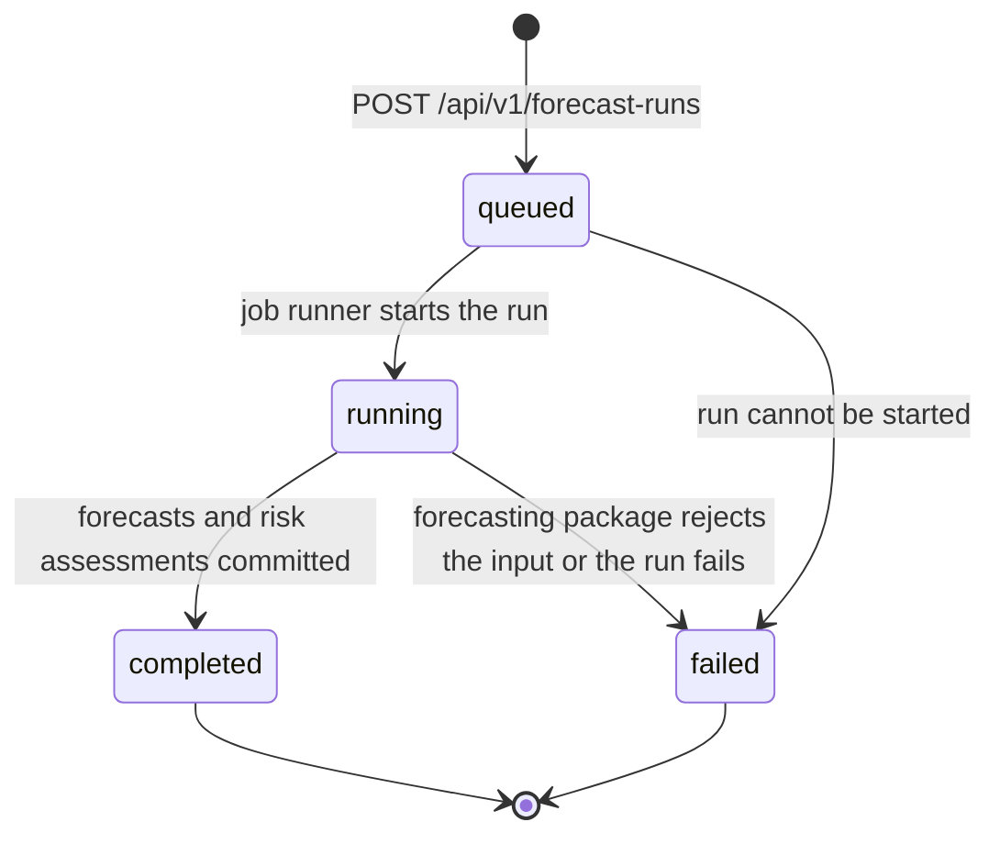

# PharmaStock — REST API contract (v1 draft)

_PHA2-17 · Authors: Abzal Bakhytov (conventions and endpoints), Evelina Penkova (forecasting payloads, sections 4 and 5) · Status: draft for review · Last updated: 2026-10-19_

This document is the contract of REST API v1 of PharmaStock, the prototype developed in the
diploma project "Development of smart supply chain analytics system for forecasting
pharmaceutical inventory and preventing medicine shortages in healthcare organizations"
(Astana IT University, group SE-2414, 2026–2027). The backend (`backend/`, FastAPI) implements
it, the web interface (`frontend/`, Vue 3) consumes it, and the forecasting package
(`forecasting/`) is called by the backend behind `POST /api/v1/forecast-runs`. Frontend and
backend are developed in parallel against this document: the OpenAPI schema that FastAPI
produces must match it, and a code change that alters the API is merged only together with the
corresponding change here (`docs/requirements.md`, section 5.5.2).

| Related document | Content |
|---|---|
| `docs/requirements.md` | FR/NFR requirements; data and API constraints (section 5.5); forecasting requirements FQ-01…FQ-15 (section 5.6); acceptance scenarios that name the fields used below |
| `docs/architecture/architecture.md` | Components, import and forecast flows, decisions ADR-1…ADR-5 |
| `docs/architecture/database-schema.md` | Tables and the JSON payload shapes (`summary_json`, `config_json`, `projected_stock_json`) that the responses expose |
| `docs/data/data-specification.md` | Import file formats and validation rules (planned) |
| `docs/ux/use-cases.md` | Use cases UC-01…UC-14 that call the endpoints |
| `forecasting/README.md` | Scope and approach of the forecasting module whose interface section 5 describes |
| `forecasting/forecasting/api.py`, `forecasting/forecasting/data/validation.py` | Package 0.1.0 (PHA2-16): `forecast_items`, `ForecastConfig`, `ForecastResult`, `DataValidationError` / `ValidationError`, `ValidationProblem` |
| `backend/README.md` | How to run the backend and open the generated OpenAPI documentation |

Task tracking: [Linear project PharmaStock](https://linear.app/pharmacy-kz/project/pharmastock-03a3f33ce30b).

Contents: 1 Conventions · 2 Endpoint overview · 3 Endpoints · 4 Forecasting payloads ·
5 Internal interface: forecasting package · 6 Proposed additions · 7 Open points ·
8 Revision history.

## 1. Conventions

### 1.1 Base path, versioning and documentation

- Every endpoint is served under the prefix `/api/v1`. Paths in this document are written in
  full; the backend mounts its routers under the prefix from `backend/app/core/config.py`
  (`api_prefix`).
- The OpenAPI document that FastAPI serves is available at `/api/v1/openapi.json`; the
  interactive documentation (Swagger UI and ReDoc) is mounted by the backend, see
  `backend/README.md`.
- Within `v1` only backward-compatible changes are allowed: adding endpoints, adding optional
  request fields, adding response fields. Removing or renaming a field, changing a type or
  changing semantics requires a new prefix, which is not planned for this project.
- `GET /api/v1/health` and `POST /api/v1/auth/login` are public; every other endpoint requires
  a bearer token (section 1.4).

### 1.2 Content types and encoding

| Direction | Content type | Used by |
|---|---|---|
| Request body | `application/json` (UTF-8) | All endpoints with a body except the file upload |
| Request body | `multipart/form-data` | `POST /api/v1/imports` (file upload) |
| Response body | `application/json` (UTF-8) | All endpoints except report downloads |
| Response body | `text/csv` (UTF-8, header row, comma separated) | `GET /api/v1/reports/risks.csv` |

Clients do not need to send an `Accept` header. Responses are not compressed by the
application; compression, TLS and caching headers are the job of the reverse proxy in
deployment (`docs/architecture/architecture.md`, section 7).

### 1.3 Data types and naming

| Kind | Representation | Example |
|---|---|---|
| Identifier | JSON integer, the `id` column of the entity | `17` |
| Timestamp | ISO 8601 in UTC with the `Z` suffix | `"2026-10-19T09:15:42Z"` |
| Date | ISO 8601 calendar date | `"2026-10-12"` |
| Week | `period_start`, the Monday of the ISO week, as a date | `"2026-10-12"` |
| Quantity | JSON number with at most three decimals, never a string; non-negative; in the unit of the item (`medicine_item.unit`) | `35`, `12.5` |
| Enumeration | Lower-case string with the values listed at the field | `"high"` |
| Absent optional value | `null` (the key is present) | `"finished_at": null` |

- Field names are `snake_case` and reuse the entity and column names of
  `docs/architecture/database-schema.md` verbatim (`medicine_item.code` is returned as `code`,
  `stock_snapshot.quantity_on_hand` as `quantity_on_hand`, and so on). Nested objects are named
  after the entity they represent (`item`, `run`, `supplier`).
- Unknown fields in a request body are rejected with `422 VALIDATION_ERROR`, so that a typo in
  the frontend is noticed immediately.
- Responses never contain `password_hash` or any other secret, and never contain stack traces.
- Rounding to whole units happens only in the interface; the API returns the stored values
  (`numeric(14, 3)`). Forecast values are returned with the precision the forecasting package
  produced (section 4.2).

### 1.4 Authentication and roles

- `POST /api/v1/auth/login` with e-mail and password returns a signed bearer token (JWT) that
  carries the user id and role. Every other request sends it as
  `Authorization: Bearer <token>`.
- Token lifetime is a backend setting; the initial value is 12 hours. There is no refresh
  endpoint in v1: an expired token is answered with `401 UNAUTHENTICATED` and the interface
  returns to the login page.
- Roles (`app_user.role`, FR-14): `administrator`, `pharmacist`, `viewer`. The permission
  matrix of `docs/requirements.md` (section 6.11) is applied per endpoint; the column "Roles"
  in section 2 lists who may call each endpoint. A request by an authenticated user whose role
  is not allowed is answered with `403 FORBIDDEN`; a request without a valid token, with an
  expired token or from a deactivated user (`is_active = false`) with `401 UNAUTHENTICATED`.
- Permission checks are FastAPI dependencies on each router
  (`docs/architecture/architecture.md`, section 8.1). The frontend hides actions a role cannot
  perform, but security is enforced only by the backend.
- Passwords are stored as salted hashes (NFR-03) and travel only in the login request body
  over HTTPS in deployment.

### 1.5 Error envelope

Every error response, whatever the status code, has the same body:

```json
{
  "error": {
    "code": "IMPORT_VALIDATION_FAILED",
    "message": "Import rejected: 3 validation errors",
    "details": [
      {"row": 15, "column": "quantity", "value": "-3", "code": "negative_quantity", "message": "quantity must be >= 0"}
    ]
  }
}
```

- `code` is a stable upper-snake-case identifier that clients may branch on.
- `message` is a human-readable summary in English.
- `details` is optional; when present it is a list of structured items. For request validation
  each item has `field` and `message` (`field` uses dotted paths for nested fields, for example
  `model.params.window`); for import validation each item has `row` (1-based data row,
  `null` for file-level errors), `column`, `value`, `code` and `message`; for errors raised by
  the forecasting package each item is a problem of section 5.5. Import validation reports at
  most the first 100 errors in `details` and states the total in `message` (FR-02-S7).
- FastAPI's default `{"detail": ...}` body is replaced by this envelope through application-wide
  exception handlers, so that request validation errors (422) and HTTP errors share the shape.

HTTP status codes and the codes used with them:

| Status | Used for | `code` values |
|---|---|---|
| 400 | Malformed request that cannot be processed: unsupported file type, file too large, bad query parameter | `BAD_REQUEST`, `UNSUPPORTED_FILE_TYPE`, `FILE_TOO_LARGE` |
| 401 | Missing, invalid or expired token; deactivated user; failed login | `UNAUTHENTICATED`, `INVALID_CREDENTIALS` |
| 403 | Authenticated user lacks the role for the action | `FORBIDDEN` |
| 404 | Entity not found (item, import batch, forecast run) | `NOT_FOUND` |
| 409 | Conflict with existing data | `ITEM_CODE_EXISTS`, `RUN_IN_PROGRESS` |
| 422 | Request body or query parameters fail validation; import file fails validation | `VALIDATION_ERROR`, `IMPORT_VALIDATION_FAILED` |
| 500 | Unexpected server error | `INTERNAL_ERROR` |

Successful responses use `200 OK` for reads and updates, `201 Created` for created entities,
and `202 Accepted` for a forecast run that has been queued (section 1.7). The codes
`FORECAST_VALIDATION_FAILED` and `FORECAST_ERROR` appear only inside the `error` field of a
failed forecast run (section 3.9), not as HTTP responses.

### 1.6 Pagination and ordering

- List endpoints accept `limit` (integer, default 50, maximum 500) and `offset` (integer,
  default 0) as query parameters and return the envelope

  ```json
  {"items": [], "total": 0, "limit": 50, "offset": 0}
  ```

  where `total` is the number of rows matching the filters regardless of `limit`. Endpoints
  may add further top-level fields next to the envelope (for example `run` and `counts` in
  `GET /api/v1/risks`).
- A `limit` above 500 or a negative `offset` is answered with `400 BAD_REQUEST`.
- Every list has a fixed default order stated in its section. A `sort` parameter is not part of
  the draft; it will be added only if the interface needs server-side sorting to meet NFR-02.
- Filters are query parameters; an unknown value of an enumerated filter (for example
  `level=critical`) is answered with `400 BAD_REQUEST`.

### 1.7 Long-running operations

A forecast run can take minutes (NFR-01), so it is modelled as a resource rather than as a
request that waits for the result (ADR-3, ADR-5): `POST /api/v1/forecast-runs` creates a
`forecast_run` with status `queued` and returns `202 Accepted` immediately; the client polls
`GET /api/v1/forecast-runs/{id}` until the status is `completed` or `failed`. Forecasts and
risk assessments are committed only when a run completes, so readers never see a partial run.
Imports are processed synchronously inside the request (files are limited to 20 MB).

### 1.8 Side effects and audit log

Endpoints that change data write an `audit_log` entry in the same transaction (FR-15):
`POST /api/v1/imports`, `POST /api/v1/items`, `POST /api/v1/forecast-runs` (creation; the job
runner adds the completion or failure entry), `PUT /api/v1/config/thresholds`, and
`POST /api/v1/auth/login` (successful and failed logins). The action names are listed in
`docs/architecture/database-schema.md`, section 4.14. Read endpoints write no audit entries.

## 2. Endpoint overview

Roles: "public" needs no token; "any" is any authenticated user (`administrator`, `pharmacist`
or `viewer`); "pharmacist" means `pharmacist` and `administrator`.

| # | Method | Path | Purpose | Roles | Requirements | Section |
|---|---|---|---|---|---|---|
| 1 | GET | `/api/v1/health` | Liveness of the service | public | NFR-07 | 3.1 |
| 2 | POST | `/api/v1/auth/login` | Obtain a bearer token | public | FR-14, NFR-03 | 3.2 |
| 3 | GET | `/api/v1/items` | List and search the medicine catalogue | any | FR-03 | 3.3 |
| 4 | POST | `/api/v1/items` | Create a catalogue item | pharmacist | FR-03, FR-15 | 3.4 |
| 5 | GET | `/api/v1/items/{id}/history` | Weekly consumption and stock history of an item | any | FR-05, FR-17 | 3.5 |
| 6 | POST | `/api/v1/imports` | Upload and validate a CSV/XLSX file | pharmacist | FR-01, FR-02, FR-10, FR-17, FR-18 | 3.6 |
| 7 | GET | `/api/v1/imports/{id}` | Status, validation report and data-quality summary of an import | any | FR-02, FR-18 | 3.7 |
| 8 | POST | `/api/v1/forecast-runs` | Start a forecast run | pharmacist | FR-06, FR-08, FR-12, NFR-05 | 3.8 |
| 9 | GET | `/api/v1/forecast-runs/{id}` | Status, progress and summary of a run | any | FR-06 | 3.9 |
| 10 | GET | `/api/v1/items/{id}/forecast` | Forecast of an item with history, risk and model information | any | FR-07, FR-08, FR-16 | 3.10 |
| 11 | GET | `/api/v1/risks` | Prioritised list of items at risk | any | FR-08, FR-09 | 3.11 |
| 12 | GET | `/api/v1/notifications` | In-app notifications of the current user | any | FR-12 | 3.12 |
| 13 | GET | `/api/v1/config/thresholds` | Read risk thresholds and safety-stock parameters | any | FR-11 | 3.13 |
| 14 | PUT | `/api/v1/config/thresholds` | Change thresholds | pharmacist | FR-11, FR-15 | 3.14 |
| 15 | GET | `/api/v1/reports/risks.csv` | Download the risk list as CSV | any | FR-13 | 3.15 |

Endpoints that other documents ask for but that are not part of the draft (single planned
receipts, suppliers, users, audit log, model comparison) are collected in section 6.

## 3. Endpoints

Examples use the item `A10BA02 Metformin 500 mg tab` with a current stock of 120 tablets, a
weekly consumption of about 35 tablets, a primary supplier with a lead time of 21 days, and the
default thresholds (`safety_stock_weeks = 2`, `forecast_horizon_weeks = 12`). Values are
illustrative; they are not results of an experiment.

### 3.1 GET /api/v1/health

Liveness information for monitoring, smoke tests and the Docker Compose health check. The
endpoint does not touch the database on purpose, so that a database outage and a backend
outage can be told apart. Implemented in `backend/app/api/routes/health.py`.

Response `200`:

```json
{"status": "ok", "app_name": "PharmaStock", "version": "0.1.0", "environment": "development"}
```

A readiness check that also verifies the database connection is proposed (section 6).

### 3.2 POST /api/v1/auth/login

Authenticates a user by e-mail and password and returns a bearer token (FR-14).

Request:

```json
{"email": "pharmacist@example.org", "password": "<password>"}
```

| Field | Type | Rules |
|---|---|---|
| `email` | string | Required; matched case-insensitively against `app_user.email` |
| `password` | string | Required; compared with `app_user.password_hash` |

Response `200`:

```json
{
  "access_token": "<token>",
  "token_type": "bearer",
  "expires_at": "2026-10-19T21:15:42Z",
  "user": {"id": 2, "email": "pharmacist@example.org", "full_name": "Demo Pharmacist", "role": "pharmacist"}
}
```

Errors:

| Status | `code` | When |
|---|---|---|
| 401 | `INVALID_CREDENTIALS` | Wrong password, unknown e-mail or deactivated user; the message is the same in all three cases so that the endpoint does not reveal whether an e-mail exists (FR-14-S2) |
| 422 | `VALIDATION_ERROR` | Missing or malformed field |

Successful and failed logins are written to the audit log.

### 3.3 GET /api/v1/items

Lists the medicine catalogue (FR-03) with search and filters. Default order: `code` ascending.

Query parameters:

| Parameter | Type | Default | Meaning |
|---|---|---|---|
| `search` | string | – | Case-insensitive substring of `code` or `name` |
| `group` | string | – | Exact match of `group` |
| `is_active` | boolean | – | `true` or `false`; omitted means both |
| `limit`, `offset` | integer | 50, 0 | Pagination (section 1.6) |

Example: `GET /api/v1/items?search=metf&group=A10&is_active=true`

Response `200`:

```json
{
  "items": [
    {"id": 17, "code": "A10BA02", "name": "Metformin 500 mg tab", "unit": "tab", "group": "A10", "is_active": true}
  ],
  "total": 1,
  "limit": 50,
  "offset": 0
}
```

The object is the `medicine_item` entity: `id`, `code`, `name`, `unit`, `group` (nullable),
`is_active`.

### 3.4 POST /api/v1/items

Creates a catalogue item (FR-03). Role `pharmacist` or `administrator`.

Request:

```json
{"code": "A10BA02", "name": "Metformin 500 mg tab", "unit": "tab", "group": "A10"}
```

| Field | Type | Rules |
|---|---|---|
| `code` | string | Required, 1–64 characters, unique in the catalogue; the key used in import files |
| `name` | string | Required, 1–255 characters |
| `unit` | string | Required, 1–32 characters, for example `tab`, `vial`, `ml` |
| `group` | string or null | Optional, up to 128 characters; medicine group used for filters and error analysis |
| `is_active` | boolean | Optional, default `true` |

Response `201`: the created `medicine_item` object as in section 3.3.

Errors: `409 ITEM_CODE_EXISTS` when `code` is already used; `422 VALIDATION_ERROR` with a
detail per field (for example `{"field": "unit", "message": "field required"}`);
`403 FORBIDDEN` for a viewer. An audit entry is written. Editing and deactivating an item
(`PUT /api/v1/items/{id}`) is proposed in section 6.

### 3.5 GET /api/v1/items/{id}/history

Weekly consumption and stock history of one item as the item page shows it in a table and a
chart (FR-05), with stock-out weeks marked (FR-17). Weeks are contiguous from `period_from` to
`period_to`: a week without a `consumption_record` is returned with `quantity = 0` (FQ-02), a
week without a `stock_snapshot` with `quantity_on_hand = null` and `is_stock_out = false`.
Order: `period_start` ascending.

Query parameters:

| Parameter | Type | Default | Meaning |
|---|---|---|---|
| `weeks` | integer 1–520 | 52 | Number of most recent weeks to return (26, 52 and all are the ranges offered by the interface) |
| `from`, `to` | date | – | Explicit range of `period_start`; when `from` is given, `weeks` is ignored |

Response `200`:

```json
{
  "item": {"id": 17, "code": "A10BA02", "name": "Metformin 500 mg tab", "unit": "tab", "group": "A10", "is_active": true},
  "current_stock": {"period_start": "2026-10-12", "quantity_on_hand": 120, "is_stock_out": false},
  "lead_time_days": 21,
  "lead_time_source": "supplier",
  "period_from": "2026-09-21",
  "period_to": "2026-10-12",
  "weeks": [
    {"period_start": "2026-09-21", "quantity": 0, "quantity_on_hand": 0, "is_stock_out": true, "receipts": 200},
    {"period_start": "2026-09-28", "quantity": 42, "quantity_on_hand": 200, "is_stock_out": false, "receipts": 0},
    {"period_start": "2026-10-05", "quantity": 38, "quantity_on_hand": 158, "is_stock_out": false, "receipts": 0},
    {"period_start": "2026-10-12", "quantity": 38, "quantity_on_hand": 120, "is_stock_out": false, "receipts": 0}
  ],
  "planned_receipts": [
    {"id": 5, "expected_on": "2026-11-30", "quantity": 60, "supplier": "SK-Pharmacy", "status": "planned"}
  ]
}
```

| Field | Meaning |
|---|---|
| `current_stock` | Latest `stock_snapshot` of the item; `null` when the item has no stock data |
| `lead_time_days`, `lead_time_source` | Lead time of the primary supplier (`"supplier"`) or `threshold_config.default_lead_time_days` (`"default"`) |
| `weeks[].quantity` | `consumption_record.quantity` of the week |
| `weeks[].quantity_on_hand`, `weeks[].is_stock_out` | `stock_snapshot` of the week; `is_stock_out = true` marks censored demand (FR-17) |
| `weeks[].receipts` | Sum of `receipt.quantity` received in that week |
| `planned_receipts` | `planned_receipt` rows of the item with status `planned`, ordered by `expected_on` |

Errors: `404 NOT_FOUND` for an unknown item; `400 BAD_REQUEST` for an invalid range.

### 3.6 POST /api/v1/imports

Uploads one export file, validates it and stores its rows (FR-01, FR-02, FR-17, FR-18;
UC-01). Role `pharmacist` or `administrator`. Validation is all-or-nothing per file: if any
blocking error is found, no rows are stored.

Request `multipart/form-data`:

| Form field | Type | Rules |
|---|---|---|
| `file` | file | Required; `.csv` (UTF-8, comma separated, header row) or `.xlsx` (first sheet, header in the first row); at most 20 MB |
| `source_type` | string | Required; `consumption`, `stock`, `receipts` or `planned_receipts`; selects the expected columns (`docs/requirements.md`, section 5.5.1) |
| `validate_only` | boolean | Optional, default `false`; when `true` the file is validated and the report returned, but no batch and no rows are stored (validation-only mode of UC-01) |

Example:

```bash
curl -X POST http://localhost:8000/api/v1/imports \
  -H "Authorization: Bearer <token>" \
  -F "source_type=consumption" \
  -F "file=@consumption.csv;type=text/csv"
```

Response `201` (file accepted and stored): the `import_batch` entity with its summary.

```json
{
  "id": 42,
  "file_name": "consumption.csv",
  "source_type": "consumption",
  "imported_at": "2026-10-19T08:40:11Z",
  "user_id": 2,
  "status": "completed",
  "summary_json": {
    "rows_total": 1240,
    "rows_imported": 1240,
    "rows_replaced": 52,
    "errors_total": 0,
    "errors": [],
    "warnings": [
      {"row": null, "column": "comment", "value": null, "code": "extra_column", "message": "column ignored"}
    ],
    "items_affected": 310,
    "period_from": "2024-01-01",
    "period_to": "2026-10-12",
    "weeks_total": 146,
    "items_with_gaps": 12,
    "gap_weeks_total": 37,
    "gaps": [{"item_code": "A10BA02", "weeks": ["2025-03-03", "2025-03-10"]}],
    "stock_out_weeks": 41,
    "items_with_stock_out": 9,
    "outliers_total": 1,
    "outliers": [{"item_code": "J01CA04", "period_start": "2025-11-17", "quantity": 480, "median_nonzero": 40}],
    "items_without_consumption": 3
  }
}
```

Response `200` with `validate_only=true` and a valid file:

```json
{"valid": true, "file_name": "consumption.csv", "source_type": "consumption", "summary_json": {"rows_total": 1240, "errors_total": 0, "errors": [], "warnings": []}}
```

| Field of `summary_json` | Meaning |
|---|---|
| `rows_total`, `rows_imported`, `rows_replaced` | Data rows read, stored, and stored in place of earlier rows for the same (`item_code`, `period_start`) pair (section 5.5.1 of the requirements) |
| `errors_total`, `errors` | Blocking errors; `errors` holds up to 1,000 items of the shape `{row, column, value, code, message}` with `code` in `missing_column`, `negative_quantity`, `unknown_item`, `unknown_supplier`, `duplicate_period`, `invalid_period` (not a Monday), `invalid_date`, `invalid_number` |
| `warnings` | Non-blocking findings in the same shape, for example `extra_column` |
| `items_affected`, `period_from`, `period_to`, `weeks_total` | Coverage of the file (FR-18) |
| `items_with_gaps`, `gap_weeks_total`, `gaps` | Weeks between an item's first and last week that have no row (FR-18; stored as zero consumption per FQ-02); `gaps` is limited to 100 items |
| `stock_out_weeks`, `items_with_stock_out` | Weeks flagged `is_stock_out` (FR-17); for `consumption` files computed over the weeks that have stock snapshots |
| `outliers_total`, `outliers` | Weekly quantities above `threshold_config.outlier_factor` times the item's median non-zero weekly quantity, evaluated only for items with at least 8 non-zero weeks (FR-18 definitions); flagged, not rejected; `outliers` is limited to 100 entries; empty for `stock`, `receipts` and `planned_receipts` files |
| `items_without_consumption` | Items whose rows in the file are all zero |

Keys may be added to `summary_json`; existing keys are not renamed.

Errors:

| Status | `code` | When | Batch stored? |
|---|---|---|---|
| 400 | `UNSUPPORTED_FILE_TYPE` | Extension other than `.csv` or `.xlsx`, or unreadable file | Yes, with `status = "failed"` and the error in `summary_json` (FR-01-S4); not in validation-only mode |
| 400 | `FILE_TOO_LARGE` | File larger than 20 MB; rejected before parsing | No |
| 403 | `FORBIDDEN` | Viewer | No |
| 422 | `IMPORT_VALIDATION_FAILED` | Missing column, negative quantity, unknown item code or supplier, duplicate period, `period_start` not a Monday, invalid date or number | Yes, with `status = "failed"` and the full report in `summary_json`; the response carries `Location: /api/v1/imports/{id}` so that the client can open it; not in validation-only mode |
| 422 | `VALIDATION_ERROR` | Missing `file` or `source_type`, unknown `source_type` | No |

The batch status passes through `pending` and `processing` inside the request; a client only
sees `completed` or `failed`. The `details` list of a 422 response holds the first 100 errors
(FR-02-S7); the complete list is in `summary_json.errors`. The validation report format is
shared with `docs/data/data-specification.md`.

### 3.7 GET /api/v1/imports/{id}

Returns one `import_batch` with its status, validation report and data-quality summary
(FR-02, FR-18; UC-02). Any authenticated user.

Response `200` for a failed batch:

```json
{
  "id": 43,
  "file_name": "stock_2026-10.csv",
  "source_type": "stock",
  "imported_at": "2026-10-19T08:52:03Z",
  "user_id": 2,
  "status": "failed",
  "summary_json": {
    "rows_total": 310,
    "rows_imported": 0,
    "rows_replaced": 0,
    "errors_total": 2,
    "errors": [
      {"row": null, "column": "quantity_on_hand", "value": null, "code": "missing_column", "message": "required column is missing"},
      {"row": 15, "column": "period_start", "value": "2026-03-04", "code": "invalid_period", "message": "period_start must be a Monday"}
    ],
    "warnings": []
  }
}
```

`status` is one of `pending`, `processing`, `completed`, `failed`. For a completed batch
`summary_json` has the full shape of section 3.6. Errors: `404 NOT_FOUND`. A paginated list of
batches for the import history page is proposed in section 6.

### 3.8 POST /api/v1/forecast-runs

Starts a forecast run for all active items or for a selection (FR-06; UC-06). Role
`pharmacist` or `administrator`. The run is executed in the background (section 1.7): the
backend builds the weekly history per item with stock-out weeks marked (FQ-02), calls
`forecasting.api.forecast_items(history, horizon, config)` (section 5), stores one `forecast`
row per item and week, computes the `risk_assessment` per item (FR-08, section 4.3) and
creates notifications for the levels listed in `threshold_config.notification_levels`
(FR-12).

The model selection and parameter fields are defined together with the forecasting module in
section 4.1 (revision 0.2), which holds the complete configuration schema.

Request:

```json
{
  "horizon_weeks": 12,
  "item_ids": [17, 42],
  "model": {"name": "croston", "params": {"alpha": 0.1}},
  "interval_level": 0.8,
  "censoring": "exclude",
  "min_history_weeks": 12,
  "seed": 42
}
```

| Field | Type | Rules |
|---|---|---|
| `horizon_weeks` | integer 1–52 | Optional; default `threshold_config.forecast_horizon_weeks` (12). Out of range: `422` with a detail for `horizon_weeks` ("must be between 1 and 52") |
| `item_ids` | list of integers | Optional; when absent, all active items are forecast. Explicitly listed inactive items are included (FR-06-S2). An unknown id: `422` before the run is created |
| `groups` | list of strings | Optional; restricts the run to active items of these `group` values; combined with `item_ids` as a union |
| `include_inactive` | boolean | Optional, default `false`; when `true`, a run without `item_ids` and `groups` also includes inactive items |
| `model` | object `{name, params}` | Optional; default: the production model configured in the backend (`DEFAULT_FORECAST_MODEL` setting, planned; `croston` until the hold-out evaluation selects the production model, FQ-06). `name` and `params` are validated before the run is created by building `forecasting.api.ForecastConfig` (section 5.3; `available_models()` is planned, open point 12): an unknown name or parameter is a `422` with a detail such as `{"field": "model.params.window", "message": "window must be a positive integer, got 0"}` |
| `interval_level` | number 0.5–0.99 | Optional, default `0.8` (FQ-07) |
| `censoring` | string | Optional; `exclude` (default) or `impute` (planned, FQ-10) |
| `min_history_weeks` | integer ≥ 1 | Optional, default `12` (FQ-04) |
| `seed` | integer | Optional, default `42` (FQ-11) |

The fields `interval_level`, `censoring`, `min_history_weeks` and `seed` are accepted and recorded
in `config_json` from the first backend version, so that the configuration of a run is stable;
package 0.1.0 does not read them yet and the backend passes it only `model` and `horizon_weeks`
(section 5.3). They take effect with the next package version (section 5.8, open point 12).

Response `202 Accepted`: the created `forecast_run` with the complete, reproducible
configuration (NFR-05).

```json
{
  "id": 7,
  "status": "queued",
  "started_at": "2026-10-19T09:00:00Z",
  "finished_at": null,
  "horizon_weeks": 12,
  "model_name": "croston",
  "config_json": {
    "seed": 42,
    "forecasting_version": "0.1.0",
    "horizon_weeks": 12,
    "model": {"name": "croston", "params": {"alpha": 0.1}},
    "fallback_model": {"name": "moving_average", "params": {"window": 8}},
    "items": [17, 42],
    "groups": null,
    "include_inactive": false,
    "interval_level": 0.8,
    "censoring": "exclude",
    "min_history_weeks": 12,
    "data_snapshot": {"max_import_batch_id": 42, "history_from": "2024-01-01", "history_to": "2026-10-12"},
    "thresholds": {"safety_stock_weeks": 2, "default_lead_time_days": 30}
  },
  "user_id": 2
}
```

`started_at` is the time the run was accepted (`forecast_run.started_at`); `model_name` equals
`config_json.model.name`; the keys of `config_json` are described in section 4.1.

Errors: `409 RUN_IN_PROGRESS` when a run with status `queued` or `running` exists (one run at a
time, FR-06-S6); `422 VALIDATION_ERROR` for the rules above; `403 FORBIDDEN`.

Lifecycle of `forecast_run.status`:



### 3.9 GET /api/v1/forecast-runs/{id}

Status, progress and summary of a run (FR-06). Any authenticated user. The interface polls this
endpoint every few seconds while the status is `queued` or `running` (FR-06-S8).

Response `200` for a running run (`config_json` abbreviated; full shape in section 3.8):

```json
{
  "id": 7,
  "status": "running",
  "started_at": "2026-10-19T09:00:00Z",
  "finished_at": null,
  "horizon_weeks": 12,
  "model_name": "croston",
  "config_json": {"seed": 42, "horizon_weeks": 12, "model": {"name": "croston", "params": {"alpha": 0.1}}, "items": "all"},
  "user_id": 2,
  "progress": {"items_total": 310, "items_done": 120},
  "summary": null,
  "error": null
}
```

Response `200` for a completed run:

```json
{
  "id": 7,
  "status": "completed",
  "started_at": "2026-10-19T09:00:00Z",
  "finished_at": "2026-10-19T09:01:23Z",
  "horizon_weeks": 12,
  "model_name": "croston",
  "config_json": {"seed": 42, "horizon_weeks": 12, "model": {"name": "croston", "params": {"alpha": 0.1}}, "items": "all"},
  "user_id": 2,
  "progress": {"items_total": 310, "items_done": 310},
  "summary": {
    "items_forecast": 310,
    "items_fallback": 1,
    "insufficient_history": [{"item_id": 58, "item_code": "N02BE01", "weeks_available": 6, "model_name": "moving_average"}],
    "no_stock_data": [{"item_id": 91, "item_code": "B01AC06"}],
    "censored_weeks_total": 41,
    "warnings": [],
    "risk_counts": {"high": 4, "medium": 11, "low": 294},
    "notifications_created": 8,
    "duration_seconds": 83.4
  },
  "error": null
}
```

Response `200` for a failed run (only the fields that differ):

```json
{
  "status": "failed",
  "finished_at": "2026-10-19T09:00:04Z",
  "progress": null,
  "summary": null,
  "error": {
    "code": "FORECAST_VALIDATION_FAILED",
    "message": "history rejected by the forecasting package: 2 problems",
    "details": [
      {"kind": "gap", "code": "gap", "item_code": "A10BA02", "period_start": "2026-03-09", "column": "period_start", "message": "week missing from the weekly index"},
      {"kind": "invalid_quantity", "code": "negative_quantity", "item_code": "J01CA04", "period_start": "2026-05-04", "column": "quantity", "message": "column 'quantity' has negative values"}
    ]
  }
}
```

| Field | Meaning |
|---|---|
| `status` | `queued`, `running`, `completed` or `failed` (section 3.8) |
| `progress` | Items processed so far; `null` while queued or after a failure |
| `summary` | Present when `status = "completed"`. `items_forecast`: items with forecast rows. `items_fallback` and `insufficient_history`: items forecast with the fallback baseline because they have fewer than `min_history_weeks` non-censored weeks (FQ-04, FR-06-S4), with the number of weeks available and the model used. `no_stock_data`: items without a stock snapshot, which receive no risk level (FR-08). `censored_weeks_total`: stock-out weeks in the history passed to the package (FR-17). `warnings`: messages of `ForecastResult.warnings` (section 5.4), for example `"N02BE01: seasonal_naive needs 52 weeks of history, got 6; naive forecast used"` in a `seasonal_naive` run. With package 0.1.0 `items_fallback` is `0` and `insufficient_history` is empty, because the fallback for short histories is planned (section 5.8). `risk_counts`, `notifications_created`: outcome of the risk calculation. `duration_seconds`: wall-clock time from `started_at` to `finished_at`, compared with NFR-01 |
| `error` | Present when `status = "failed"`: `{code, message, details}` as stored for the run. `FORECAST_VALIDATION_FAILED` when the forecasting package rejected the input (NFR-06); `details` are the problems of section 5.5 in the shape `{kind, code, item_code, period_start, column, message}`; with package 0.1.0 `item_code` and `period_start` are `null` (section 5.8). `FORECAST_ERROR` for any other failure, with a message and no stack trace. No forecasts or risk assessments of a failed run are stored; the previous completed run remains the current one (FR-06-S5) |

Errors: `404 NOT_FOUND`.

### 3.10 GET /api/v1/items/{id}/forecast

Forecast of one item from a completed run together with its history, the interval, the model
information and the risk assessment with the projected stock, as the item page charts it
(FR-07, FR-08; UC-07, UC-08 step 4). Any authenticated user. The forecast fields are defined
in section 4.2, the `risk` field in section 4.3.

Query parameters:

| Parameter | Type | Default | Meaning |
|---|---|---|---|
| `run_id` | integer | latest completed run that contains the item | Show the forecast of an earlier run (FR-07-S3) |
| `weeks` | integer 1–520 | 52 | Number of history weeks returned |

Response `200` (`forecast` and `risk.weeks` shortened to the first weeks of the 12-week
horizon):

```json
{
  "item": {"id": 17, "code": "A10BA02", "name": "Metformin 500 mg tab", "unit": "tab", "group": "A10", "is_active": true},
  "run_id": 7,
  "generated_at": "2026-10-19T09:01:23Z",
  "run": {
    "id": 7,
    "model_name": "croston",
    "started_at": "2026-10-19T09:00:00Z",
    "finished_at": "2026-10-19T09:01:23Z",
    "horizon_weeks": 12,
    "interval_level": 0.8,
    "censoring": "exclude"
  },
  "item_model_name": "croston",
  "flags": {"insufficient_history": false, "fallback_used": false, "history_weeks": 146, "censored_weeks": 4},
  "history": [
    {"period_start": "2026-09-21", "quantity": 0, "is_stock_out": true},
    {"period_start": "2026-09-28", "quantity": 42, "is_stock_out": false},
    {"period_start": "2026-10-05", "quantity": 38, "is_stock_out": false},
    {"period_start": "2026-10-12", "quantity": 38, "is_stock_out": false}
  ],
  "forecast": [
    {"period_start": "2026-10-19", "point": 35.2, "lower": 21.0, "upper": 52.4},
    {"period_start": "2026-10-26", "point": 35.2, "lower": 21.0, "upper": 52.4},
    {"period_start": "2026-11-02", "point": 35.2, "lower": 21.0, "upper": 52.4}
  ],
  "risk": {
    "id": 1203,
    "risk_level": "high",
    "expected_stockout_date": "2026-10-26",
    "computed_at": "2026-10-19T09:01:20Z",
    "inputs": {
      "as_of": "2026-10-19",
      "current_stock": 120,
      "current_stock_date": "2026-10-12",
      "safety_stock": 70.4,
      "safety_stock_weeks": 2,
      "lead_time_days": 21,
      "lead_time_source": "supplier",
      "horizon_weeks": 12,
      "forecast_basis": "point"
    },
    "weeks": [
      {"period_start": "2026-10-19", "forecast": 35.2, "planned_receipts": 0, "projected_stock": 84.8},
      {"period_start": "2026-10-26", "forecast": 35.2, "planned_receipts": 0, "projected_stock": 49.6},
      {"period_start": "2026-11-02", "forecast": 35.2, "planned_receipts": 0, "projected_stock": 14.4},
      {"period_start": "2026-11-09", "forecast": 35.2, "planned_receipts": 0, "projected_stock": -20.8}
    ]
  }
}
```

| Field | Meaning |
|---|---|
| `run_id`, `generated_at` | The `forecast_run` the forecast comes from and the time its forecasts were committed (`forecast_run.finished_at`) |
| `run` | Metadata of the run: `model_name` is the run-level model (`config_json.model.name`), `interval_level` and `censoring` come from `config_json`. `null` when the item has no forecast in any completed run; then `run_id`, `generated_at`, `item_model_name`, `flags` and `risk` are `null`, `forecast` is empty and `history` is still populated (FR-07-S4) |
| `item_model_name` | Model used for this item, which is the fallback baseline when `flags.fallback_used` is `true` (FQ-04) |
| `flags` | Per-item information of the forecasting package (section 5.4): `insufficient_history`, `fallback_used`, `history_weeks` and `censored_weeks` |
| `history` | Last `weeks` weeks of `{period_start, quantity, is_stock_out}` in ascending order, same source as section 3.5 |
| `forecast` | Exactly `horizon_weeks` entries in ascending order; see section 4.2 (`lower` and `upper` are `null` until the package delivers intervals) |
| `risk` | The `risk_assessment` of the item in this run (section 4.3); `null` when the item has no stock data (FR-08) |

Errors: `404 NOT_FOUND` for an unknown item or run.

### 3.11 GET /api/v1/risks

Prioritised list of items at risk from the latest completed forecast run (FR-08, FR-09;
UC-08). Any authenticated user. Default order: `risk_level` (`high`, `medium`, `low`), then
`expected_stockout_date` ascending with `null` last, then `code`.

Query parameters:

| Parameter | Type | Default | Meaning |
|---|---|---|---|
| `level` | string | – | `high`, `medium` or `low`; other values: `400 BAD_REQUEST` (FR-09-S2) |
| `run_id` | integer | latest completed run | Risk assessments of an earlier run |
| `group` | string | – | Exact match of `medicine_item.group` |
| `search` | string | – | Case-insensitive substring of `code` or `name` |
| `include_inactive` | boolean | `false` | Include inactive items (FR-09-S5) |
| `limit`, `offset` | integer | 50, 0 | Pagination (section 1.6) |

Response `200`:

```json
{
  "run": {"id": 7, "finished_at": "2026-10-19T09:01:23Z", "horizon_weeks": 12},
  "counts": {"high": 4, "medium": 11, "low": 294, "no_stock_data": 1},
  "items": [
    {
      "risk_assessment_id": 1203,
      "item": {"id": 17, "code": "A10BA02", "name": "Metformin 500 mg tab", "unit": "tab", "group": "A10"},
      "risk_level": "high",
      "expected_stockout_date": "2026-10-26",
      "current_stock": 120,
      "current_stock_date": "2026-10-12",
      "safety_stock": 70.4,
      "lead_time_days": 21,
      "lead_time_source": "supplier",
      "planned_receipts_in_horizon": 60,
      "forecast_over_lead_time": 105.6,
      "computed_at": "2026-10-19T09:01:20Z"
    }
  ],
  "total": 309,
  "limit": 50,
  "offset": 0
}
```

| Field | Meaning |
|---|---|
| `run` | The `forecast_run` the assessments belong to; `null` with empty `items` when no run has completed yet (UC-08 A1) |
| `counts` | Number of items per level in the run, before filters; `no_stock_data` counts items of the run without a stock snapshot, which have no assessment and are not listed (FR-08) |
| `risk_level` | `high` if the stock-out is expected within the item's lead time, `medium` if within the horizon, `low` otherwise |
| `expected_stockout_date` | First `period_start` where projected stock ≤ safety stock; `null` for `low` |
| `current_stock`, `current_stock_date` | Latest `stock_snapshot` used by the calculation |
| `safety_stock` | Average weekly point forecast × `threshold_config.safety_stock_weeks` |
| `lead_time_days`, `lead_time_source` | As in section 3.5; the interface shows a "default" marker when the source is `default` (FR-09-S4) |
| `planned_receipts_in_horizon` | Sum of `planned_receipt.quantity` with status `planned` due within the horizon |
| `forecast_over_lead_time` | Sum of the point forecast over the lead time |
| `computed_at` | `risk_assessment.computed_at`; changes when thresholds or planned receipts trigger a recalculation (UC-08 A4) |

The projected stock per week of one item is served with the item forecast (section 3.10,
field `risk`; payload in section 4.3). Errors: `400 BAD_REQUEST` for an unknown `level`;
`404 NOT_FOUND` for an unknown `run_id`.

### 3.12 GET /api/v1/notifications

In-app notifications of the authenticated user, newest first (FR-12; UC-11). A notification
is created for every item that reaches a level listed in `threshold_config.notification_levels`
when a run completes, once per `risk_assessment` and user.

Query parameters:

| Parameter | Type | Default | Meaning |
|---|---|---|---|
| `unread_only` | boolean | `false` | Only notifications with `read_at = null` |
| `limit`, `offset` | integer | 50, 0 | Pagination (section 1.6) |

Response `200`:

```json
{
  "unread_total": 3,
  "items": [
    {
      "id": 501,
      "created_at": "2026-10-19T09:01:22Z",
      "read_at": null,
      "item": {"id": 17, "code": "A10BA02", "name": "Metformin 500 mg tab"},
      "risk_assessment": {"id": 1203, "run_id": 7, "risk_level": "high", "expected_stockout_date": "2026-10-26"}
    }
  ],
  "total": 8,
  "limit": 50,
  "offset": 0
}
```

`unread_total` feeds the counter in the navigation bar. Marking a notification as read
(`POST /api/v1/notifications/{id}/read`) is proposed in section 6.

### 3.13 GET /api/v1/config/thresholds

Risk thresholds and safety-stock parameters (FR-11) stored in `threshold_config`. Any
authenticated user may read them (the item page explains the safety stock with them).

Response `200`:

```json
{
  "items": [
    {"key": "safety_stock_weeks", "value": 2, "updated_at": "2026-10-12T10:00:00Z", "updated_by": null},
    {"key": "default_lead_time_days", "value": 30, "updated_at": "2026-10-12T10:00:00Z", "updated_by": null},
    {"key": "forecast_horizon_weeks", "value": 12, "updated_at": "2026-10-12T10:00:00Z", "updated_by": null},
    {"key": "notification_levels", "value": ["high"], "updated_at": "2026-10-12T10:00:00Z", "updated_by": null},
    {"key": "outlier_factor", "value": 5, "updated_at": "2026-10-12T10:00:00Z", "updated_by": null}
  ]
}
```

| Key | Type and range | Used by |
|---|---|---|
| `safety_stock_weeks` | number ≥ 0 | Safety stock of an item = average weekly forecast × this number of weeks (FR-08) |
| `default_lead_time_days` | integer ≥ 0 | Lead time of items without a primary supplier (FR-04-S5) |
| `forecast_horizon_weeks` | integer 1–52 | Default `horizon_weeks` of new runs (FQ-03) |
| `notification_levels` | list of `high`, `medium`, `low` | Risk levels that create notifications (FR-12) |
| `outlier_factor` | number > 1 | Outlier rule of the data-quality summary (FR-18) |

`updated_by` is the `id` of the user who last changed the key, `null` for values set by the
initial migration.

### 3.14 PUT /api/v1/config/thresholds

Changes one or more thresholds (FR-11). Role `pharmacist` or `administrator`. Keys that are not
in the request keep their values; unknown keys and values outside the ranges of section 3.13
are rejected with `422` and nothing is changed.

Request:

```json
{"values": {"safety_stock_weeks": 3, "notification_levels": ["high", "medium"]}}
```

Response `200`: the full list as in section 3.13 with the new values, `updated_at` and
`updated_by`.

Side effects: one audit entry per changed key with the old and the new value (FR-15-S3);
when `safety_stock_weeks` or `default_lead_time_days` changes, the risk assessments of the
latest completed run are recomputed from the stored forecasts and their `computed_at` is
updated (UC-10, UC-08 A4). Forecasts themselves are not recomputed.

### 3.15 GET /api/v1/reports/risks.csv

Downloads the risk list as CSV (FR-13; UC-12). Any authenticated user. The same query
parameters as section 3.11 apply (`level`, `run_id`, `group`, `search`, `include_inactive`);
`limit` and `offset` are ignored and all matching rows are exported, in the order of
section 3.11.

Response `200`, `Content-Type: text/csv; charset=utf-8`,
`Content-Disposition: attachment; filename="risks_run7_2026-10-19.csv"`:

```csv
item_code,item_name,unit,group,risk_level,expected_stockout_date,current_stock,safety_stock,lead_time_days,lead_time_source,planned_receipts_in_horizon,forecast_over_lead_time,run_id,computed_at
A10BA02,Metformin 500 mg tab,tab,A10,high,2026-10-26,120,70.4,21,supplier,60,105.6,7,2026-10-19T09:01:20Z
```

Columns are the fields of section 3.11 in a flat form; empty cells for `null`. An XLSX
variant and a forecast report are proposed in section 6 (open question Q3 of the
requirements).

## 4. Forecasting payloads

Author: Evelina Penkova. This section fixes the parts of the API that carry forecasting data:
the configuration of a run (4.1), the forecast of an item (4.2) and the risk assessment
derived from it (4.3). It follows the forecasting requirements FQ-01…FQ-15 of
`docs/requirements.md` and the JSON shapes of `forecast_run.config_json` and
`risk_assessment.projected_stock_json` in `docs/architecture/database-schema.md`. The internal
call behind these payloads is specified in section 5.

### 4.1 Forecast run configuration (`config_json`)

`config_json` is the complete, reproducible configuration of a run (NFR-05, FQ-11): starting a
new run with the same `config_json` on an unchanged database yields the same `point`, `lower`
and `upper` values (NFR-05-S4). The request of section 3.8 supplies the first group of keys;
the backend fills in the second group before the run is queued.

| Key | Type | Default | Source | Meaning |
|---|---|---|---|---|
| `horizon_weeks` | integer 1–52 | `threshold_config.forecast_horizon_weeks` | request | Forecast horizon (FQ-03) |
| `model` | `{name, params}` | production model (section 3.8) | request | Model for every item with sufficient history; names and parameters below |
| `fallback_model` | `{name, params}` | `{"name": "moving_average", "params": {"window": 8}}` | package default (planned) | Model for items with fewer than `min_history_weeks` non-censored weeks (FQ-04); recorded so that the fallback is reproducible |
| `interval_level` | number 0.5–0.99 | `0.8` | request | Coverage of the interval `[lower, upper]` (FQ-07) |
| `censoring` | string | `"exclude"` | request | Handling of weeks with `is_stock_out = true`: `exclude` treats the week as missing when fitting and excludes it from evaluation (FQ-10); `impute` (planned, open question Q8) replaces it by the item's expected demand |
| `min_history_weeks` | integer ≥ 1 | `12` | request | Minimum number of non-censored weeks for the main model (FQ-04) |
| `seed` | integer | `42` | request | Seed of every stochastic component (FQ-11) |
| `items` | `"all"` or list of item ids | `"all"` | backend | Resolved item selection: the ids of `item_ids` and `groups` of the request, or `"all"` for all active items |
| `groups` | list of strings or `null` | `null` | backend | Copy of the request field, for the run page |
| `include_inactive` | boolean | `false` | backend | Copy of the request field |
| `forecasting_version` | string | – | backend | `forecasting.__version__` of the installed package |
| `data_snapshot` | `{max_import_batch_id, history_from, history_to}` | – | backend | Highest `import_batch.id` and the first and last `period_start` of the history at the time of the run; `history_to` is the last week with data, so the first forecast week is `history_to + 7 days` |
| `thresholds` | `{safety_stock_weeks, default_lead_time_days}` | – | backend | Threshold values used by the risk calculation of this run (section 4.3) |

Model names and parameters accepted in `model` and `fallback_model` (FQ-05). In package 0.1.0
the list is `forecasting.models.baselines.BASELINE_NAMES` and `forecasting.api.ForecastConfig`
validates a name with its parameters (section 5.3), which is what the backend uses to validate
the request before the run is created; `available_models()`, which will expose the list with
the parameter ranges, is planned (open point 12). The keys `fallback_model`, `interval_level`,
`censoring`, `min_history_weeks` and `seed` are recorded from the first backend version but are
read by the package only from its next version (section 5.8); until then every item is forecast
with the configured model, and the baselines of 0.1.0 use all weeks of the history, censored
ones included.

| `name` | `params` | Default | Behaviour |
|---|---|---|---|
| `naive` | – | – | Last non-censored weekly value |
| `seasonal_naive` | – | – | Value 52 weeks earlier; needs at least 53 weeks of history (FQ-04; package 0.1.0 checks 52, open point 12) and otherwise falls back to `naive` for that item, which is reported in `warnings` |
| `moving_average` | `window`: integer ≥ 1 | `8` | Mean of the last `window` non-censored weeks |
| `croston` | `alpha`: number in (0, 1] | `0.1` | Croston's method for intermittent demand: separate smoothing of demand size and inter-demand interval |
| `sba` | `alpha`: number in (0, 1] | `0.1` | Croston with the Syntetos–Boylan bias correction |

Candidate models (FQ-06) are added to the list once they pass the hold-out evaluation (FR-16);
the names `tsb`, `adida`, `imapa`, `ets`, `auto_arima` (statsforecast) and `lightgbm_global`
are reserved for them and are rejected with `422` until then. Package 0.1.0 returns point
forecasts only; the method used to produce `lower` and `upper` for each model is implemented
and documented with the next package version (November 2026; open points 9 and 12).

### 4.2 Forecast response

The `forecast` list of section 3.10 carries `period_start` and `point` of
`ForecastResult.forecasts` (section 5.4) plus `lower` and `upper`, which the package delivers
from its next version (section 5.8). For every item of a completed run there are exactly
`horizon_weeks` rows.

| Field | Type | Rules |
|---|---|---|
| `period_start` | date | Monday of forecast week `k` (`k = 1 … horizon_weeks`): `history_to + 7·k` days, where `history_to` is the last week of the history passed to the package, common to all items of the run (`config_json.data_snapshot.history_to`, `ForecastResult.origin`); ascending, contiguous |
| `point` | number ≥ 0 | Point forecast of the weekly consumption in the item's unit (FQ-07) |
| `lower` | number or `null` | `0 ≤ lower ≤ point`; lower bound of the interval at `interval_level`; `null` while the package returns point forecasts only (0.1.0) |
| `upper` | number or `null` | `upper ≥ point`; upper bound of the interval; `null` as for `lower` |

Values are stored as `numeric(14, 3)` in the `forecast` table and returned without rounding;
the interface rounds to whole units for display (FQ-07). Fields that accompany the list in
section 3.10:

| Field | Meaning |
|---|---|
| `run_id` | `forecast_run.id` |
| `generated_at` | `forecast_run.finished_at`: the time the forecasts of the run were committed |
| `run.model_name` | Run-level model, `config_json.model.name` |
| `item_model_name` | Model that produced this item's rows: `run.model_name`, or `config_json.fallback_model.name` when `flags.fallback_used` is `true`, or `naive` when `seasonal_naive` had too little history |
| `flags.insufficient_history` | `true` when the item had fewer than `min_history_weeks` non-censored weeks (FQ-04); `false` with package 0.1.0 (section 5.8) |
| `flags.fallback_used` | `true` when `fallback_model` produced the rows; `false` with package 0.1.0 |
| `flags.history_weeks` | Number of weeks in the history passed to the package for this item (`item_info.n_history_weeks`) |
| `flags.censored_weeks` | Number of those weeks with `is_stock_out = true` (FR-17-S2; `item_info.n_censored_weeks`) |

The quality indicators of a model (MAE, WAPE on the hold-out windows, FR-16) are not part of
this response; they come from the saved experiment results and are served by the proposed
`GET /api/v1/model-comparison` (section 6).

### 4.3 Risk assessment payload

The `risk` object of section 3.10 is the `risk_assessment` row of the item in the run; `inputs`
and `weeks` are the two keys of `risk_assessment.projected_stock_json`. The calculation (FR-08)
uses the point forecast of section 4.2 and runs in the backend (RiskService), not in the
forecasting package:

```text
t0                 = as_of = first forecast week = history_to + 7 days
projected_stock(k) = current_stock + planned receipts due by week k − Σ forecast(1..k)
                     for k = 1 … horizon_weeks
expected stock-out = period_start of the first week k with projected_stock(k) ≤ safety_stock
risk_level         = high   if expected stock-out ≤ as_of + lead_time_days
                   = medium if a stock-out is expected within the horizon
                   = low    if projected_stock stays above safety_stock for the whole horizon
```

| Field | Type | Meaning |
|---|---|---|
| `id` | integer | `risk_assessment.id` |
| `risk_level` | `high`, `medium`, `low` | As defined above, AC-08.3 (FR-08) |
| `expected_stockout_date` | date or `null` | First week with `projected_stock ≤ safety_stock`; `null` for `low` |
| `computed_at` | timestamp | Time of the calculation; later than `generated_at` of the run when thresholds or planned receipts triggered a recalculation (sections 3.14 and 6) |
| `inputs.as_of` | date | `t0`; the risk calculation date (FR-08 definitions) |
| `inputs.current_stock`, `inputs.current_stock_date` | number, date | Latest `stock_snapshot.quantity_on_hand` and its `period_start` |
| `inputs.safety_stock` | number | Average weekly point forecast over the horizon × `inputs.safety_stock_weeks` |
| `inputs.safety_stock_weeks` | number | `threshold_config.safety_stock_weeks` at the time of the calculation (also in `config_json.thresholds`) |
| `inputs.lead_time_days`, `inputs.lead_time_source` | integer, `supplier` or `default` | Lead time of the primary supplier or the default threshold |
| `inputs.horizon_weeks` | integer | Horizon of the run |
| `inputs.forecast_basis` | `point` | Forecast series used for the cumulative demand; `upper` is reserved for the conservative variant (open question Q6) and is not accepted yet |
| `weeks[].period_start` | date | Forecast week `k`, same dates as `forecast[].period_start` |
| `weeks[].forecast` | number | `point` of that week (or the series named by `forecast_basis`) |
| `weeks[].planned_receipts` | number | Sum of `planned_receipt.quantity` with status `planned` and `expected_on` before the start of week `k + 1` |
| `weeks[].projected_stock` | number | `projected_stock(k)`; may be negative, in which case its absolute value is the quantity missing by that week (UC-09 step 7) |

Items without a stock snapshot have no `risk_assessment`; they are listed under
`no_stock_data` in the run summary (section 3.9) and `risk` is `null` in section 3.10. The
list endpoint of section 3.11 exposes `risk_level`, `expected_stockout_date`, `current_stock`,
`safety_stock`, `lead_time_days` and `computed_at` of the same row plus the two aggregates
`planned_receipts_in_horizon` and `forecast_over_lead_time`.

## 5. Internal interface: forecasting package

Author: Evelina Penkova. The backend calls the forecasting package in-process (ADR-1); there
is no HTTP between them. This section describes the interface of
`forecasting/forecasting/api.py` as package version 0.1.0 implements it (checked against the
merged code and `forecasting/tests/test_api.py`, `forecasting/tests/test_validation.py`;
FQ-12, FQ-13, NFR-06) and marks every extension that the payloads of sections 3.8–3.10 and 4
need as *planned (next package version)*. Section 5.8 maps the current interface to the target
one, and open point 12 lists the package changes.

Status: package 0.1.0 (task PHA2-16, merged 2026-10-19) implements point forecasts of the five
baselines (`naive`, `seasonal_naive`, `moving_average`, `croston`, `sba`) through
`forecast_items(history, horizon, config)` with `ForecastConfig(model, horizon, params)`,
`ForecastResult(forecasts, item_info, model_name, horizon, origin, config, warnings)` and
`DataValidationError` (alias `ValidationError`) carrying `ValidationProblem` objects.
Prediction intervals, the fallback model, the seed, censoring handling, `min_history_weeks` and
a model registry function (`available_models()`) are planned for the next package version.

### 5.1 Signature

```python
from forecasting.api import ForecastConfig, ForecastResult, forecast_items

result = forecast_items(history, horizon=None, config=None)   # -> ForecastResult
```

| Argument | Type | Meaning |
|---|---|---|
| `history` | `pandas.DataFrame` | Weekly consumption per item (section 5.2) |
| `horizon` | `int` or `None` | Weeks to forecast, 1–52 (FQ-03); overrides `config.horizon` when given |
| `config` | `ForecastConfig`, mapping or `None` | Model, horizon and parameters (section 5.3); `None` means `naive`, 12 weeks; a mapping goes through `ForecastConfig.from_dict`; any other type raises `TypeError` |

- `forecast_items` is a pure function: no database, no network, no files, no global state. The
  same `history`, `horizon` and `config` give the same result on the same package version
  (NFR-05). The baselines are deterministic, so 0.1.0 needs no seed; the `seed` of section 4.1
  is planned for stochastic models (FQ-11).
- The accepted model names are `forecasting.models.baselines.BASELINE_NAMES`;
  `forecasting.models.baselines.make_forecaster(name, **params)` creates a model and raises
  `ValueError` for an unknown name or parameter, which is how `ForecastConfig` validates its
  fields (section 5.3). `available_models()`, a function returning the names with their
  parameter schema, for example
  `{"moving_average": {"params": {"window": {"type": "integer", "min": 1, "default": 8}}}, ...}`,
  is planned (next package version); until then the backend validates the `model` field of a
  request by building a `ForecastConfig` and maps its `ValueError` to `422` (section 3.8).
- The package has no knowledge of item ids, users, thresholds or planned receipts; it works on
  item codes and weekly quantities only.

### 5.2 Input: `history`

A `pandas.DataFrame` with one row per item and week (schema
`forecasting.data.schema.CONSUMPTION`), built by the backend as described in FQ-02: weeks
without a `consumption_record` carry `quantity = 0`, `is_stock_out` comes from the
`stock_snapshot` of the week and is `False` when there is no snapshot.

| Column | Required in 0.1.0 | Accepted values | Rules |
|---|---|---|---|
| `item_code` | yes | string, not empty | `medicine_item.code`; the package reports results by this key; surrounding whitespace is stripped |
| `period_start` | yes | ISO date as `datetime64` or string (`2026-10-12`), no time part | Monday of the ISO week (FQ-01) |
| `quantity` | yes | number ≥ 0, finite, not missing | Consumption of the week |
| `is_stock_out` | no (planned: required, NFR-06-S1) | `True` / `False` | `True` marks a stock-out week (censored demand, FR-17). In 0.1.0 the column is only counted per item (`n_censored_weeks`); treating censored weeks as missing when fitting (FQ-10) is planned |
| `item_name`, `unit` | no | string | Ignored by the models; kept in the normalised frame |

Rows may arrive in any order; the package sorts by `item_code`, `period_start` and does not
modify the caller's frame. Per item the weekly index must be contiguous (no duplicates, no
missing Mondays). In 0.1.0 a week missing between an item's first week and the last week of
the frame is filled with zero consumption by `forecasting.data.validation.make_regular_weekly`,
flagged in the column `is_filled`, counted in `item_info.n_filled_weeks` and reported in
`warnings`; rejecting it as a `gap` problem (FQ-12, NFR-06-S5) is planned. All items share one
forecast origin, the last `period_start` present anywhere in the frame
(`ForecastResult.origin`); an item that ends earlier is extended to it with zero weeks. The
backend builds every item's history up to the same last week (FQ-02), so neither case occurs in
a normal run. Items with a single week are accepted. Example of the history of one item:

| item_code | period_start | quantity | is_stock_out |
|---|---|---|---|
| A10BA02 | 2026-09-21 | 0 | True |
| A10BA02 | 2026-09-28 | 42 | False |
| A10BA02 | 2026-10-05 | 38 | False |
| A10BA02 | 2026-10-12 | 38 | False |

### 5.3 Inputs: `horizon` and `config`

`ForecastConfig` is a frozen dataclass in `forecasting/forecasting/api.py`:

| Field | Type | Default | Rules |
|---|---|---|---|
| `model` | `str` | `"naive"` | One of `naive`, `seasonal_naive`, `moving_average`, `croston`, `sba` (section 4.1) |
| `horizon` | `int` | `12` | 1–52 (FQ-03); a boolean, a float or a string is rejected |
| `params` | mapping | `{}` | Constructor parameters of the model: `window` (integer ≥ 1) for `moving_average`, `alpha` (number in (0, 1]) for `croston` and `sba`, `season_length` (integer ≥ 1, default 52) for `seasonal_naive`; `naive` takes none |

- The configuration is validated when it is created: an unknown model, an unknown or
  out-of-range parameter, an invalid horizon or a `params` value that is not a mapping raise
  `ValueError` with a message that names the field, for example
  `unknown forecaster 'prophet'; expected one of naive, seasonal_naive, moving_average, croston, sba`,
  `window must be a positive integer, got 0` or
  `horizon must be between 1 and 52 weeks, got 60`.
- `ForecastConfig.from_dict(mapping)` accepts exactly the keys `model`, `horizon` and `params`
  and raises `ValueError("unknown configuration keys: [...]")` for any other key, so that a
  typo cannot silently change a run. `to_dict()` returns `{"model", "horizon", "params"}` with
  the parameters as given; parameter defaults are not filled in, they are fixed by
  `forecasting_version`.
- The `horizon` argument of `forecast_items` overrides `config.horizon`; the backend passes the
  `horizon_weeks` of the run.

Mapping from `config_json` (section 4.1) to the package: the backend builds
`ForecastConfig(model=config_json["model"]["name"], params=config_json["model"]["params"], horizon=config_json["horizon_weeks"])`.
The shape of section 4.1 is not accepted directly:
`ForecastConfig.from_dict({"model": {"name": "croston", "params": {"alpha": 0.1}}, "seed": 42})`
raises `ValueError("unknown configuration keys: ['seed']")`. The keys `fallback_model`, `seed`,
`interval_level`, `censoring` and `min_history_weeks` are recorded by the backend and will be
read by the package from its next version (planned; section 5.8, open point 12). `items`,
`groups`, `include_inactive`, `data_snapshot`, `thresholds`, `forecasting_version` and
`horizon_weeks` stay backend-owned.

### 5.4 Output: `ForecastResult`

A frozen dataclass defined in `forecasting/forecasting/api.py`:

| Attribute | Type | Content (package 0.1.0) |
|---|---|---|
| `forecasts` | `pandas.DataFrame` | Columns `item_code`, `period_start`, `point`, `model`; exactly `horizon` rows per item, sorted by `item_code`, `period_start`; `period_start` of the first row is the Monday after `origin`; `point ≥ 0` (`float64`), no `NaN`; `model` is the model that produced the row (`naive` when `seasonal_naive` had too little history). The columns `lower` and `upper` (FQ-07) are planned |
| `item_info` | `pandas.DataFrame` | One row per item: `item_code`, `n_history_weeks` (length of the series the model was fitted on), `n_filled_weeks` (weeks filled with zero, section 5.2), `n_censored_weeks` (weeks with `is_stock_out = True`), `model`; the source of `flags` in section 4.2 and of the run summary in section 3.9. The columns `insufficient_history` and `fallback_used` (FQ-04) are planned |
| `model_name` | `str` | The configured model, `config.model` |
| `horizon` | `int` | Number of forecast weeks |
| `origin` | `pandas.Timestamp` | Last week of the history; forecasts start the week after |
| `config` | `ForecastConfig` | The configuration used; `config.to_dict()` is the package part of `config_json` |
| `warnings` | `tuple[str, ...]` | Non-fatal findings: a seasonal model replaced by `naive` for an item (`"N02BE01: seasonal_naive needs 52 weeks of history, got 6; naive forecast used"`) or weeks filled with zero (`"1 item(s) had 3 missing week(s) filled with zero consumption"`); shown in the run summary (section 3.9) |
| `item_codes` | property, `list[str]` | Item codes in the order of `item_info` |

The result is complete or absent: the package never returns forecasts for a subset of the
items it was given. Neither the package version nor the generation time is an attribute of the
result in 0.1.0: the backend reads `forecasting.__version__` for
`config_json.forecasting_version` and uses `forecast_run.finished_at` as `generated_at`
(section 4.2); the attributes `forecasting_version` and `generated_at` are planned
(section 5.8). FQ-13 locates the schema in `forecasting/forecasting/data/schema.py`; in 0.1.0
that module holds the column names and the frame schemas (`CONSUMPTION`, `STOCK`, `RECEIPTS`),
whereas `ForecastConfig` and `ForecastResult` are defined in `api.py`.

### 5.5 Error behaviour

`forecast_items` validates `history` before any model is fitted
(`forecasting.data.validation.validate_consumption`) and raises
`forecasting.data.validation.DataValidationError`, exported under the name `ValidationError`
that FQ-12 uses, when anything is wrong (NFR-06). No `ForecastResult` is produced for any item
when validation fails. The exception is a subclass of `ValueError`.

| Attribute of `ValidationError` | Content (package 0.1.0) |
|---|---|
| `problems` | `list[ValidationProblem]`: every problem found, in the order of the checks. `ValidationProblem` is a frozen dataclass with `code` (stable identifier, table below), `message`, `column` (`None` for frame-level problems), `row_count` (`0` for frame-level problems) and `examples` (index labels of up to 10 offending rows) |
| `codes` | Property: the `code` values as a tuple, in order |
| `frame_name` | `"consumption"` for the history |
| `str(error)` | One line, for example `consumption data failed validation with 1 problem(s): column 'quantity' has negative values (1 row(s), e.g. index [1])` |

Problem codes of 0.1.0 and the `kind` of the NFR-06 scenarios they correspond to (the `kind`
attribute itself is planned; for codes without a scenario `kind` equals `code`):

| `code` (0.1.0) | `kind` (NFR-06) | Raised when |
|---|---|---|
| `missing_column` | `missing_column` (S1) | A required column of section 5.2 is absent; the other checks are then skipped. A missing `is_stock_out` is accepted in 0.1.0 (section 5.2) |
| `no_rows` | `no_rows` | `history` has no rows |
| `missing_item_code` | `missing_item_code` | `item_code` is missing or empty |
| `missing_date`, `unparsable_date`, `date_has_time` | same as `code` (no scenario) | `period_start` is missing, is not an ISO date (`YYYY-MM-DD`; day-first formats are rejected on purpose), or carries a time part |
| `period_not_monday` | `period_not_monday` (S3) | `period_start` is not a Monday |
| `missing_quantity`, `non_numeric_quantity`, `non_finite_quantity`, `negative_quantity` | `invalid_quantity` (S2) | `quantity` is missing, is not a number, is infinite, or is `< 0` |
| `invalid_boolean` | `invalid_boolean` | `is_stock_out` holds a value other than `True` / `False` |
| `duplicate_period` | `duplicate_period` (S4) | Two rows for the same `item_code` and `period_start` |
| – (planned) | `gap` (S5) | A week is missing between an item's first week and the origin; 0.1.0 fills it with zero and warns (section 5.2) |
| – (`ValueError`) | `invalid_horizon` (S6) | `horizon` is not an integer in 1–52; 0.1.0 raises `ValueError` from `ForecastConfig`, a `ValidationError` problem is planned |

Mapping to the scenario names of `docs/requirements.md` (NFR-06-S1…S6): `missing_column`
(S1), `period_not_monday` (S3) and `duplicate_period` (S4) are the same names in the package
and in the scenarios; `invalid_quantity` (S2) is the scenario synonym of the four package codes
`missing_quantity`, `non_numeric_quantity`, `non_finite_quantity` and `negative_quantity`;
`gap` (S5) and `invalid_horizon` (S6) have no package code yet and are planned (0.1.0 fills a
gap with zero and rejects a bad horizon with `ValueError`). The names `invalid_period`,
`invalid_number`, `gap_in_index` and `horizon_out_of_range` used by an earlier draft of this
section exist neither in the package nor in the requirements and are not used for forecast
errors; `invalid_period` and `invalid_number` remain codes of the import report of section 3.6,
which the backend produces itself.

Configuration errors are not `ValidationError`: an unknown model, an invalid parameter, an
invalid horizon or an unknown configuration key raise `ValueError` from `ForecastConfig`
(section 5.3) before `history` is looked at; a `config` of another type raises `TypeError`. Any
other exception (a library failure during fitting, for example) propagates unchanged; the
package does not catch it and never returns a partial result.

How the backend maps the errors:

| Where | Exception | Backend behaviour |
|---|---|---|
| Request validation, before the run exists | `ValueError` from building `ForecastConfig` with the `model` and `horizon_weeks` of the request | HTTP `422 VALIDATION_ERROR`; `details` carries `{"field", "message"}`, for example `{"field": "model.params.alpha", "message": "alpha must be in (0, 1], got 2"}` |
| Inside the background run | `ValidationError` | `forecast_run.status = "failed"`, `error.code = "FORECAST_VALIDATION_FAILED"`, `error.details` with one entry per problem of the shape `{kind, code, item_code, period_start, column, message}` (section 3.9); with package 0.1.0 `kind` is derived from `code` by the table above, `item_code` and `period_start` are `null`, and `row_count` and `examples` are added to the entry; audit entry for the failure; no `forecast` or `risk_assessment` rows |
| Inside the background run | Any other exception | `status = "failed"`, `error.code = "FORECAST_ERROR"`, message without stack trace; the stack trace goes to the backend log |

Planned (next package version, open point 12): problems carry `kind` from the vocabulary above,
one entry per offending row with `item_code` and `period_start`, capped at 100 entries with the
total count (AC-N06.2, NFR-06-S7); `gap` and `invalid_horizon` become `ValidationError`
problems.

### 5.6 Backend steps around the call

1. Build `ForecastConfig` from the `model` and `horizon_weeks` of the request (`422` on
   `ValueError`), resolve the item selection to active items (plus explicitly listed ones) and
   check that a run is not already in progress (`409`).
2. Build `history` per FQ-02 from `consumption_record` and `stock_snapshot`; record
   `data_snapshot` and `forecasting_version = forecasting.__version__` in `config_json`.
3. Call `forecast_items(history, horizon_weeks, config)` in the background job runner (ADR-5).
4. Map `item_code` back to `item_id`, write one `forecast` row per row of `result.forecasts`
   (`lower` and `upper` are `null` until the package delivers intervals, section 4.2), and keep
   `result.item_info` and `result.warnings` for the run summary.
5. Compute the `risk_assessment` per item with a stock snapshot (section 4.3), create
   notifications, set `finished_at` and `status = "completed"` in one transaction.

### 5.7 Example (package 0.1.0)

```python
import pandas as pd
from forecasting.api import forecast_items

history = pd.DataFrame(
    {
        "item_code": ["A10BA02"] * 4,
        "period_start": pd.to_datetime(["2026-09-21", "2026-09-28", "2026-10-05", "2026-10-12"]),
        "quantity": [0.0, 42.0, 38.0, 38.0],
        "is_stock_out": [True, False, False, False],
    }
)
config = {"model": "moving_average", "params": {"window": 8}}

result = forecast_items(history, horizon=12, config=config)
```

Output of version 0.1.0 (computed with the package):

- `result.forecasts` has 12 rows for `A10BA02` with `period_start` from `2026-10-19` to
  `2027-01-04`, `point = 29.5` in every row and `model = "moving_average"`. The value is the
  mean of all four weeks, `(0 + 42 + 38 + 38) / 4`: the window of 8 weeks is longer than the
  history, so every week is used, and the censored week `2026-09-21` is still counted as a zero
  observation in 0.1.0, because censoring handling (FQ-10) is planned.
- `result.item_info` has one row: `item_code = "A10BA02"`, `n_history_weeks = 4`,
  `n_filled_weeks = 0`, `n_censored_weeks = 1`, `model = "moving_average"`.
- `result.model_name == "moving_average"`, `result.horizon == 12`,
  `result.origin == pd.Timestamp("2026-10-12")`,
  `result.config.to_dict() == {"model": "moving_average", "horizon": 12, "params": {"window": 8}}`
  and `result.warnings == ()`.

The other baselines on the same frame give `point = 38.0` (`naive`, the last week), `22.785`
(`croston`, α = 0.1), `21.645` (`sba`, α = 0.1) and `38.0` for `seasonal_naive`, which falls
back to `naive` with the warning
`"A10BA02: seasonal_naive needs 52 weeks of history, got 4; naive forecast used"`. With the
planned extensions (section 5.8) the same call configured as in section 4.1 would exclude the
censored week (FQ-10, FR-17-S3) and, because only three non-censored weeks remain
(`min_history_weeks = 12`, FQ-04), use the fallback `moving_average(window=8)`:
`point = 39.333`, the mean of 42, 38 and 38, with `insufficient_history = True` and
`fallback_used = True`. That value is the target behaviour, not what 0.1.0 returns.

### 5.8 Current → target mapping

The target interface is the one that the payloads of sections 3.8–3.10 and 4 and the
requirements FQ-04, FQ-07, FQ-10, FQ-11, FQ-12 and FQ-13 describe. The table lists every
planned extension against version 0.1.0; "next package version" is the release of open
point 12 (November 2026), and the letters refer to its list.

| Target field or behaviour | Version 0.1.0 | Planned in |
|---|---|---|
| Configuration dictionary in the shape of section 4.1: `model: {name, params}` plus the run keys (FQ-13) | `ForecastConfig(model, horizon, params)` with `model` a string; `from_dict` accepts only `model`, `horizon` and `params` and raises `ValueError` for any other key; the backend converts `config_json.model.name` and `.params` (section 5.3) | Next package version, open point 12 (a); the string form stays accepted |
| `fallback_model` `{name, params}` and `item_info.fallback_used` (FQ-04) | Not read; every item is forecast with the configured model (`item_info.model`); only `seasonal_naive` falls back to `naive` below `season_length` weeks | Next package version, open point 12 (c) |
| `seed` (FQ-11) | Not read; the five baselines are deterministic | Next package version, open point 12 (a); used by the first stochastic model |
| `interval_level` with the columns `forecasts.lower` and `forecasts.upper` (FQ-07) | Not read; `forecasts` has `item_code`, `period_start`, `point`, `model` only; the backend stores `lower = upper = null` | Next package version, open point 12 (b); interval method documented per model |
| Censoring method `censoring` (`exclude`, later `impute`; FQ-10) | Not read; stock-out weeks are counted in `item_info.n_censored_weeks` and used as zero observations when fitting (section 5.7) | `exclude`: next package version, open point 12 (d); `impute`: after the experiment of open question Q8 |
| `min_history_weeks` and `item_info.insufficient_history` (FQ-04) | Not read; an item with a single week is forecast with the configured model | Next package version, open point 12 (c) |
| `available_models()` with the parameter ranges, for request validation (section 3.8) | Not present; the names are `forecasting.models.baselines.BASELINE_NAMES` and `ForecastConfig` validates a name with its parameters by raising `ValueError` | Next package version, open point 12 (g) |
| `generated_at` and `forecasting_version` in `ForecastResult` | Not present; the backend uses `forecast_run.finished_at` and `forecasting.__version__` (sections 4.1, 4.2, 5.4) | Next package version, open point 12 (h) |
| Strict weekly index: a missing week is a `gap` problem (NFR-06-S5, FQ-12) | `make_regular_weekly` fills the week with zero, flags it in `is_filled`, counts it in `item_info.n_filled_weeks` and adds a warning (section 5.2) | Next package version, open point 12 (e); `make_regular_weekly` stays available for data preparation |
| `invalid_horizon` as a `ValidationError` problem (NFR-06-S6) | `ValueError` from `ForecastConfig`, raised before the history is read | Next package version, open point 12 (e) |
| `is_stock_out` required (NFR-06-S1, FQ-12) | Optional; validated as boolean when present, `False` in filled weeks | Next package version, open point 12 (d) |
| `ValidationProblem.kind`, `item_code` and `period_start` per problem, cap of 100 with the total (AC-N06.2, NFR-06-S7) | `code`, `message`, `column`, `row_count`, `examples` (index labels, at most 10); the backend derives `kind` from the table of section 5.5 and sends `item_code = period_start = null` | Next package version, open point 12 (f) |
| `seasonal_naive` requires 53 weeks (FQ-04) | Falls back to `naive` below `season_length = 52` weeks, with a warning | Next package version, open point 12 (d) |
| `forecasts.period_start`, `forecasts.point`, `item_info.model`, `item_info.n_history_weeks`, `item_info.n_censored_weeks`, `ForecastResult.warnings`, `ForecastResult.origin` | Present; the sources of `forecast[]`, `item_model_name`, `flags.history_weeks`, `flags.censored_weeks`, `summary.warnings` and `summary.censored_weeks_total` | No change |

The backend is written against this table, so that the next package version changes the
package only; every stored run stays reproducible through its `forecasting_version` (NFR-05).

## 6. Proposed additions (not part of the v1 draft)

The documents written so far ask for the endpoints below. They are listed here so that the
frontend can plan for them; each is added to section 3 by its own task once agreed.

| Method | Path | Purpose | Requirements | Asked for in |
|---|---|---|---|---|
| GET | `/api/v1/health/ready` | Readiness check including the database connection | NFR-07 | `backend/app/api/routes/health.py` |
| GET, PUT | `/api/v1/items/{id}` | Read, edit and deactivate one item | FR-03 | FR-03-S4 |
| GET | `/api/v1/imports` | Paginated import history, newest first | FR-01 | FR-01-S6 |
| GET | `/api/v1/forecast-runs` | Paginated list of runs, newest first | FR-06 | UC-06 |
| GET, POST | `/api/v1/suppliers`; PUT `/api/v1/items/{id}/suppliers` | Suppliers and lead times per item | FR-04 | `architecture.md` section 11, UC-04 |
| GET, POST; PUT | `/api/v1/planned-receipts`; `/api/v1/planned-receipts/{id}` | Single planned receipts and status changes; a change recomputes the item's risk assessment (section 4.3) | FR-10, FR-08 | `architecture.md` section 10.2, UC-09 |
| POST | `/api/v1/notifications/{id}/read` | Mark a notification as read | FR-12 | UC-11 |
| GET, POST; PUT | `/api/v1/users`; `/api/v1/users/{id}` | User and role management (administrator) | FR-14 | UC-13 |
| GET | `/api/v1/audit-log` | Audit log with filters `user_id`, `action`, `from`, `to` (administrator) | FR-15 | FR-15-S4, UC-14 |
| GET | `/api/v1/model-comparison` | Saved hold-out comparison of models with MAE and WAPE per medicine group | FR-16 | FR-16-S5 |
| GET | `/api/v1/reports/forecast.csv`, `.xlsx` variants | Forecast report; XLSX export | FR-13 | Open question Q3 |

## 7. Open points

| # | Point | Affects | Resolution |
|---|---|---|---|
| 1 | Status vocabulary: this document, `docs/requirements.md` (AC-06.2, FR-01-S1), `docs/architecture/database-schema.md` (section 2.4) and `backend/app/db/models.py` (`ImportStatus`) use `completed`; the schema document also reserves `cancelled` for `forecast_run`, which no v1 endpoint sets | Sections 3.8, 3.9 | Vocabulary aligned; decide later whether a cancel endpoint is added (then `cancelled` enters section 3.9) or the value stays reserved |
| 2 | Horizon range: this document, FQ-03 and the schema document (`ck_forecast_run_horizon_range`, 1–52 weeks) agree; the forecasting module rejects any other value (FQ-12) | Sections 3.8, 4.1, 5.3 | Aligned; the endpoint reuses the message of FR-06-S3 ("must be between 1 and 52") |
| 3 | Error body: `architecture.md`, section 8.4, describes a `detail`/`code`/`errors` shape; this document and the requirements use the `error` envelope of section 1.5 | Backend exception handlers | Update the architecture description |
| 4 | Forecast-run request and response payloads depend on the `forecast_items` interface | Sections 3.8–3.10 | Resolved in version 0.2: sections 4 and 5 |
| 5 | Token lifetime (12 hours) and whether a refresh endpoint is needed for long sessions | Section 1.4 | Decide during the authentication task |
| 6 | Server-side `sort` parameter for the item and risk lists | Section 1.6 | Decide with the first frontend screens against NFR-02 |
| 7 | Per-item safety-stock override (open question in the schema document) | Sections 3.11, 3.13, 4.3 | After the stakeholder discussions |
| 8 | Default production model (`DEFAULT_FORECAST_MODEL`) and the final list of accepted model names | Sections 3.8, 4.1 | After the hold-out evaluation (FR-16), March 2027; `croston` and the five baselines until then |
| 9 | Interval method per model and the `impute` censoring option | Sections 4.1, 4.2, 5.8 | Next package version (November 2026, open point 12) for the intervals; the censoring experiment (open question Q8) for `impute` |
| 10 | `summary_json` keys: this document and `docs/architecture/database-schema.md` (section 4.4) follow the acceptance scenarios FR-01-S1 and FR-18-S1 (`rows_imported`, `items_affected`, `gaps`, `outliers`, …); `rows_replaced` and `warnings` are listed in both. The `outlier_factor` key of sections 3.13 and 3.14 (FR-18 definitions, default `5`) is among the initial `threshold_config` keys of the schema document (section 4.15), which the data migration `0002_threshold_defaults` inserts | Sections 3.6, 3.7, 3.13, 3.14 | Aligned; keys may be added, existing keys are not renamed. Note for `docs/architecture/database-schema.md`: the initial `threshold_config` keys of its section 4.15 must include `outlier_factor` (default `5`), because sections 3.13 and 3.14 read and write it; the current revision of the schema document lists it, and the key must not be dropped or renamed when that document changes |
| 11 | Shape of `projected_stock_json`: section 4.3 and `docs/architecture/database-schema.md` (`risk_assessment` payload) use the object `{inputs, weeks}`; scenario FR-08-S5 in `docs/requirements.md` describes it as a list of `{period_start, projected_stock}` | Section 4.3 | Align the wording of FR-08-S5 with the `{inputs, weeks}` shape; the API and the schema document stay as they are |
| 12 | Forecasting package 0.1.0 (PHA2-16, merged 2026-10-19) implements the interface of section 5 with point forecasts only; reaching the target interface of section 5.8 (payloads of sections 3.8–3.10 and 4) needs these package changes: (a) `ForecastConfig.from_dict` accepts the configuration in the shape of section 4.1 (`model: {name, params}`, `fallback_model`, `min_history_weeks`, `seed`, `interval_level`, `censoring`) next to the current string form, and `to_dict()` returns the effective values; (b) `forecasts` gains `lower` and `upper` at `interval_level`, with the interval method documented per model (FQ-07); (c) fallback model for items with fewer than `min_history_weeks` non-censored weeks and `item_info.insufficient_history`, `item_info.fallback_used` (FQ-04); (d) stock-out weeks treated as missing when fitting (`censoring = "exclude"`, FQ-10), `is_stock_out` required (NFR-06-S1), and `seasonal_naive` requiring 53 weeks as FQ-04 states (0.1.0 falls back below 52); (e) `forecast_items` rejects a gap in the weekly index with `gap` instead of filling it with zero (FQ-12, NFR-06-S5; `make_regular_weekly` stays available for data preparation) and raises `ValidationError` with `invalid_horizon` for a horizon outside 1–52 (NFR-06-S6); (f) `ValidationProblem` gains `kind` with the NFR-06 vocabulary (`invalid_quantity` for the four quantity codes), one entry per offending row with `item_code` and `period_start`, a cap of 100 entries and the total count (AC-N06.2, NFR-06-S7); (g) `available_models()` for request validation (section 3.8); (h) `ForecastResult` gains `generated_at` and `forecasting_version`, so that the backend no longer assembles them (section 5.4) | Sections 3.8–3.10, 4.1, 4.2, 5; `forecasting/forecasting/api.py`, `data/validation.py`, `models/baselines.py`, `forecasting/tests/` | Next package version, planned for November 2026 together with the first model comparison (M3); to be registered as a task in `docs/project-management/task-register.md`; until then the backend applies the rules of section 5.8 |
| 13 | Other documents deviate from `docs/requirements.md` where this contract follows it: `docs/ux/use-cases.md` UC-06 A1 says that items with insufficient history are skipped, whereas FR-06-S4, FQ-04 and section 3.9 forecast them with the fallback model; `docs/data/data-specification.md` section 8 defines outliers by the fence `Q3 + 3·IQR` for items with at least 8 non-zero weeks, whereas FR-18 and section 3.6 use `outlier_factor` times the median non-zero quantity; `docs/requirements.md` section 5.5.2 names the interactive documentation `/api/v1/docs`, whereas the backend serves `/docs` and `/redoc` (`backend/README.md`, section 1.1) | UC-06, data specification section 8, requirements section 5.5.2; no change to this contract | The owners of those documents align them with the requirements, or a registered task changes the requirements |

## 8. Revision history

| Date | Version | Author | Change |
|---|---|---|---|
| 2026-10-19 | 0.1 | Abzal Bakhytov | Initial draft: conventions, endpoint overview, request and response examples for all v1 endpoints; forecast-run and item-forecast payloads marked for confirmation with the forecasting module; proposed additions and open points |
| 2026-10-19 | 0.2 | Evelina Penkova | Forecasting payloads: forecast-run configuration (4.1), forecast response (4.2), risk assessment payload (4.3); section 5 aligned with package 0.1.0 (PHA2-16, merged the same day): signatures, problem codes and the example of 5.7 checked against the package, planned extensions marked and listed in the current → target mapping (table 5.8); problem kinds of a failed run aligned with NFR-06-S1…S6; sections 3.8–3.10 completed; open point 4 closed, open point 10 extended with `outlier_factor`, open points 8, 9, 11, 12 and 13 added |
