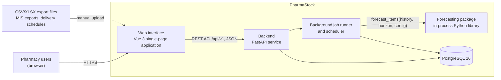

# PharmaStock — Architecture description

Task: PHA2-12 · Primary author: Abzal Bakhytov · Status: draft · Last updated: 2026-10-15

This document describes the architecture of PharmaStock, the prototype developed in the
diploma project "Development of smart supply chain analytics system for forecasting
pharmaceutical inventory and preventing medicine shortages in healthcare organizations"
(Astana IT University, group SE-2414, 2026–2027). It is the entry point for the other
architecture documents:

| Document | Content | State |
|---|---|---|
| `docs/architecture/architecture.md` (this file) | Goals, context, high-level overview, components, decisions | Draft |
| `docs/architecture/api-contract.md` | REST API v1 endpoints, request/response schemas | In progress |
| `docs/architecture/database-schema.md` | Tables, keys, constraints, migrations | In progress |
| `docs/requirements.md` | Functional (FR) and non-functional (NFR) requirements | In progress |
| `docs/technology-comparison.md` | Justification of the technology stack | In progress |
| `docs/diagrams/src/*.mmd`, `docs/diagrams/export/*.svg` | Diagram sources (Mermaid) and exports | See below |

Task tracking: [Linear project PharmaStock](https://linear.app/pharmacy-kz/project/pharmastock-03a3f33ce30b).

## 1. Architectural goals

The goals below drive the decisions in this document. They are derived from the
requirements (`docs/requirements.md`) and from the project constraints (three-person team,
one academic year, uncertain access to real data).

| ID | Goal | Driven by |
|---|---|---|
| AG-1 | Correct treatment of intermittent and censored demand: stock-out periods are flagged and zero consumption during a stock-out is never learned as zero demand | FR-17, NFR-06 |
| AG-2 | Reproducible forecasting: fixed seeds, versioned configurations, saved results for every forecast run and experiment | FR-16, NFR-05 |
| AG-3 | Security and privacy by design: role-based access, hashed passwords, audit trail, no patient data anywhere in the system | FR-14, FR-15, NFR-03, NFR-04 |
| AG-4 | Few moving parts: a single backend service, one database, the forecasting module as an in-process library, so that three students can build, test and deploy the system | NFR-07, NFR-08 |
| AG-5 | Predictable performance for a hospital-scale catalogue (up to 5,000 items, forecast run for 1,000 items with 3 years of weekly history within 5 minutes) | NFR-01, NFR-02 |
| AG-6 | Clear ownership boundaries that match the team responsibilities: frontend, backend and forecasting communicate only through two documented contracts (REST API and the forecasting package interface) | Team structure, `docs/project-management/responsibilities.md` |
| AG-7 | Replaceable data sources: the prototype works with a documented synthetic dataset and switches to real exports without code changes beyond the importer | Data access risk, `docs/project-management/risks.md` |

## 2. System context

PharmaStock is an internal web application of one healthcare organization. It does not
process patient data and it does not execute procurement; it turns historical consumption,
current stock, planned receipts and lead times into per-item consumption forecasts and
shortage-risk signals that pharmacy and procurement staff act on.

Context diagram: `docs/diagrams/export/system-context.svg` (source:
`docs/diagrams/src/system-context.mmd`; the SVG export is produced from the Mermaid source).

### 2.1 Users

| Actor | Role in the organization | Role in PharmaStock (FR-14) | Main interactions |
|---|---|---|---|
| Head of hospital pharmacy / pharmacist | Owns the pharmacy stock | `pharmacist` | Uploads export files, maintains the catalogue, runs forecasts, reviews the risk list and item pages, configures thresholds |
| Procurement and supply specialist | Plans purchases and deliveries | `pharmacist` | Records planned deliveries and lead times, uses the prioritised risk list and reports |
| Head of clinical department | Consumes medicines in the department | `viewer` | Views forecasts and risk status for the department's medicines (read only) |
| System administrator | Operates the installation | `administrator` | Manages users and roles, reviews the audit log, maintains the deployment |

The three application roles (`administrator`, `pharmacist`, `viewer`) are defined in FR-14;
the mapping above is the initial assumption and is revisited in the requirements work.

### 2.2 External systems and data sources

| External element | Direction | How it enters the system | Notes |
|---|---|---|---|
| Hospital accounting system / medical information system (MIS) | Into PharmaStock | CSV/XLSX export files (`consumption.csv`, `stock.csv`, `receipts.csv`) uploaded manually by the pharmacist | No real-time integration with 1C or national systems in the prototype (scope OUT, future work) |
| SK-Pharmacy delivery schedules | Into PharmaStock | Planned deliveries entered manually or imported as `planned_receipts.csv` | Centralised procurement for the guaranteed volume of free medical care; the schedule is a document, not an API |
| Users' browsers | Both | HTTPS | Current Chrome, Firefox and Edge on desktop, responsive down to 1280 px (NFR-09) |

Deliberately not in the context: e-mail or messenger gateways (notifications are in-app
only, FR-12), ordering or procurement systems (scope OUT), mobile applications (scope OUT),
other organizations (single-organization deployment, no multi-tenant SaaS).

## 3. High-level overview

PharmaStock is a three-tier web application with one additional in-process component,
the forecasting package.

| Element | Responsibility | Owner |
|---|---|---|
| Web interface (`frontend/`) | Single-page application for all user interactions: dashboards, item pages with history and forecast charts, prioritised risk list, imports, settings. Talks to the backend only through the REST API. | Birkhanym Kazhymukhamet |
| Backend (`backend/`) | FastAPI service exposing REST API v1; authentication and roles; medicine catalogue; importer; forecast runs; shortage-risk calculation; notifications; audit log; configuration; report export. | Abzal Bakhytov |
| Importer (part of the backend) | Parses uploaded CSV/XLSX files, validates them (FR-02), flags stock-out periods (FR-17), produces a data-quality summary (FR-18) and stores records linked to an `import_batch`. | Abzal Bakhytov |
| Background job runner and scheduler (part of the backend) | Executes long-running work outside the request cycle: forecast runs triggered by `POST /api/v1/forecast-runs` and periodic runs (planned: weekly after the import). Updates `forecast_run.status` so that the interface can poll progress. | Abzal Bakhytov |
| Forecasting package (`forecasting/`) | Pure Python library called in-process by the job runner: data validation, feature preparation, baselines (naive, seasonal naive, moving average, Croston, SBA), ML models, evaluation (MAE, WAPE, bias, rolling-origin split). Entry point `forecasting.api.forecast_items(history, horizon, config) -> ForecastResult`. Has no database access and no knowledge of HTTP. | Evelina Penkova |
| Database (PostgreSQL 16) | Single relational store for the catalogue, imported time series, forecasts, risk assessments, notifications, users, audit log and configuration (entities listed in `docs/architecture/database-schema.md`). | Abzal Bakhytov |

Request path: the browser loads the SPA as static files and calls the backend at
`/api/v1/...` with a bearer token obtained from `POST /api/v1/auth/login`. The backend
reads and writes PostgreSQL through SQLAlchemy 2.x; schema changes are applied with Alembic
migrations.

Forecast path: a forecast run is created as a `forecast_run` row with status `queued` and
handed to the job runner. The runner loads the weekly history (consumption with stock-out
flags), calls `forecasting.api.forecast_items`, stores one `forecast` row per item and
week, computes a `risk_assessment` per item (projected stock = current stock + planned
receipts due by week t − cumulative forecast up to t; expected stock-out date = first week
where projected stock ≤ safety stock; High if within lead time, Medium if within the
horizon, Low otherwise) and creates in-app `notification` rows for high-risk items.

Weekly granularity: all time-series tables store `period_start`, the Monday of the ISO
week, as the period key; the initial horizon is 12 weeks and is configurable per run
(`forecast_run.horizon_weeks`).

## 4. Next steps for this document

- Component diagram (`docs/diagrams/src/component-diagram.mmd`) with frontend views,
  backend routers and services, forecasting sub-modules and the database — planned.
- Component responsibilities, key flows (import, forecast run), technology mapping,
  deployment view (Docker Compose) and cross-cutting concerns — planned.
- Architectural decisions (ADR-style) and alignment with the requirement IDs — planned.
- Review with the team and the supervisor at the weekly meeting before the pre-defense-1
  tag.
