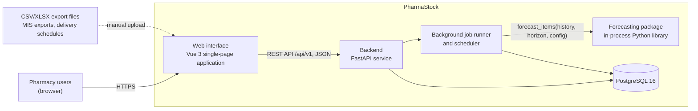
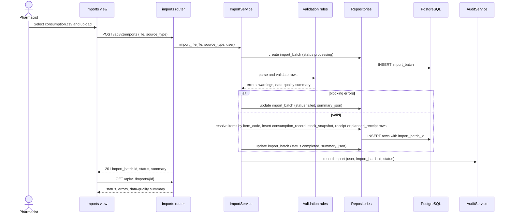
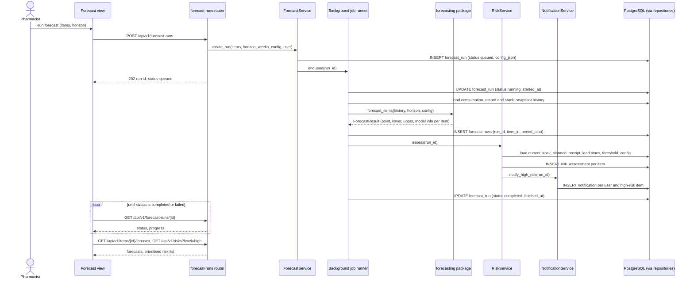
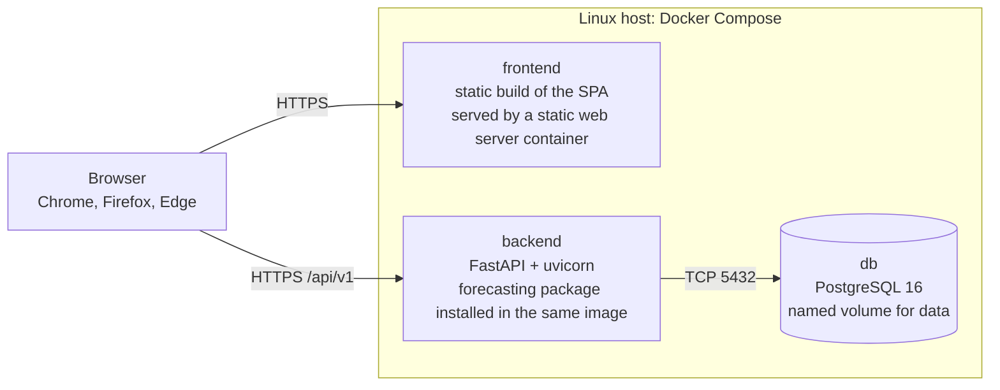

# PharmaStock — Architecture description

Task: PHA2-12 · Primary author: Abzal Bakhytov · Status: draft · Last updated: 2026-10-17

This document describes the architecture of PharmaStock, the prototype developed in the
diploma project "Development of smart supply chain analytics system for forecasting
pharmaceutical inventory and preventing medicine shortages in healthcare organizations"
(Astana IT University, group SE-2414, 2026–2027). It is the entry point for the other
architecture documents:

| Document | Content | State |
|---|---|---|
| `docs/architecture/architecture.md` (this file) | Goals, context, high-level overview, components, flows, deployment, decisions | Draft |
| `docs/architecture/api-contract.md` | REST API v1 endpoints, request/response schemas | In progress |
| `docs/architecture/database-schema.md` | Tables, keys, constraints, migrations | In progress |
| `docs/requirements.md` | Functional (FR) and non-functional (NFR) requirements | In progress |
| `docs/technology-comparison.md` | Justification of the technology stack | In progress |
| `docs/diagrams/src/*.mmd`, `docs/diagrams/export/*.svg` | Diagram sources (Mermaid) and exports | See below |

Task tracking: [Linear project PharmaStock](https://linear.app/pharmacy-kz/project/pharmastock-03a3f33ce30b).

Contents: 1 Architectural goals · 2 System context · 3 High-level overview ·
4 Component view · 5 Key flows · 6 Technology mapping · 7 Deployment view ·
8 Cross-cutting concerns · 9 Next steps.

## 1. Architectural goals

The goals below drive the decisions in this document. They are derived from the
requirements (`docs/requirements.md`) and from the project constraints (three-person team,
one academic year, uncertain access to real data).

| ID | Goal | Driven by |
|---|---|---|
| AG-1 | Correct treatment of intermittent and censored demand: stock-out periods are flagged and zero consumption during a stock-out is never learned as zero demand | FR-17, NFR-06 |
| AG-2 | Reproducible forecasting: fixed seeds, versioned configurations, saved results for every forecast run and experiment | FR-16, NFR-05 |
| AG-3 | Security and privacy by design: role-based access, hashed passwords, audit trail, no patient data anywhere in the system | FR-14, FR-15, NFR-03, NFR-04 |
| AG-4 | Few moving parts: a single backend service, one database, the forecasting module as an in-process library, so that three students can build, test and deploy the system | NFR-07, NFR-08 |
| AG-5 | Predictable performance for a hospital-scale catalogue (up to 5,000 items, forecast run for 1,000 items with 3 years of weekly history within 5 minutes) | NFR-01, NFR-02 |
| AG-6 | Clear ownership boundaries that match the team responsibilities: frontend, backend and forecasting communicate only through two documented contracts (REST API and the forecasting package interface) | Team structure, `docs/project-management/responsibilities.md` |
| AG-7 | Replaceable data sources: the prototype works with a documented synthetic dataset and switches to real exports without code changes beyond the importer | Data access risk, `docs/project-management/risks.md` |

## 2. System context

PharmaStock is an internal web application of one healthcare organization. It does not
process patient data and it does not execute procurement; it turns historical consumption,
current stock, planned receipts and lead times into per-item consumption forecasts and
shortage-risk signals that pharmacy and procurement staff act on.

Context diagram: `docs/diagrams/export/system-context.svg` (source:
`docs/diagrams/src/system-context.mmd`; the SVG export is produced from the Mermaid source).


### 2.1 Users

| Actor | Role in the organization | Role in PharmaStock (FR-14) | Main interactions |
|---|---|---|---|
| Head of hospital pharmacy / pharmacist | Owns the pharmacy stock | `pharmacist` | Uploads export files, maintains the catalogue, runs forecasts, reviews the risk list and item pages, configures thresholds |
| Procurement and supply specialist | Plans purchases and deliveries | `pharmacist` | Records planned deliveries and lead times, uses the prioritised risk list and reports |
| Head of clinical department | Consumes medicines in the department | `viewer` | Views forecasts and risk status for the department's medicines (read only) |
| System administrator | Operates the installation | `administrator` | Manages users and roles, reviews the audit log, maintains the deployment |

The three application roles (`administrator`, `pharmacist`, `viewer`) are defined in FR-14;
the mapping above is the initial assumption and is revisited in the requirements work.

### 2.2 External systems and data sources

| External element | Direction | How it enters the system | Notes |
|---|---|---|---|
| Hospital accounting system / medical information system (MIS) | Into PharmaStock | CSV/XLSX export files (`consumption.csv`, `stock.csv`, `receipts.csv`) uploaded manually by the pharmacist | No real-time integration with 1C or national systems in the prototype (scope OUT, future work) |
| SK-Pharmacy delivery schedules | Into PharmaStock | Planned deliveries entered manually or imported as `planned_receipts.csv` | Centralised procurement for the guaranteed volume of free medical care; the schedule is a document, not an API |
| Users' browsers | Both | HTTPS | Current Chrome, Firefox and Edge on desktop, responsive down to 1280 px (NFR-09) |

Deliberately not in the context: e-mail or messenger gateways (notifications are in-app
only, FR-12), ordering or procurement systems (scope OUT), mobile applications (scope OUT),
other organizations (single-organization deployment, no multi-tenant SaaS).

## 3. High-level overview

PharmaStock is a three-tier web application with one additional in-process component,
the forecasting package.



| Element | Responsibility | Owner |
|---|---|---|
| Web interface (`frontend/`) | Single-page application for all user interactions: dashboards, item pages with history and forecast charts, prioritised risk list, imports, settings. Talks to the backend only through the REST API. | Birkhanym Kazhymukhamet |
| Backend (`backend/`) | FastAPI service exposing REST API v1; authentication and roles; medicine catalogue; importer; forecast runs; shortage-risk calculation; notifications; audit log; configuration; report export. | Abzal Bakhytov |
| Importer (part of the backend) | Parses uploaded CSV/XLSX files, validates them (FR-02), flags stock-out periods (FR-17), produces a data-quality summary (FR-18) and stores records linked to an `import_batch`. | Abzal Bakhytov |
| Background job runner and scheduler (part of the backend) | Executes long-running work outside the request cycle: forecast runs triggered by `POST /api/v1/forecast-runs` and periodic runs (planned: weekly after the import). Updates `forecast_run.status` so that the interface can poll progress. | Abzal Bakhytov |
| Forecasting package (`forecasting/`) | Pure Python library called in-process by the job runner: data validation, feature preparation, baselines (naive, seasonal naive, moving average, Croston, SBA), ML models, evaluation (MAE, WAPE, bias, rolling-origin split). Entry point `forecasting.api.forecast_items(history, horizon, config) -> ForecastResult`. Has no database access and no knowledge of HTTP. | Evelina Penkova |
| Database (PostgreSQL 16) | Single relational store for the catalogue, imported time series, forecasts, risk assessments, notifications, users, audit log and configuration (entities listed in `docs/architecture/database-schema.md`). | Abzal Bakhytov |

Request path: the browser loads the SPA as static files and calls the backend at
`/api/v1/...` with a bearer token obtained from `POST /api/v1/auth/login`. The backend
reads and writes PostgreSQL through SQLAlchemy 2.x; schema changes are applied with Alembic
migrations.

Forecast path: a forecast run is created as a `forecast_run` row with status `queued` and
handed to the job runner. The runner loads the weekly history (consumption with stock-out
flags), calls `forecasting.api.forecast_items`, stores one `forecast` row per item and
week, computes a `risk_assessment` per item (projected stock = current stock + planned
receipts due by week t − cumulative forecast up to t; expected stock-out date = first week
where projected stock ≤ safety stock; High if within lead time, Medium if within the
horizon, Low otherwise) and creates in-app `notification` rows for high-risk items.

Weekly granularity: all time-series tables store `period_start`, the Monday of the ISO
week, as the period key; the initial horizon is 12 weeks and is configurable per run
(`forecast_run.horizon_weeks`).

## 4. Component view

Component diagram (draft): `docs/diagrams/export/component-diagram.svg` (source:
`docs/diagrams/src/component-diagram.mmd`).


The diagram groups the components into five areas: the frontend, the backend, the
forecasting package, the database and the external file sources. Arrows show synchronous
calls; dotted arrows show manual upload or entry by a user.

### 4.1 Component responsibilities

| Area | Component | Responsibility | Data entities touched | Owner |
|---|---|---|---|---|
| Frontend | Dashboard view | Summary of the latest forecast run: counts of items by risk level, recent imports, unread notifications | — (via API) | Birkhanym |
| Frontend | Items view | Catalogue list and item page: current stock, consumption history as table and chart, suppliers and lead times | — (via API) | Birkhanym |
| Frontend | Forecast view | Start a forecast run for all or selected items with a horizon, follow run status, show point forecast, interval and model information per item together with history | — (via API) | Birkhanym |
| Frontend | Risks view | Prioritised risk list with risk level, expected stock-out date and projected stock; filters by level; CSV export link | — (via API) | Birkhanym |
| Frontend | Imports view | Upload CSV/XLSX files, show validation errors and the data-quality summary per import | — (via API) | Birkhanym |
| Frontend | Settings view | Risk thresholds and safety-stock parameters; user and role management for administrators | — (via API) | Birkhanym |
| Frontend | API client | Typed HTTP client generated from the OpenAPI schema plus Pinia stores for session, catalogue, runs and notifications; attaches the bearer token; maps API errors to user messages | — | Birkhanym |
| Backend | Application entry point (`backend/app/main.py`) | Creates the FastAPI application, mounts the routers under `/api/v1`, registers error handlers and CORS; `GET /api/v1/health` for Docker Compose health checks and the CI smoke test | — | Abzal |
| Backend | `auth` router | `POST /api/v1/auth/login`; issues bearer tokens; dependency that resolves the current user and checks roles | `app_user` | Abzal |
| Backend | `items` router | `GET/POST /api/v1/items`, `GET /api/v1/items/{id}/history`, `GET /api/v1/items/{id}/forecast` | `medicine_item`, `consumption_record`, `stock_snapshot`, `forecast` | Abzal |
| Backend | `imports` router | `POST /api/v1/imports` (file upload), `GET /api/v1/imports/{id}` (status, errors, data-quality summary) | `import_batch` | Abzal |
| Backend | `forecast-runs` router | `POST /api/v1/forecast-runs`, `GET /api/v1/forecast-runs/{id}` | `forecast_run` | Abzal |
| Backend | `risks` router | `GET /api/v1/risks?level=high\|medium\|low`, `GET /api/v1/reports/risks.csv` (report export; a separate `reports` router is split out if more report types are added) | `risk_assessment` | Abzal |
| Backend | `notifications` router | `GET /api/v1/notifications`, mark as read | `notification` | Abzal |
| Backend | `config` router | `GET/PUT /api/v1/config/thresholds` | `threshold_config` | Abzal |
| Backend | ImportService | Parses CSV/XLSX, calls the validation rules, flags stock-out periods, updates name and unit of catalogue items found in files (unknown codes are rejected, FR-02), stores records and the summary, sets `import_batch.status` | `import_batch`, `medicine_item`, `consumption_record`, `stock_snapshot`, `receipt`, `planned_receipt` | Abzal |
| Backend | CatalogueService | Medicine catalogue, suppliers and lead times, history queries for item pages | `medicine_item`, `supplier`, `item_supplier` | Abzal |
| Backend | ForecastService | Creates and tracks forecast runs, prepares the history table for the forecasting package, stores forecasts, records the configuration used | `forecast_run`, `forecast` | Abzal, with Evelina for the data contract |
| Backend | RiskService | Shortage-risk calculation per item (projected stock, expected stock-out date, risk level) using thresholds and lead times; owns threshold configuration | `risk_assessment`, `planned_receipt`, `item_supplier`, `threshold_config` | Abzal |
| Backend | NotificationService | Creates in-app notifications for high-risk items after each run; read/unread state per user | `notification` | Abzal |
| Backend | AuditService | Writes audit entries for imports, forecast runs, configuration changes and user management | `audit_log` | Abzal |
| Backend | Repositories | SQLAlchemy 2.x models and query functions per entity; sessions per request and per job; Alembic migrations | all | Abzal |
| Backend | Background job runner and scheduler | Executes queued forecast runs one at a time and periodic runs; isolates failures and records them in `forecast_run.status` | `forecast_run` | Abzal |
| Forecasting | Data validation (`forecasting/forecasting/data/schema.py`, `validation.py`) | Schema of the history table, checks for missing columns, negative quantities, duplicate periods, irregular weeks; rejects malformed input with a clear error (NFR-06) | — | Evelina |
| Forecasting | Feature preparation | Resampling to a regular weekly series, censored-demand handling for stock-out weeks, lags, rolling statistics, calendar features, item group attributes | — | Evelina |
| Forecasting | Baselines (`models/baselines.py`) | naive, seasonal_naive (season 52), moving_average(window), croston, sba | — | Evelina |
| Forecasting | ML models | Gradient boosting (LightGBM) on lag and calendar features; statistical models from statsforecast; global models across items — candidates, final choice after experiments | — | Evelina |
| Forecasting | Evaluation (`evaluation/metrics.py`, `evaluation/split.py`) | mae, wape (None when the sum of actuals is 0), bias; time-based rolling-origin split with train/validation/test by date | — | Evelina |
| Forecasting | `forecasting.api` | `forecast_items(history, horizon, config) -> ForecastResult`: the single entry point used by the backend | — | Evelina, with Abzal for integration |
| Database | PostgreSQL 16 | Persistent storage; one schema managed by Alembic | all | Abzal |

### 4.2 Contracts between the areas

| Contract | Between | Where it is defined |
|---|---|---|
| REST API v1 | Frontend ↔ Backend | `docs/architecture/api-contract.md`; OpenAPI schema that FastAPI produces |
| Forecasting package interface | Backend ↔ Forecasting | `forecasting/README.md`, `forecasting/forecasting/api.py`, history schema in `forecasting/forecasting/data/schema.py` |
| Import file formats | Users/MIS ↔ Backend | `docs/data/data-specification.md`: `consumption.csv`, `stock.csv`, `receipts.csv`, `planned_receipts.csv` (CSV, UTF-8, header row, `period_start` = Monday of the week, ISO date) |
| Database schema | Backend ↔ PostgreSQL | `docs/architecture/database-schema.md`; Alembic migrations in `backend/` |

## 5. Key flows

### 5.1 Import → validation → storage



Rules applied during validation (FR-02, FR-17, FR-18):

- blocking errors: missing columns, negative quantities, unknown item codes (codes absent
  from the medicine catalogue are listed so that the catalogue can be completed under
  FR-03 before the file is imported again), unparseable dates, duplicate
  `(item_code, period_start)` within one file, `period_start` that is not a Monday;
- warnings: gaps in the weekly series, outliers flagged by the data-quality rules;
- stock-out flag: a week is marked `stock_snapshot.is_stock_out = true` when
  `quantity_on_hand` is 0 at `period_start`; the forecasting package receives this flag
  with the history so that zero consumption in such weeks is treated as censored demand;
- the data-quality summary (coverage, gaps, outliers) is stored in
  `import_batch.summary_json` and shown in the Imports view.

### 5.2 Forecast run → forecasting package → forecasts, risk assessment, notifications



Failure handling: if the forecasting package raises a validation error (NFR-06) or the run
fails for any other reason, the runner stores `forecast_run.status = failed`, no partial
`forecast` or `risk_assessment` rows are kept, and an audit entry with the error message in
`audit_log.details_json` is written. The interface shows the message in the Forecast view.

Risk calculation (FR-08, FR-09) per item for each week t of the horizon:

```text
projected_stock(t) = current_stock + planned receipts due by t − cumulative forecast up to t
expected stock-out date = first week where projected_stock(t) ≤ safety stock
risk level = High   if the stock-out is expected within the item's lead time
           = Medium if within the forecast horizon
           = Low    otherwise
```

`current_stock` is the latest `stock_snapshot` for the item, planned receipts come from
`planned_receipt` with status planned, lead time from the primary `item_supplier`, safety
stock and the level boundaries from `threshold_config`. The projected series is stored in
`risk_assessment.projected_stock_json` so that the Risks view can chart it.

## 6. Technology mapping

| Component | Technology | Notes |
|---|---|---|
| Web interface | Vue 3, Vite, TypeScript, Vue Router, Pinia, Chart.js | Built to static files; Vitest for unit tests (later) |
| Backend API | Python 3.12, FastAPI, Pydantic v2, uvicorn | OpenAPI schema generated; request validation at the boundary |
| Persistence | SQLAlchemy 2.x, Alembic, PostgreSQL 16 | JSONB columns for `summary_json`, `config_json`, `projected_stock_json`, `details_json`, `value_json` |
| Background jobs | In-process worker in the backend | Mechanism to be confirmed during backend implementation (see next steps) |
| Forecasting | pandas, numpy, scikit-learn, statsforecast, LightGBM | Installed into the backend environment as the `forecasting` package |
| Tests | pytest (backend, forecasting), Vitest (frontend, later) | Run in CI on every pull request (NFR-08) |
| Infrastructure | Docker Compose (PostgreSQL), GitHub Actions CI | `docker-compose.yml`, `.github/workflows/ci.yml` |
| Documentation | Markdown, Mermaid | Sources in `docs/diagrams/src/*.mmd`, exports in `docs/diagrams/export/*.svg` |

Justification of the choices: `docs/technology-comparison.md`.

## 7. Deployment view

Target: a single Linux host with Docker Compose (NFR-07). Three services:



| Service | Image / build | Configuration | Notes |
|---|---|---|---|
| `db` | `postgres:16` | `POSTGRES_DB`, `POSTGRES_USER`, `POSTGRES_PASSWORD` from `.env`; data in a named volume | The only service needed for local backend development |
| `backend` | Built from `backend/` (Python 3.12 base image, installs `backend/` and `forecasting/`) | `DATABASE_URL`, `SECRET_KEY`, `LOG_LEVEL`, forecasting defaults from `.env`; Alembic migrations run on start | Runs uvicorn; the job runner lives in the same process |
| `frontend` | Built from `frontend/` (Vite build copied into a static web server image) | API base URL at build time | Serves the SPA; `/api/v1` requests go to `backend` |

- HTTPS is terminated by a reverse proxy in front of Compose in the deployed environment
  (NFR-03); in local development plain HTTP on localhost is used.
- `.env.example` documents every variable; secrets are never committed.
- Developer setup: `docker compose up db`, then run the backend with uvicorn and the
  frontend with the Vite dev server (documented in `backend/README.md` and
  `frontend/README.md`).
- CI (GitHub Actions) runs pytest for `backend/` and `forecasting/` with a PostgreSQL
  service container, and the frontend build on every pull request (NFR-08).

## 8. Cross-cutting concerns

### 8.1 Authentication and authorization (FR-14, NFR-03)

- `POST /api/v1/auth/login` with e-mail and password returns a signed bearer token with
  the user id and role; the token is sent in the `Authorization` header.
- Passwords are stored only as salted hashes in `app_user.password_hash`.
- Roles: `administrator` (users, roles, all data), `pharmacist` (imports, catalogue,
  forecast runs, thresholds, planned receipts, reports), `viewer` (read-only access to
  items, forecasts, risks and notifications). Permission checks are FastAPI dependencies
  on each router; the frontend hides actions the role cannot perform but does not enforce
  security.
- No patient data exists in any entity (NFR-04); the only personal data are the e-mail
  and full name of application users.

### 8.2 Audit log (FR-15)

AuditService writes an `audit_log` row (`user_id`, `action`, `entity`, `entity_id`,
`created_at`, `details_json`) for: imports (created, completed, failed), forecast runs
(created, completed, failed), threshold changes, planned-receipt changes, user and role
changes. Entries are written in the same database transaction as the change. The audit log
is readable by administrators in the Settings view (planned).

### 8.3 Configuration (FR-11, NFR-05)

| Kind | Where | Changed by |
|---|---|---|
| Infrastructure settings (database URL, secret key, log level, job concurrency) | Environment variables read by `backend/app/core/config.py` (Pydantic settings); documented in `.env.example` | Deployment |
| Domain thresholds (safety-stock rule, risk level boundaries, default horizon) | `threshold_config` table, `GET/PUT /api/v1/config/thresholds` | Pharmacist or administrator, audited |
| Forecast model configuration (model name, parameters, seed, feature set) | `forecast_run.config_json` for runs; versioned experiment configurations in `forecasting/experiments/` | Forecast run request; experiments by Evelina |

Every forecast run stores the full configuration it used, so results can be reproduced
from the database alone.

### 8.4 Logging and error handling

- Structured application logs through the Python `logging` module with a request id per
  HTTP request and a run id per background job; uvicorn access logs; log level from
  configuration. Logs contain no file contents and no user credentials.
- API errors follow one JSON shape (`detail`, `code`, optional `errors` list). Input
  validation errors return 422 with the offending fields; domain errors (unknown item,
  run not found, role not allowed) return 404, 403 or 409.
- The forecasting package validates its input before modelling and raises a typed
  exception with a clear message instead of producing a wrong forecast (NFR-06); the
  backend turns it into a failed import or failed run with the message visible to the user.

### 8.5 Data validation at the boundaries

Validation happens twice, with different purposes: Pydantic schemas validate API payloads
(types, required fields, enumerations); the importer and the forecasting package validate
the content of time series (negative quantities, duplicate periods, non-Monday
`period_start`, gaps, stock-out consistency). The rules are shared where possible so that
an import that passed validation can always be forecast.

## 9. Next steps for this document

- Architectural decisions (ADR-style entries: in-process forecasting package, PostgreSQL,
  REST/JSON, weekly granularity stored as `period_start`, background forecast runs) —
  planned.
- Alignment of components with the requirement IDs (FR-01 … FR-18, NFR-01 … NFR-10) —
  planned.
- Confirm the background job mechanism against NFR-01 with the first models (Nov 2026).
- Produce the SVG exports of both diagrams from the Mermaid sources and review the
  document with the team and the supervisor before the `pre-defense-1` tag.
