# PharmaStock — Database schema

_PHA2-14 · Primary author: Abzal Bakhytov · Status: draft · Last updated: 2026-10-18_

This document describes the PostgreSQL 16 schema of PharmaStock, the prototype developed in
the diploma project "Development of smart supply chain analytics system for forecasting
pharmaceutical inventory and preventing medicine shortages in healthcare organizations"
(Astana IT University, group SE-2414, 2026–2027). It is the reference for the SQLAlchemy 2.x
models in `backend/app/db/models.py` and for the Alembic migrations in `backend/alembic/`.
Entity and column names are shared vocabulary with `docs/architecture/api-contract.md`,
`docs/data/data-specification.md` and the forecasting package; they are used verbatim.

| Related document | Content |
|---|---|
| `docs/architecture/architecture.md` | System context, components, forecast and import paths |
| `docs/architecture/api-contract.md` | REST API v1 that reads and writes these tables (planned) |
| `docs/data/data-specification.md` | Import file formats, validation rules, weekly conventions, stock-out flagging |
| `docs/requirements.md` | Functional (FR) and non-functional (NFR) requirements referenced below |
| `docs/diagrams/src/er-diagram.mmd` | Mermaid source of the ER diagram |
| `docs/diagrams/export/er-diagram.svg` | Rendered ER diagram for the thesis and presentations |

Task tracking: [Linear project PharmaStock](https://linear.app/pharmacy-kz/project/pharmastock-03a3f33ce30b).

## 1. Scope and design decisions

| ID | Decision | Rationale |
|---|---|---|
| DB-1 | One PostgreSQL 16 database, one schema (`public`), 15 tables | Single-organization deployment, few moving parts (architectural goal AG-4) |
| DB-2 | Relational core; `jsonb` only for semi-structured payloads (`summary_json`, `config_json`, `projected_stock_json`, `details_json`, `value_json`) | Time series and catalogue need constraints and indexes; payloads change shape during the project |
| DB-3 | All time series are weekly; `period_start` is the Monday of the ISO week | Initial decision of the project (weekly step, 12-week horizon); one period key for history, forecasts and risk |
| DB-4 | Stock-out weeks are stored explicitly (`stock_snapshot.is_stock_out`) | FR-17: zero consumption during a stock-out is censored demand, not zero demand |
| DB-5 | Every forecast run keeps its full configuration and outputs | FR-16, NFR-05: reproducible experiments, comparison on a hold-out period |
| DB-6 | No patient-level entity exists; consumption is aggregated per item per week | NFR-04: no patient personal data is stored or processed |
| DB-7 | Enumerations are `varchar` columns with CHECK constraints, not PostgreSQL `ENUM` types | Adding a value is an ordinary Alembic migration without `ALTER TYPE` |
| DB-8 | Catalogue rows are deactivated, never deleted; audit log is append-only | FR-15, NFR-03: history and audit trail survive configuration changes |

### 1.1 Entities

| Table | Purpose | Written by | Read by |
|---|---|---|---|
| `medicine_item` | Medicine catalogue (FR-03) | Catalogue screens, importer | Everything |
| `supplier` | Suppliers (FR-04) | Catalogue screens, importer | Risk calculation, planned deliveries |
| `item_supplier` | Lead time per item and supplier (FR-04) | Catalogue screens | Risk calculation |
| `import_batch` | One uploaded file with its status and data-quality summary (FR-01, FR-02, FR-18) | Importer | Import screens, audit |
| `consumption_record` | Weekly consumption per item (FR-01, FR-05) | Importer | Forecasting, item pages |
| `stock_snapshot` | Weekly stock per item with stock-out flag (FR-01, FR-05, FR-17) | Importer | Forecasting, risk calculation, item pages |
| `receipt` | Actual deliveries (FR-01) | Importer | Item pages, data quality |
| `planned_receipt` | Expected deliveries (FR-10) | Planned-deliveries screen, importer | Risk calculation |
| `forecast_run` | One execution of the forecasting module (FR-06, NFR-05) | Job runner | Forecast screens, model comparison |
| `forecast` | Point forecast and interval per item and week (FR-07) | Job runner | Item pages, risk calculation, reports |
| `risk_assessment` | Shortage risk per item for a run (FR-08, FR-09) | Job runner | Risk list, dashboards, notifications, reports |
| `notification` | In-app notification for a high-risk item (FR-12) | Job runner | Notification list |
| `app_user` | Users and roles (FR-14, NFR-03) | Administration screens | Authentication, authorisation |
| `audit_log` | Imports, forecast runs, configuration changes, logins (FR-15) | Backend services | Administration screens |
| `threshold_config` | Risk thresholds and safety-stock parameters (FR-11) | Settings screen | Risk calculation, job runner |

## 2. Conventions

### 2.1 Naming

- Tables and columns are `snake_case`, singular table names (`medicine_item`, not
  `medicine_items`), exactly as the data entities agreed by the team are named in
  `docs/requirements.md` (section 5.5) and in `docs/architecture/api-contract.md`.
- Every table has a surrogate primary key `id`, except `item_supplier`, whose natural
  composite key `(item_id, supplier_id)` is the primary key.
- Foreign key columns are named after the referenced entity, as in the entity names of
  `docs/requirements.md` (section 5.5) and the API contract: `item_id` (`medicine_item`),
  `supplier_id`, `import_batch_id`, `run_id`
  (`forecast_run`), `risk_assessment_id`, and `user_id` or `updated_by` (`app_user`).
- `jsonb` columns end with `_json`; boolean columns start with `is_`.
- `medicine_item.group` is a reserved word in SQL. It is kept because the name is shared with
  the API and the forecasting module, and it is always quoted in SQL (`"group"`); SQLAlchemy
  quotes it automatically.
- Constraint and index names follow the SQLAlchemy naming convention below (the
  `NAMING_CONVENTION` of `backend/app/db/base.py`) so that Alembic autogenerate produces
  deterministic migrations. The convention names primary keys, foreign keys, single-column
  unique constraints (`uq_medicine_item_code`), single-column indexes
  (`ix_medicine_item_group`) and CHECK constraints (`ck_<table>_<rule>` from the rule name
  given in the model, for example `quantity_nonnegative`). Composite unique constraints and
  composite or partial indexes are named explicitly in the models and migrations (for example
  `uq_consumption_record_item_period`, `ix_receipt_item_id_received_on`); sections 4 and 5
  list the names to use.

```python
NAMING_CONVENTION = {
    "ix": "ix_%(column_0_label)s",
    "uq": "uq_%(table_name)s_%(column_0_N_name)s",
    "ck": "ck_%(table_name)s_%(constraint_name)s",
    "fk": "fk_%(table_name)s_%(column_0_name)s_%(referred_table_name)s",
    "pk": "pk_%(table_name)s",
}
```

### 2.2 Types

| Kind of data | PostgreSQL type | SQLAlchemy type | Notes |
|---|---|---|---|
| Surrogate key, reference tables | `integer GENERATED ALWAYS AS IDENTITY` | `Integer`, `Identity(always=True)` | `medicine_item`, `supplier`, `import_batch`, `planned_receipt`, `forecast_run`, `app_user`, `threshold_config` |
| Surrogate key, high-volume tables | `bigint GENERATED ALWAYS AS IDENTITY` | `BigInteger().with_variant(Integer(), "sqlite")`, `Identity(always=True)` | `consumption_record`, `stock_snapshot`, `receipt`, `forecast`, `risk_assessment`, `notification`, `audit_log`; the SQLite variant keeps the mapping tests runnable without PostgreSQL (section 8) |
| Small counters | `smallint` | `SmallInteger` | `item_supplier.lead_time_days`, `forecast_run.horizon_weeks` |
| Quantities | `numeric(14,3)` | `Numeric(14, 3)` | Units may be fractional (for example millilitres); never `float` |
| Calendar dates | `date` | `Date` | `period_start`, `received_on`, `expected_on`, `expected_stockout_date` |
| Timestamps | `timestamptz` | `DateTime(timezone=True)` | Stored in UTC, displayed in the organization's local time (UTC+5) |
| Short codes and names | `varchar(n)` | `String(n)` | Lengths are given per column |
| Enumerations | `varchar(n)` + CHECK | `Enum(StrEnum, native_enum=False, create_constraint=True, length=n)`, which renders `varchar(n)` and the CHECK constraint on every dialect | See section 2.4; no PostgreSQL `ENUM` types (DB-7) |
| Semi-structured payloads | `jsonb` | `JSON().with_variant(JSONB(), "postgresql")` | Shape documented per column; `jsonb` on PostgreSQL, plain `JSON` on SQLite in the mapping tests |

### 2.3 Weekly period convention

- `period_start` in `consumption_record`, `stock_snapshot` and `forecast` is the Monday of
  the ISO week (`extract(isodow from period_start) = 1`, enforced by a CHECK constraint).
  Import files already carry the Monday (see the file formats in
  `docs/data/data-specification.md`); the importer rejects any other weekday (FR-02).
- `consumption_record.quantity` is the total quantity consumed during the week that starts on
  `period_start`.
- `stock_snapshot.quantity_on_hand` is the closing balance at the end of the week that starts
  on `period_start`, after that week's receipts and consumption (the convention of
  `docs/data/data-specification.md`, section 2; an export that gives opening balances is
  shifted by one week before import).
- `receipt.received_on` and `planned_receipt.expected_on` are exact calendar dates. Where a
  weekly value is needed (risk calculation, charts), they are assigned to the week that contains
  the date with `date_trunc('week', received_on)`, which returns the Monday in PostgreSQL.
- Inside the covered period of a consumption file, an (item, week) without a row is stored as
  an explicit `quantity = 0` row and reported as a gap (FQ-02, FR-18; data specification,
  section 6). Weeks missing in `stock.csv` are not filled: no `stock_snapshot` row is created
  and the stock-out flag is derived only from observed snapshots. The weekly history that the
  backend passes to `forecasting.api.forecast_items` is therefore a complete grid per item in
  which weeks with `is_stock_out = true` are marked as censored.
- `is_stock_out` is derived by the importer. Primary rule (AC-17.1): `true` when
  `quantity_on_hand = 0` for that week, that is, when the closing balance of the week is zero.
  Refinement of the rule (receipts within the week, partial stock-outs) is tracked in the data
  specification and does not change the schema.

### 2.4 Enumerations

Each enumeration is stored as `varchar` with a CHECK constraint named
`ck_<table>_<column>_values` and mapped to an `enum.StrEnum` in `backend/app/db/models.py`
(`sqlalchemy.Enum(..., native_enum=False, create_constraint=True)`, so that the Python
enumeration, the CHECK constraint and the API share one list of values). The string values
are the ones used by the API (for example `GET /api/v1/risks?level=high`) and by the
acceptance scenarios of `docs/requirements.md`: finished imports and runs are `completed`
(FR-01-S1, AC-06.2).

| Enumeration | Column | Values | Meaning |
|---|---|---|---|
| `user_role` | `app_user.role` | `administrator`, `pharmacist`, `viewer` | FR-14; the role mapping of the actors is in `architecture.md`, section 2.1 |
| `risk_level` | `risk_assessment.risk_level` | `high`, `medium`, `low` | High: stock-out expected within the item's lead time; Medium: within the forecast horizon; Low: otherwise |
| `forecast_run_status` | `forecast_run.status` | `queued`, `running`, `completed`, `failed`, `cancelled` | Lifecycle of a run (AC-06.2); the interface polls `GET /api/v1/forecast-runs/{id}`. `cancelled` is reserved for a later cancel endpoint, which is not part of REST API v1; no v1 endpoint sets it |
| `import_status` | `import_batch.status` | `pending`, `processing`, `completed`, `failed` | `pending` and `processing` are transient while the upload is handled; a client reads `completed` (FR-01-S1) or `failed` (validation rejected the file); warnings do not change the status. The backend `ImportStatus` enumeration carries the same four values |
| `source_type` | `import_batch.source_type` | `consumption`, `stock`, `receipts`, `planned_receipts` | One value per import file format |
| `planned_receipt_status` | `planned_receipt.status` | `planned`, `received`, `cancelled` | Only `planned` rows enter the risk calculation |

### 2.5 Referential actions

| Parent | Children | `ON DELETE` | Reason |
|---|---|---|---|
| `medicine_item` | all tables with `item_id` | `RESTRICT` | Items are deactivated (`is_active = false`), never deleted; history must survive |
| `supplier` | `item_supplier` | `CASCADE` | A supplier link has no meaning without the supplier |
| `supplier` | `receipt`, `planned_receipt` | `SET NULL` | Deliveries remain, supplier becomes unknown |
| `import_batch` | `consumption_record`, `stock_snapshot`, `receipt` | `RESTRICT` | A batch that loaded rows cannot be deleted; corrections are made by re-importing |
| `forecast_run` | `forecast`, `risk_assessment` | `CASCADE` | Deleting a run (retention housekeeping) removes its outputs |
| `risk_assessment` | `notification` | `CASCADE` | Notifications belong to the assessment that produced them |
| `app_user` | `import_batch`, `forecast_run`, `audit_log`, `threshold_config` | `SET NULL` | Users are deactivated, not deleted; if one is deleted, history keeps a null author |
| `app_user` | `notification` | `CASCADE` | Notifications are private to the recipient |

## 3. ER diagram

Source: `docs/diagrams/src/er-diagram.mmd`; export: `docs/diagrams/export/er-diagram.svg`
(the SVG is produced from the Mermaid source and re-exported in the same pull request as any
change to the source). The diagram below is the same source embedded so that GitHub renders it.

```mermaid
erDiagram
    medicine_item {
        int id PK
        varchar(64) code UK "item code of the accounting system"
        varchar(255) name
        varchar(32) unit "unit of measure, for example pack or vial"
        varchar(128) group "medicine group used for error analysis"
        boolean is_active "inactive items keep history but are not forecast"
    }

    supplier {
        int id PK
        varchar(255) name UK
    }

    item_supplier {
        int item_id PK, FK
        int supplier_id PK, FK
        smallint lead_time_days
        boolean is_primary "at most one primary supplier per item"
    }

    import_batch {
        int id PK
        varchar(255) file_name
        varchar(32) source_type "consumption, stock, receipts, planned_receipts"
        timestamptz imported_at
        int user_id FK "null for command-line imports"
        varchar(16) status "pending, processing, completed, failed"
        jsonb summary_json "validation errors and data-quality summary"
    }

    consumption_record {
        bigint id PK
        int item_id FK
        date period_start "Monday of the ISO week"
        numeric quantity
        int import_batch_id FK
    }

    stock_snapshot {
        bigint id PK
        int item_id FK
        date period_start "Monday of the ISO week"
        numeric quantity_on_hand "closing balance of the week"
        boolean is_stock_out "censored demand flag"
        int import_batch_id FK
    }

    receipt {
        bigint id PK
        int item_id FK
        date received_on
        numeric quantity
        int supplier_id FK "null when the file names no supplier"
        int import_batch_id FK
    }

    planned_receipt {
        int id PK
        int item_id FK
        date expected_on
        numeric quantity
        int supplier_id FK "null when the supplier is not known"
        varchar(16) status "planned, received, cancelled"
    }

    forecast_run {
        int id PK
        timestamptz started_at
        timestamptz finished_at "null while the run is not finished"
        smallint horizon_weeks "12 by default"
        varchar(64) model_name
        jsonb config_json "seed, model parameters, data snapshot"
        varchar(16) status "queued, running, completed, failed, cancelled (reserved)"
        int user_id FK "null for scheduled runs"
    }

    forecast {
        bigint id PK
        int run_id FK
        int item_id FK
        date period_start "Monday of the forecast week"
        numeric point
        numeric lower "null when the model gives no interval"
        numeric upper "null when the model gives no interval"
    }

    risk_assessment {
        bigint id PK
        int run_id FK
        int item_id FK
        varchar(8) risk_level "high, medium, low"
        date expected_stockout_date "null when no stock-out is expected"
        jsonb projected_stock_json "projected stock per week and inputs used"
        timestamptz computed_at
    }

    notification {
        bigint id PK
        int user_id FK
        int item_id FK
        bigint risk_assessment_id FK
        timestamptz created_at
        timestamptz read_at "null until the user reads it"
    }

    app_user {
        int id PK
        varchar(255) email UK "unique case-insensitively"
        varchar(255) full_name
        varchar(255) password_hash
        varchar(16) role "administrator, pharmacist, viewer"
        boolean is_active
        timestamptz created_at
    }

    audit_log {
        bigint id PK
        int user_id FK "null for system actions"
        varchar(64) action "entity.verb, for example import.create"
        varchar(64) entity "table name"
        bigint entity_id "row id in that table, no foreign key"
        timestamptz created_at
        jsonb details_json
    }

    threshold_config {
        int id PK
        varchar(64) key UK
        jsonb value_json
        int updated_by FK "null when set by the initial migration"
        timestamptz updated_at
    }

    %% Catalogue and suppliers
    medicine_item ||--o{ item_supplier : "is supplied by"
    supplier ||--o{ item_supplier : "supplies"

    %% Imported time series
    medicine_item ||--o{ consumption_record : "has weekly consumption"
    medicine_item ||--o{ stock_snapshot : "has weekly stock"
    medicine_item ||--o{ receipt : "receives"
    medicine_item ||--o{ planned_receipt : "expects"
    supplier |o..o{ receipt : "delivered"
    supplier |o..o{ planned_receipt : "will deliver"
    import_batch ||--o{ consumption_record : "loads"
    import_batch ||--o{ stock_snapshot : "loads"
    import_batch ||--o{ receipt : "loads"
    app_user |o..o{ import_batch : "uploads"

    %% Forecasting and shortage risk
    forecast_run ||--o{ forecast : "produces"
    forecast_run ||--o{ risk_assessment : "produces"
    medicine_item ||--o{ forecast : "is forecast in"
    medicine_item ||--o{ risk_assessment : "is assessed in"
    app_user |o..o{ forecast_run : "starts"

    %% Notifications, audit trail and configuration
    risk_assessment ||--o{ notification : "triggers"
    app_user ||--o{ notification : "receives"
    medicine_item ||--o{ notification : "concerns"
    app_user |o..o{ audit_log : "performs"
    app_user |o..o{ threshold_config : "last updated by"
```



Notation: `PK` primary key, `FK` foreign key, `UK` unique column; a solid line is a mandatory
parent (`NOT NULL` foreign key), a dashed line an optional parent (nullable foreign key).

## 4. Tables

Column tables list the type, whether `NULL` is allowed, the default and the meaning. `✓` in
the Null column means nullable.

### 4.1 `medicine_item`

Medicine catalogue (FR-03). Rows are created on the catalogue screen or by the consumption
import, whose rows carry `item_code`, `item_name` and `unit`; stock and receipt imports require
known codes and report unknown items as errors (FR-02).

| Column | Type | Null | Default | Description |
|---|---|---|---|---|
| `id` | `integer` identity | | | Primary key |
| `code` | `varchar(64)` | | | Item code of the accounting system; matches `item_code` in import files |
| `name` | `varchar(255)` | | | Item name as in the accounting system |
| `unit` | `varchar(32)` | | | Unit of measure (pack, vial, tablet, millilitre) |
| `group` | `varchar(128)` | ✓ | | Medicine group (pharmacological or accounting); basis of the error analysis per group; quoted as `"group"` in SQL |
| `is_active` | `boolean` | | `true` | Inactive items keep their history but are excluded from forecast runs and the risk list |

Constraints and indexes: `pk_medicine_item`; `uq_medicine_item_code` on `(code)`;
`ck_medicine_item_code_not_blank` (`length(trim(code)) > 0`); `ix_medicine_item_group` on
`("group")` for the error analysis and group filters.

### 4.2 `supplier`

Suppliers (FR-04). The single distributor for the guaranteed volume of free medical care
(SK-Pharmacy) and the organization's own suppliers are rows of this table.

| Column | Type | Null | Default | Description |
|---|---|---|---|---|
| `id` | `integer` identity | | | Primary key |
| `name` | `varchar(255)` | | | Supplier name; matches the `supplier` column of `receipts.csv` and `planned_receipts.csv` |

Constraints and indexes: `pk_supplier`; `uq_supplier_name` on `(name)`.

### 4.3 `item_supplier`

Lead time per item and supplier (FR-04). The risk calculation uses the lead time of the
primary supplier; an item without a primary supplier uses the `default_lead_time_days` key of
`threshold_config`.

| Column | Type | Null | Default | Description |
|---|---|---|---|---|
| `item_id` | `integer` | | | FK `medicine_item.id`, part of the primary key |
| `supplier_id` | `integer` | | | FK `supplier.id`, part of the primary key |
| `lead_time_days` | `smallint` | | | Days from order to receipt |
| `is_primary` | `boolean` | | `false` | At most one primary supplier per item |

Constraints and indexes: `pk_item_supplier` on `(item_id, supplier_id)`;
`ck_item_supplier_lead_time_nonnegative` (`lead_time_days >= 0`);
`uq_item_supplier_primary` partial unique index on `(item_id) WHERE is_primary`.

### 4.4 `import_batch`

One uploaded file (FR-01). The file itself is not stored in the database; the backend keeps it
in its import directory and records the metadata, the status and the validation and
data-quality summary here (FR-02, FR-18).

| Column | Type | Null | Default | Description |
|---|---|---|---|---|
| `id` | `integer` identity | | | Primary key |
| `file_name` | `varchar(255)` | | | Original file name as uploaded |
| `source_type` | `varchar(32)` | | | `consumption`, `stock`, `receipts` or `planned_receipts` |
| `imported_at` | `timestamptz` | | `now()` | Time the upload was accepted |
| `user_id` | `integer` | ✓ | | FK `app_user.id`, created together with `app_user` in the users and roles task (a plain integer column until then); null for command-line imports (synthetic dataset, seeds) |
| `status` | `varchar(16)` | | `'pending'` | `pending`, `processing`, `completed`, `failed` (section 2.4) |
| `summary_json` | `jsonb` | | `'{}'` | Result of validation and data-quality checks (shape below) |

Constraints and indexes: `pk_import_batch`; `ck_import_batch_source_type_values`;
`ck_import_batch_status_values`; `ix_import_batch_imported_at` on `(imported_at)` (declared in
the models; PostgreSQL scans the B-tree backwards for the newest-first listing, so no
descending index is needed);
`ix_import_batch_user_id`.

Shape of `summary_json` for a completed `consumption` import. The keys are the ones fixed by
the acceptance scenarios FR-01-S1 and FR-18-S1 of `docs/requirements.md`; keys may be added,
existing keys are not renamed.

```json
{
  "rows_total": 1240,
  "rows_imported": 1240,
  "rows_replaced": 52,
  "errors_total": 0,
  "errors": [],
  "warnings": [
    {"row": null, "column": "comment", "value": null, "code": "extra_column", "message": "column ignored"}
  ],
  "items_affected": 310,
  "period_from": "2024-01-01",
  "period_to": "2026-09-28",
  "weeks_total": 144,
  "items_with_gaps": 12,
  "gap_weeks_total": 37,
  "gaps": [{"item_code": "A-1002", "weeks": ["2025-03-03", "2025-03-10"]}],
  "stock_out_weeks": 41,
  "items_with_stock_out": 9,
  "outliers_total": 1,
  "outliers": [{"item_code": "B-2210", "period_start": "2025-11-17", "quantity": 480, "median_nonzero": 40}],
  "items_without_consumption": 3
}
```

| Key | Meaning |
|---|---|
| `rows_total`, `rows_imported`, `rows_replaced` | Data rows read, stored, and stored in place of earlier rows for the same (`item_code`, `period_start`) pair (re-import rule of section 4.5) |
| `errors_total`, `errors` | Blocking errors (FR-02); `errors` holds up to 1,000 entries of the shape `{row, column, value, code, message}`; a `failed` batch keeps the full report here |
| `warnings` | Non-blocking findings in the same shape, for example `extra_column` |
| `items_affected`, `period_from`, `period_to`, `weeks_total` | Coverage of the file (FR-18) |
| `items_with_gaps`, `gap_weeks_total`, `gaps` | Weeks between an item's first and last week without a row (FR-18; stored as zero consumption, section 2.3); `gaps` lists at most 100 items |
| `stock_out_weeks`, `items_with_stock_out` | Weeks flagged `is_stock_out` (FR-17); for `consumption` files computed over the weeks that have stock snapshots |
| `outliers_total`, `outliers` | Weekly quantities above `outlier_factor` (section 4.15) times the item's median non-zero weekly quantity, evaluated for items with at least 8 non-zero weeks (FR-18); flagged, not rejected; `outliers` lists at most 100 entries and is empty for `stock`, `receipts` and `planned_receipts` files |
| `items_without_consumption` | Items whose rows in the file are all zero |

Error codes follow FR-02: `missing_column`, `negative_quantity`, `unknown_item`,
`unknown_supplier`, `duplicate_period`, `invalid_period` (not a Monday), `invalid_date`,
`invalid_number`.

### 4.5 `consumption_record`

Weekly consumption per item (FR-01, FR-05). Source: `consumption.csv`.

| Column | Type | Null | Default | Description |
|---|---|---|---|---|
| `id` | `bigint` identity | | | Primary key |
| `item_id` | `integer` | | | FK `medicine_item.id` |
| `period_start` | `date` | | | Monday of the ISO week |
| `quantity` | `numeric(14,3)` | | | Quantity consumed during the week |
| `import_batch_id` | `integer` | | | FK `import_batch.id`; the batch that last wrote the row |

Constraints and indexes: `pk_consumption_record`; `uq_consumption_record_item_period` on
`(item_id, period_start)`; `ck_consumption_record_period_monday`
(`extract(isodow from period_start) = 1`); `ck_consumption_record_quantity_nonnegative`
(`quantity >= 0`); `ix_consumption_record_period_start`; `ix_consumption_record_import_batch_id`.

Re-import rule: the unique constraint makes an import idempotent. A row for an existing
`(item_id, period_start)` is updated (`INSERT ... ON CONFLICT (item_id, period_start) DO UPDATE`),
`import_batch_id` points to the latest batch, and `summary_json.rows_replaced` reports how
many rows were stored in place of earlier rows (requirements, section 5.5.1). A duplicate
period inside one file is a validation error (FR-02), not an update.

DDL as it will appear in the initial migration (the other tables follow the same pattern;
`ck_consumption_record_period_monday` uses `extract(isodow ...)`, which only PostgreSQL
provides, so it is written in the migration rather than in the SQLAlchemy model):

```sql
CREATE TABLE consumption_record (
    id               bigint GENERATED ALWAYS AS IDENTITY,
    item_id          integer NOT NULL,
    period_start     date NOT NULL,
    quantity         numeric(14,3) NOT NULL,
    import_batch_id  integer NOT NULL,
    CONSTRAINT pk_consumption_record PRIMARY KEY (id),
    CONSTRAINT fk_consumption_record_item_id_medicine_item
        FOREIGN KEY (item_id) REFERENCES medicine_item (id) ON DELETE RESTRICT,
    CONSTRAINT fk_consumption_record_import_batch_id_import_batch
        FOREIGN KEY (import_batch_id) REFERENCES import_batch (id) ON DELETE RESTRICT,
    CONSTRAINT uq_consumption_record_item_period UNIQUE (item_id, period_start),
    CONSTRAINT ck_consumption_record_period_monday CHECK (extract(isodow FROM period_start) = 1),
    CONSTRAINT ck_consumption_record_quantity_nonnegative CHECK (quantity >= 0)
);
CREATE INDEX ix_consumption_record_period_start ON consumption_record (period_start);
CREATE INDEX ix_consumption_record_import_batch_id ON consumption_record (import_batch_id);
```

### 4.6 `stock_snapshot`

Weekly stock per item (FR-01, FR-05) with the stock-out flag that marks censored demand
(FR-17). Source: `stock.csv`.

| Column | Type | Null | Default | Description |
|---|---|---|---|---|
| `id` | `bigint` identity | | | Primary key |
| `item_id` | `integer` | | | FK `medicine_item.id` |
| `period_start` | `date` | | | Monday of the ISO week |
| `quantity_on_hand` | `numeric(14,3)` | | | Closing balance at the end of the week (after that week's receipts and consumption) |
| `is_stock_out` | `boolean` | | `false` | `true` when `quantity_on_hand = 0` for this week, that is, when the closing balance is zero (AC-17.1); consumption of this week is censored |
| `import_batch_id` | `integer` | | | FK `import_batch.id` |

Constraints and indexes: `pk_stock_snapshot`; `uq_stock_snapshot_item_period` on
`(item_id, period_start)`; `ck_stock_snapshot_period_monday`;
`ck_stock_snapshot_quantity_nonnegative` (`quantity_on_hand >= 0`);
`ix_stock_snapshot_import_batch_id`; `ix_stock_snapshot_stock_out` partial index on
`(item_id, period_start) WHERE is_stock_out`, used to build the censoring mask of a history
quickly. The re-import rule is the same as for `consumption_record`. The latest row per item
(`max(period_start)`) is the current stock used by the risk calculation.

### 4.7 `receipt`

Actual deliveries (FR-01). Source: `receipts.csv`.

| Column | Type | Null | Default | Description |
|---|---|---|---|---|
| `id` | `bigint` identity | | | Primary key |
| `item_id` | `integer` | | | FK `medicine_item.id` |
| `received_on` | `date` | | | Delivery date |
| `quantity` | `numeric(14,3)` | | | Quantity received |
| `supplier_id` | `integer` | ✓ | | FK `supplier.id`; null when the file names no supplier |
| `import_batch_id` | `integer` | | | FK `import_batch.id` |

Constraints and indexes: `pk_receipt`; `ck_receipt_quantity_positive` (`quantity > 0`);
`uq_receipt_item_date_supplier` unique `NULLS NOT DISTINCT (item_id, received_on, supplier_id)`
(PostgreSQL 15+; on SQLite, used by the mapping tests, a plain `UNIQUE` in which null
suppliers are distinct), so that a re-import is idempotent; several lines of one file for the
same item, date and supplier are summed by the importer before insertion;
`ix_receipt_item_id_received_on` on `(item_id, received_on)`; `ix_receipt_import_batch_id`.

### 4.8 `planned_receipt`

Expected deliveries (FR-10): deliveries from the SK-Pharmacy schedule and the organization's
own orders. Maintained on the planned-deliveries screen or imported from `planned_receipts.csv`.

| Column | Type | Null | Default | Description |
|---|---|---|---|---|
| `id` | `integer` identity | | | Primary key |
| `item_id` | `integer` | | | FK `medicine_item.id` |
| `expected_on` | `date` | | | Expected delivery date |
| `quantity` | `numeric(14,3)` | | | Expected quantity |
| `supplier_id` | `integer` | ✓ | | FK `supplier.id` |
| `status` | `varchar(16)` | | `'planned'` | `planned`, `received`, `cancelled` |

Constraints and indexes: `pk_planned_receipt`; `ck_planned_receipt_quantity_positive`
(`quantity > 0`); `ck_planned_receipt_status_values`; `ix_planned_receipt_item_id_expected_on`
on `(item_id, expected_on)`; `ix_planned_receipt_status_expected_on` on
`(status, expected_on)`, used by the risk calculation, which reads only `planned` rows with
`expected_on` inside the horizon.

### 4.9 `forecast_run`

One execution of the forecasting module (FR-06). Created by `POST /api/v1/forecast-runs` or
by the scheduler; the job runner updates `status` and `finished_at`.

| Column | Type | Null | Default | Description |
|---|---|---|---|---|
| `id` | `integer` identity | | | Primary key |
| `started_at` | `timestamptz` | | `now()` | Time the run was created |
| `finished_at` | `timestamptz` | ✓ | | Time the run reached a final status |
| `horizon_weeks` | `smallint` | | `12` | Forecast horizon in weeks |
| `model_name` | `varchar(64)` | | | Model identifier of the forecasting package: `naive`, `seasonal_naive`, `moving_average`, `croston`, `sba` or an ML model name |
| `config_json` | `jsonb` | | | Complete, reproducible configuration (shape below) |
| `status` | `varchar(16)` | | `'queued'` | `queued`, `running`, `completed`, `failed`; `cancelled` reserved (section 2.4) |
| `user_id` | `integer` | ✓ | | FK `app_user.id`; null for scheduled runs |

Constraints and indexes: `pk_forecast_run`; `ck_forecast_run_horizon_range`
(`horizon_weeks BETWEEN 1 AND 52`, the range of FQ-03; the forecasting module rejects any
other horizon, FQ-12); `ck_forecast_run_finished_after_started`
(`finished_at IS NULL OR finished_at >= started_at`); `ck_forecast_run_status_values`;
`ix_forecast_run_started_at` on `(started_at DESC)`; `ix_forecast_run_status`.

Shape of `config_json` (NFR-05): everything needed to repeat the run.

```json
{
  "seed": 42,
  "forecasting_version": "0.1.0",
  "horizon_weeks": 12,
  "model": {"name": "croston", "params": {"alpha": 0.1}},
  "items": "all",
  "data_snapshot": {"max_import_batch_id": 18, "history_to": "2026-09-28"},
  "thresholds": {"safety_stock_weeks": 2, "default_lead_time_days": 30}
}
```

`items` is either `"all"` or a list of item ids. The failure reason of a `failed` run is
recorded in `audit_log` (action `forecast_run.fail`) and returned by
`GET /api/v1/forecast-runs/{id}`.

### 4.10 `forecast`

Weekly point forecast and interval per item for a run (FR-07).

| Column | Type | Null | Default | Description |
|---|---|---|---|---|
| `id` | `bigint` identity | | | Primary key |
| `run_id` | `integer` | | | FK `forecast_run.id` |
| `item_id` | `integer` | | | FK `medicine_item.id` |
| `period_start` | `date` | | | Monday of the forecast week |
| `point` | `numeric(14,3)` | | | Point forecast |
| `lower` | `numeric(14,3)` | ✓ | | Lower bound of the prediction interval; null when the model gives none |
| `upper` | `numeric(14,3)` | ✓ | | Upper bound of the prediction interval; null when the model gives none |

Constraints and indexes: `pk_forecast`; `uq_forecast_run_item_period` on
`(run_id, item_id, period_start)`; `ck_forecast_period_monday`;
`ck_forecast_point_nonnegative` (`point >= 0`); `ck_forecast_interval_ordered`
(`lower IS NULL OR upper IS NULL OR lower <= upper`); `ix_forecast_item_id`, used by
`GET /api/v1/items/{id}/forecast` to find the latest completed run of an item.

### 4.11 `risk_assessment`

Shortage risk per item for a run (FR-08, FR-09). One row per item of the run.

| Column | Type | Null | Default | Description |
|---|---|---|---|---|
| `id` | `bigint` identity | | | Primary key |
| `run_id` | `integer` | | | FK `forecast_run.id` |
| `item_id` | `integer` | | | FK `medicine_item.id` |
| `risk_level` | `varchar(8)` | | | `high`, `medium`, `low` |
| `expected_stockout_date` | `date` | ✓ | | First week in which projected stock falls to the safety stock or below; null when it does not happen within the horizon |
| `projected_stock_json` | `jsonb` | | | Projected stock per week and the inputs used (shape below) |
| `computed_at` | `timestamptz` | | `now()` | Time of the calculation |

Constraints and indexes: `pk_risk_assessment`; `uq_risk_assessment_run_item` on
`(run_id, item_id)`; `ck_risk_assessment_risk_level_values`; `ix_risk_assessment_run_id_risk_level`
on `(run_id, risk_level)` for `GET /api/v1/risks?level=...`; `ix_risk_assessment_item_id`.

Calculation (from the architecture description): `projected_stock(t) = current_stock +
planned receipts due by t − cumulative forecast up to t`; expected stock-out date = first week
where `projected_stock ≤ safety_stock`; `high` if that week is within the item's lead time,
`medium` if within the horizon, `low` otherwise. The inputs are stored so that the item page
can explain the result without recomputation:

```json
{
  "inputs": {"as_of": "2026-10-05", "current_stock": 120, "safety_stock": 40, "lead_time_days": 30},
  "weeks": [
    {"period_start": "2026-10-05", "forecast": 35, "planned_receipts": 0, "projected_stock": 85},
    {"period_start": "2026-10-12", "forecast": 35, "planned_receipts": 0, "projected_stock": 50},
    {"period_start": "2026-10-19", "forecast": 35, "planned_receipts": 0, "projected_stock": 15}
  ]
}
```

### 4.12 `notification`

In-app notification for a high-risk item (FR-12). Initial rule: created for every active user
with role `pharmacist` when a run produces a `high` assessment; the levels are configurable
through the `notification_levels` key of `threshold_config`.

| Column | Type | Null | Default | Description |
|---|---|---|---|---|
| `id` | `bigint` identity | | | Primary key |
| `user_id` | `integer` | | | FK `app_user.id`, recipient |
| `item_id` | `integer` | | | FK `medicine_item.id`; copied from the assessment for direct listing |
| `risk_assessment_id` | `bigint` | | | FK `risk_assessment.id` |
| `created_at` | `timestamptz` | | `now()` | Creation time |
| `read_at` | `timestamptz` | ✓ | | Null until the user opens the notification |

Constraints and indexes: `pk_notification`; `uq_notification_user_assessment` on
`(user_id, risk_assessment_id)`, so that a user is notified once per assessment;
`ck_notification_read_after_created` (`read_at IS NULL OR read_at >= created_at`);
`ix_notification_user_id_unread` partial index on `(user_id, created_at DESC) WHERE read_at IS NULL`
for the unread counter and `GET /api/v1/notifications`.

### 4.13 `app_user`

Users and roles (FR-14, NFR-03). Only staff accounts: work e-mail, full name, role. No patient
data (NFR-04).

| Column | Type | Null | Default | Description |
|---|---|---|---|---|
| `id` | `integer` identity | | | Primary key |
| `email` | `varchar(255)` | | | Login name; unique case-insensitively |
| `full_name` | `varchar(255)` | | | Display name |
| `password_hash` | `varchar(255)` | | | Password hash produced by the backend's password hasher (bcrypt or argon2id; the algorithm is encoded in the hash string); never a plain password |
| `role` | `varchar(16)` | | | `administrator`, `pharmacist`, `viewer` |
| `is_active` | `boolean` | | `true` | Inactive users cannot log in; accounts are deactivated, not deleted |
| `created_at` | `timestamptz` | | `now()` | Creation time |

Constraints and indexes: `pk_app_user`; `uq_app_user_email_lower` unique index on
`(lower(email))`; `ck_app_user_role_values`.

### 4.14 `audit_log`

Append-only trail of imports, forecast runs, configuration changes and authentication events
(FR-15). The backend only inserts into this table; updates and deletes are not exposed.

| Column | Type | Null | Default | Description |
|---|---|---|---|---|
| `id` | `bigint` identity | | | Primary key |
| `user_id` | `integer` | ✓ | | FK `app_user.id`; null for system actions (scheduler, command line) |
| `action` | `varchar(64)` | | | `entity.verb`: `import.create`, `import.finish`, `import.fail`, `forecast_run.create`, `forecast_run.finish`, `forecast_run.fail`, `threshold.update`, `item.create`, `item.update`, `planned_receipt.create`, `planned_receipt.update`, `user.create`, `user.update`, `auth.login`, `auth.login_failed` |
| `entity` | `varchar(64)` | | | Table name of the affected row |
| `entity_id` | `bigint` | ✓ | | Id of the affected row; no foreign key so that the log survives deletions |
| `created_at` | `timestamptz` | | `now()` | Event time |
| `details_json` | `jsonb` | | `'{}'` | Before and after values for configuration changes, counts for imports and runs, error text for failures; never password hashes or tokens |

Constraints and indexes: `pk_audit_log`; `ix_audit_log_created_at` on `(created_at DESC)`;
`ix_audit_log_entity_entity_id` on `(entity, entity_id)`; `ix_audit_log_user_id`.

### 4.15 `threshold_config`

Risk thresholds and safety-stock parameters (FR-11) as key–value pairs, read and written through
`GET/PUT /api/v1/config/thresholds`.

| Column | Type | Null | Default | Description |
|---|---|---|---|---|
| `id` | `integer` identity | | | Primary key |
| `key` | `varchar(64)` | | | Parameter name |
| `value_json` | `jsonb` | | | Parameter value (number, string, list or object) |
| `updated_by` | `integer` | ✓ | | FK `app_user.id`; null when the value was set by a migration |
| `updated_at` | `timestamptz` | | `now()` | Time of the last change |

Constraints and indexes: `pk_threshold_config`; `uq_threshold_config_key` on `(key)`.

Initial keys, inserted by a data migration (changes are recorded in `audit_log` with action
`threshold.update`):

| Key | Default value | Used by |
|---|---|---|
| `safety_stock_weeks` | `2` | Safety stock of an item = average weekly forecast × this number of weeks |
| `default_lead_time_days` | `30` | Lead time of items without a primary supplier |
| `forecast_horizon_weeks` | `12` | Default `horizon_weeks` of new runs |
| `notification_levels` | `["high"]` | Risk levels that create notifications |
| `outlier_factor` | `5` | Outlier rule of the data-quality summary (FR-18): a weekly quantity above this factor times the item's median non-zero weekly quantity is flagged |

Per-item overrides of the safety stock are an open question (section 10).

## 5. Index summary

| Table | Unique constraints and indexes | Non-unique indexes |
|---|---|---|
| `medicine_item` | `uq_medicine_item_code` | `ix_medicine_item_group` |
| `supplier` | `uq_supplier_name` | |
| `item_supplier` | `pk_item_supplier (item_id, supplier_id)`, `uq_item_supplier_primary` (partial) | |
| `import_batch` | | `ix_import_batch_imported_at`, `ix_import_batch_user_id` |
| `consumption_record` | `uq_consumption_record_item_period (item_id, period_start)` | `ix_consumption_record_period_start`, `ix_consumption_record_import_batch_id` |
| `stock_snapshot` | `uq_stock_snapshot_item_period (item_id, period_start)` | `ix_stock_snapshot_import_batch_id`, `ix_stock_snapshot_stock_out` (partial) |
| `receipt` | `uq_receipt_item_date_supplier` (`NULLS NOT DISTINCT`) | `ix_receipt_item_id_received_on`, `ix_receipt_import_batch_id` |
| `planned_receipt` | | `ix_planned_receipt_item_id_expected_on`, `ix_planned_receipt_status_expected_on` |
| `forecast_run` | | `ix_forecast_run_started_at`, `ix_forecast_run_status` |
| `forecast` | `uq_forecast_run_item_period (run_id, item_id, period_start)` | `ix_forecast_item_id` |
| `risk_assessment` | `uq_risk_assessment_run_item (run_id, item_id)` | `ix_risk_assessment_run_id_risk_level`, `ix_risk_assessment_item_id` |
| `notification` | `uq_notification_user_assessment (user_id, risk_assessment_id)` | `ix_notification_user_id_unread` (partial), `ix_notification_risk_assessment_id` |
| `app_user` | `uq_app_user_email_lower (lower(email))` | |
| `audit_log` | | `ix_audit_log_created_at`, `ix_audit_log_entity_entity_id`, `ix_audit_log_user_id` |
| `threshold_config` | `uq_threshold_config_key` | |

Foreign key columns that are not the leading column of one of the indexes above receive a
plain index in the initial migration (for example `forecast.run_id` is covered by
`uq_forecast_run_item_period`, `notification.risk_assessment_id` is not and gets
`ix_notification_risk_assessment_id`).

## 6. Expected volumes

Sizing assumptions follow NFR-01 (1,000 items with 3 years of weekly history per run) and
NFR-02 (up to 5,000 items).

| Table | Rows | Basis |
|---|---|---|
| `medicine_item` | ≤ 5,000 | Catalogue of one organization |
| `consumption_record` | ≤ 780,000 | 5,000 items × 156 weeks |
| `stock_snapshot` | ≤ 780,000 | Same grid as consumption |
| `receipt` | ≤ 300,000 | A few deliveries per item per month |
| `forecast` | 12,000–60,000 per run | items × 12 weeks; 100 retained runs ≈ 6 million rows |
| `risk_assessment` | 1,000–5,000 per run | One row per item |
| `audit_log` | hundreds per day | Imports, runs, logins, configuration |

At these volumes PostgreSQL needs no partitioning; the composite indexes above keep the item
page, the risk list and the history extraction for a forecast run within NFR-02. The history
extraction for a run is one ordered scan of `consumption_record` and `stock_snapshot` joined
on `(item_id, period_start)`.

## 7. Data retention

| Data | Policy |
|---|---|
| Catalogue, suppliers, lead times | Kept for the lifetime of the deployment; items and users are deactivated, not deleted |
| Imported time series (`consumption_record`, `stock_snapshot`, `receipt`) | Kept for the lifetime of the deployment; they are the training data. Re-import overwrites values, it never deletes rows |
| Uploaded files | Stored outside the database in the backend's import directory; removal after the import is verified is a planned housekeeping task (not before pre-defense-2) |
| Forecast runs and outputs | All runs are kept during the project because the evaluation (FR-16) and reproducibility (NFR-05) depend on them. Planned housekeeping (February 2027): delete `failed` and `cancelled` runs after 30 days and `completed` runs older than 12 months; runs used in the thesis are exported to `forecasting/experiments/` as files before deletion |
| Notifications | Read notifications are deleted after 90 days (planned housekeeping); unread ones are kept |
| Audit log | Append-only; never deleted in the prototype |
| Users | Deactivated, never deleted; `password_hash` is replaced on password change and is never exported |
| Patient data | None is stored (NFR-04); the schema has no patient-level entity |

Backups: a daily `pg_dump` of the database is planned; the procedure will be added to the
deployment view of `docs/architecture/architecture.md`.

## 8. Migration approach (Alembic)

- Alembic lives in `backend/alembic/` (`env.py`, `script.py.mako`, `versions/`), with
  `backend/alembic.ini`. `env.py` reads the database URL from the backend settings
  (`backend/app/core/config.py`, environment variable `DATABASE_URL`, documented in
  `.env.example`) and sets `target_metadata = Base.metadata` from `backend/app/db/models.py`.
- The models are the source of truth for autogenerate; this document is the source of truth
  for the design. Both are updated in the same pull request. The models declare the types,
  nullability, defaults, referential actions, unique constraints, portable CHECK constraints
  and indexes of sections 2 and 4 with the names given there; constraints that only
  PostgreSQL provides (`ck_*_period_monday`, the functional index
  `uq_app_user_email_lower`) are added in the migrations.
- Workflow for a schema change: update the models → `alembic revision --autogenerate -m
  "PHA2-<n> <slug>"` → review the generated script (autogenerate does not emit CHECK
  constraints and does not compare functional indexes; they are added by hand with
  `op.create_check_constraint` and `op.create_index(..., postgresql_where=...)`) → `alembic
  upgrade head` against the Docker Compose PostgreSQL → `alembic downgrade -1` and `alembic
  upgrade head` again to verify the downgrade → commit under the task.
- Rules: one migration per pull request; linear history (two heads are merged with
  `alembic merge` only when unavoidable); a merged migration is never edited; schema and data
  migrations are separate files; every migration implements `downgrade()`.
- Migration files are named `<revision>_<slug>.py` with a descriptive slug
  (`0001_initial_schema`, `0002_threshold_defaults`), using `file_template` in `alembic.ini`.
- Execution (planned with the `backend` service of Docker Compose and the CI workflow,
  NFR-07, NFR-08): the backend container runs `alembic upgrade head` before starting uvicorn;
  CI starts a PostgreSQL 16 service, runs `alembic upgrade head`, then `alembic check` to
  confirm that models and migrations agree, then `pytest`.
- Tests: the mapping tests of the models (`backend/tests/test_models.py`) run on an in-memory
  SQLite database, which is why the PostgreSQL-only types of section 2.2 are declared as
  dialect variants. Behaviour that depends on PostgreSQL (`jsonb` operators, the Monday
  check, `NULLS NOT DISTINCT`, the functional unique index) and the migrations themselves are
  tested against PostgreSQL (Docker Compose locally, service container in CI); these tests are
  planned together with the first migration. Tests that do not need the database run without
  it.
- Initial migration `0001_initial_schema` creates all 15 tables as described in section 4;
  `0002_threshold_defaults` inserts the keys of section 4.15. The first administrator account
  is created by a backend management command that reads the password from an environment
  variable, never by a migration and never from a committed file. The backend scaffold task
  adds the Alembic configuration and the models of the catalogue and the imported time series
  first (`medicine_item` to `planned_receipt`, section 1.1); the remaining models and both
  migrations are planned in later backend tasks.

## 9. Traceability to requirements

| Requirement | Tables and columns |
|---|---|
| FR-01, FR-02, FR-18 | `import_batch` (`status`, `summary_json`), `consumption_record`, `stock_snapshot`, `receipt` |
| FR-03 | `medicine_item` |
| FR-04 | `supplier`, `item_supplier.lead_time_days`, `item_supplier.is_primary` |
| FR-05 | `consumption_record`, `stock_snapshot`, `receipt` |
| FR-06, FR-07 | `forecast_run.horizon_weeks`, `forecast_run.model_name`, `forecast` |
| FR-08, FR-09 | `risk_assessment` (`risk_level`, `expected_stockout_date`, `projected_stock_json`), `item_supplier.lead_time_days`, `planned_receipt` |
| FR-10 | `planned_receipt` |
| FR-11 | `threshold_config` |
| FR-12 | `notification`, `threshold_config` key `notification_levels` |
| FR-13 | Read-only exports of `risk_assessment` and `forecast` (`GET /api/v1/reports/risks.csv`) |
| FR-14, NFR-03 | `app_user` (`role`, `password_hash`, `is_active`) |
| FR-15 | `audit_log` |
| FR-16 | `forecast_run` and `forecast` of several runs over the same hold-out period |
| FR-17 | `stock_snapshot.is_stock_out` |
| NFR-01, NFR-02 | Composite indexes of section 5, volumes of section 6 |
| NFR-04 | No patient-level entity; `app_user` holds staff accounts only |
| NFR-05 | `forecast_run.config_json` (seed, versions, data snapshot) |
| NFR-07, NFR-08 | Alembic migrations applied in Docker Compose and CI (section 8) |

## 10. Open questions and next steps

Open questions, to be decided with the team at the weekly meeting:

1. `planned_receipt` has no `import_batch_id` in the entity list. Whether to add it when the
   `planned_receipts.csv` importer is built, or to keep planned deliveries as manually maintained
   rows that an import only creates, is to be decided in the importer task.
2. Per-item safety-stock override: a column on `medicine_item` or a per-item key in
   `threshold_config`. The initial design keeps one organization-wide `safety_stock_weeks`.
3. A dedicated `error_message` column on `forecast_run` instead of the audit log entry.
4. Heads of clinical departments see all items in the prototype; a `department` entity that
   scopes the `viewer` role to its medicines is a possible extension, not planned for
   pre-defense-1.
5. The exact derivation of `is_stock_out` from `stock.csv` and `receipts.csv` is settled in
   `docs/data/data-specification.md`; the schema does not change either way.

Next steps:

- SQLAlchemy models of the catalogue and the imported time series (backend scaffold task),
  then the remaining models and the initial Alembic migration (later backend tasks).
- Write `docs/architecture/api-contract.md` with the column names, enumerations and JSON
  payload shapes of this document.
- Review with the supervisor before the `pre-defense-1` tag.
