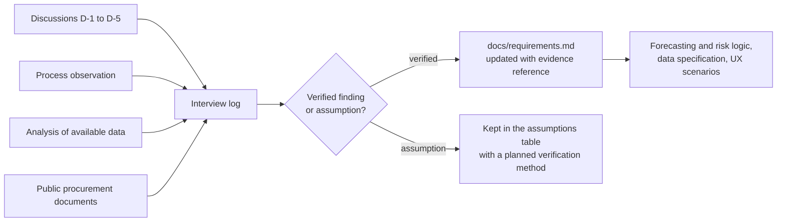

# Stakeholders and evidence plan

`PHA2-7` · Evidence of relevance · Last updated: 2026-10-15 · Author: Birkhanym Kazhymukhamet

This document is part of the "Evidence of relevance" component of the PharmaStock diploma project (Astana IT University, SE-2414, 2026–2027). It identifies who is affected by pharmaceutical stock management in a healthcare organization, what we need to learn from each stakeholder, and how we plan to collect that evidence. The companion documents are the [interview guide](./interview-guide.md) and the [interview log](./interview-log.md).

## 1. Purpose

The requirements in [docs/requirements.md](../requirements.md) were drafted from the problem statement in the [project proposal](../proposal.md) and from the team's own understanding of hospital pharmacy work. Until that understanding is checked with people who do the work, it is a set of assumptions. The purpose of the evidence-of-relevance activity is to:

1. confirm or correct the problem statement (late detection of shortages, intermittent consumption, long lead times, overstock and expiry);
2. learn which data exist, in what format and with what history, so that the data specification and the forecasting module are built for real inputs;
3. understand the decision rules pharmacists and procurement specialists apply today, so that the shortage-risk logic reflects practice;
4. check that the planned user roles, screens and notifications would actually be used;
5. keep an explicit separation between **verified findings** and **assumptions** in the [interview log](./interview-log.md), so that every requirement can be traced to its evidence.

The university requirement for this component is 3–5 discussions with user representatives (or a substantive agreement with an actual client). At least three discussions are needed for the component to meet the university requirement; individual findings are marked verified as described in section 6, and until the first discussion the log lists assumptions only.

## 2. Stakeholder map

The system has no patient users and processes no patient data (NFR-04). Stakeholders are therefore staff of a healthcare organization plus one external party that shapes the supply chain.

| # | Stakeholder | Relation to PharmaStock | Interest in the problem | Influence on requirements | Planned system role |
|---|-------------|------------------------|--------------------------|---------------------------|---------------------|
| S1 | Head of hospital pharmacy | Primary user, main decision maker on orders and stock policy | Avoid shortages and emergency purchases; reduce write-offs of expired stock; justify orders to management | High | `pharmacist` (full access to data, forecasts, risk list, thresholds) |
| S2 | Pharmacist (pharmacy staff) | Primary user for daily operations | Less manual work in accounting and stock checks; early warning for items that are running out | High | `pharmacist` |
| S3 | Procurement and supply specialist | Secondary user | Plan orders within the procurement cycle; know which items are at risk before the ordering deadline; track planned deliveries | High | `pharmacist` (mapping in docs/requirements.md; to be confirmed in D-3) |
| S4 | Head of clinical department | Consumer of information, view only | Know whether the medicines the department prescribes will be available; request substitutions in time | Medium | `viewer` |
| S5 | IT administrator of the organization | Operator of the system | Simple deployment, controlled access, data export from the existing accounting system, no new security exposure | Medium | `administrator` |
| S6 | SK-Pharmacy (single distributor for the guaranteed volume of free medical care) | External party, **not a user** | Not a stakeholder of the tool itself; its procurement calendar and delivery practice define lead times and the ordering cycle that the risk calculation must respect | Medium (constraints) | none |

Out of scope as stakeholders: patients, prescribing physicians as individual users, national information systems (future integration only), the university supervisor and committee (project stakeholders, covered in [project management](../project-management/responsibilities.md)).

## 3. What we want to learn from each stakeholder

| Stakeholder | Questions we need answered | Requirements and decisions that depend on the answer |
|-------------|----------------------------|-------------------------------------------------------|
| S1 Head of pharmacy | How are order quantities decided today? Is there a notion of minimum / safety stock per item? How far ahead do decisions have to be made? How is a shortage noticed and what happens next? Which reports are produced for management? Would a ranked list of at-risk items with an expected stock-out date be used, and how often? | FR-06, FR-07, FR-08, FR-09, FR-11, FR-13; weekly step and 12-week horizon; risk-level definition |
| S2 Pharmacist | Where is stock recorded (accounting system, spreadsheets, paper)? How often are consumption and receipts entered? At what granularity (item, batch, pack, unit)? Are stock-out periods recorded explicitly? What does a typical week of stock work look like? | FR-01, FR-02, FR-03, FR-05, FR-17, FR-18; import formats in [data specification](../data/data-specification.md) |
| S3 Procurement specialist | How does the annual procurement through SK-Pharmacy work from the organization's side? What is the typical lead time for centralised supply and for own purchases? Are planned deliveries (dates and quantities) known in advance? How are partial or late deliveries handled? | FR-04, FR-10, FR-11; lead-time field in `item_supplier`; `planned_receipt` entity |
| S4 Head of clinical department | How do departments learn about shortages today? What information would they want to see, and how often? Would in-app notifications be read? | FR-09 (view), FR-12, `viewer` role |
| S5 IT administrator | Which accounting system is used and can it export CSV/XLSX per item and period? Where could the prototype run (local server, virtual machine)? Who manages user accounts? What are the constraints on HTTPS, backups and audit? | FR-14, FR-15, NFR-03, NFR-07; deployment in `docker-compose.yml` |
| S6 SK-Pharmacy (desk research, no interview planned) | Public procurement calendar, delivery schedule rules, how organizations submit needs and adjust them during the year | Lead-time defaults, risk-level thresholds, limitations section of the thesis |

## 4. Planned discussions

Discussions are planned by role, not by named person. Names and organizations will not be stored in the repository; the log records only the role, organization type and date. Participants will be approached through the team's university and personal contacts; an introduction to a partner healthcare organization through the supervisor's professional network will be requested at the next weekly meeting.

| ID | Role (stakeholder) | Organization type | Format | Target period | Lead from the team | Status |
|----|--------------------|-------------------|--------|---------------|--------------------|--------|
| D-1 | Head of hospital pharmacy (S1) | Multi-profile hospital | Semi-structured interview, 50–60 min | October 2026 | Birkhanym Kazhymukhamet | to be scheduled |
| D-2 | Pharmacist (S2) | Polyclinic or hospital pharmacy | Semi-structured interview, 40–45 min, with observation of the stock-recording workflow if permitted | October 2026 | Birkhanym Kazhymukhamet | to be scheduled |
| D-3 | Procurement and supply specialist (S3) | Hospital | Semi-structured interview, 35–45 min | October–November 2026 | Birkhanym Kazhymukhamet (with Evelina Penkova for data questions) | to be scheduled |
| D-4 | IT administrator (S5) | Same organization as D-1 or D-2 | Short interview, 20–30 min, focused on data export and deployment | November 2026 | Abzal Bakhytov | to be scheduled |
| D-5 | Head of clinical department (S4) | Hospital | Short interview, 20 min | November 2026 (optional, if D-1–D-4 are completed) | Birkhanym Kazhymukhamet | to be scheduled |

Each discussion follows the [interview guide](./interview-guide.md). Within two working days after each discussion the lead fills in the [interview log](./interview-log.md) and updates the "Verified findings vs assumptions" table; changes that affect requirements are proposed as a pull request on `docs/requirements.md` with a reference to the log entry.

## 5. Other sources of evidence

| Source | What it gives us | Status (2026-10-14) |
|--------|------------------|---------------------|
| Observation of the stock-recording process in a pharmacy | Actual steps, tools and time spent; what is recorded and what is not (for example stock-out periods) | Planned together with D-2, subject to the organization's permission |
| Analysis of real consumption, stock and receipt exports | Intermittency profile, history length, data quality issues, share of stock-out weeks, realistic lead times | Access to anonymised item-level data is being requested from a partner healthcare organization; this is tracked as a project risk in [risks.md](../project-management/risks.md). Until data are available, a documented synthetic dataset is used (see [interview-log.md, section "Analysis of available data"](./interview-log.md#4-analysis-of-available-data)) |
| Public documents on procurement of medicines within the guaranteed volume of free medical care in Kazakhstan | Procurement calendar, roles of the single distributor and of the organization, delivery rules | Desk research in progress; sources will be listed in the [literature review](../literature-review.md) |
| Published studies on intermittent demand forecasting in hospital pharmacies | Which methods and metrics are appropriate; typical data limitations | Covered by the [literature review](../literature-review.md) |

## 6. How evidence flows into the project

A finding is marked **verified** only when it was stated by at least one interviewed representative of the relevant role or observed directly in data or in the process. Everything else remains an **assumption**, even if it is widely reported in the literature.

## 7. Consent and data protection

- Participation is voluntary; participants may stop at any time and may decline any question.
- Before each discussion the interviewer reads the introduction from the [interview guide](./interview-guide.md), explains the purpose (a diploma project at Astana IT University), and asks for consent to take notes. Audio recording is used only with explicit consent and the recording is deleted after notes are written up.
- No personal data of participants is stored in the repository: the log contains the role, organization type and date only. No patient data is requested, viewed or stored at any stage (NFR-04).
- If an organization shares data exports, they must be anonymised to item level (medicine code, name, unit, period, quantity) and are stored outside the repository; only the derived synthetic dataset and aggregate statistics are committed.

## 8. Responsibilities and timeline

| Activity | Responsible | Deadline |
|----------|-------------|----------|
| Stakeholder map and discussion plan (this document) | Birkhanym Kazhymukhamet | 2026-10-14 (done) |
| Interview guide | Birkhanym Kazhymukhamet | 2026-10-14 (done) |
| Interview log template and assumptions list | Birkhanym Kazhymukhamet | 2026-10-14 (done) |
| Scheduling D-1 and D-2 | Birkhanym Kazhymukhamet | by 2026-10-24 |
| Request for anonymised data exports | Evelina Penkova | in progress (October 2026), answer pending |
| D-3, D-4, D-5 | as in section 4 | November 2026 |
| Update of requirements based on verified findings | whole team, review by Birkhanym Kazhymukhamet | after each discussion; consolidated before pre-defense 2 |

Related tasks: this document is produced under task PHA2-7 in [Linear project PharmaStock](https://linear.app/pharmacy-kz/project/pharmastock-03a3f33ce30b).
