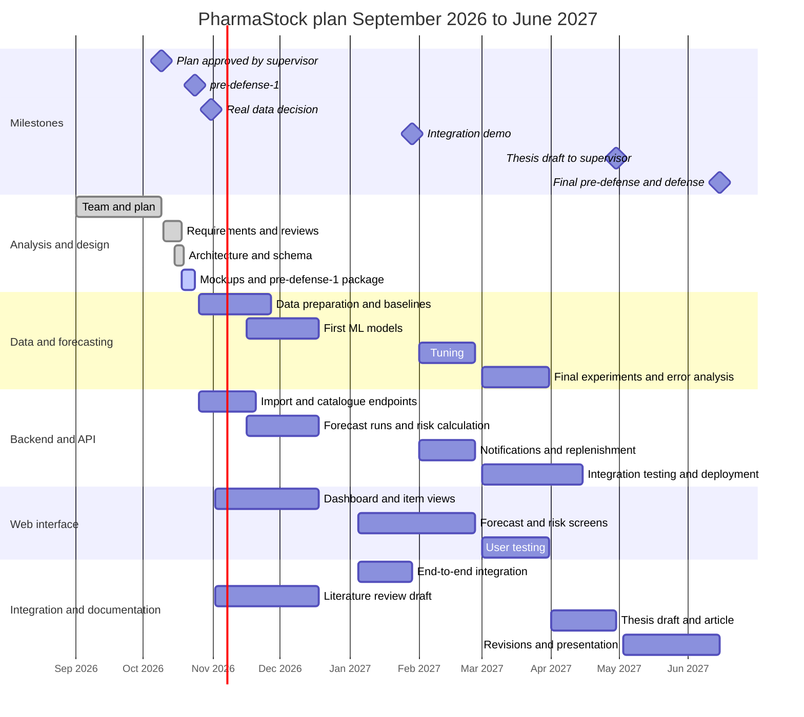

# PharmaStock — Plan and Milestones

_PHA2-20 · Last updated: 2026-10-20 · Author: Evelina Penkova · Reviewer: Birkhanym Kazhymukhamet_

This document is the working plan of the diploma project "Development of smart supply chain analytics system for forecasting pharmaceutical inventory and preventing medicine shortages in healthcare organizations" (short name: **PharmaStock**) for the academic year 2026–2027 (September 2026 – June 2027). It turns the monthly plan approved by the supervisor into a timeline, milestones with exit criteria, a supervision cadence and a definition of done that the team applies to every task.

Sources of the plan: the justification letter approved by the supervisor, Kuralay Makhmetova, on 9 October 2026 (team, roles, plan and evaluation methodology); [proposal.md](../proposal.md) (objectives, scope, success criteria, deliverables per pre-defense); [requirements.md](../requirements.md); [verification-and-evaluation-plan.md](../verification-and-evaluation-plan.md). Work is tracked as tasks in the [Linear project PharmaStock](https://linear.app/pharmacy-kz/project/pharmastock-03a3f33ce30b) and mirrored in [task-register.md](task-register.md). The split of responsibilities is in [responsibilities.md](responsibilities.md); the risk register and the dependencies between modules are in [risks.md](risks.md).

## 1. Key dates

| Date | Event | Evidence |
|---|---|---|
| 9 October 2026 | Supervisor approves the team, roles, plan and evaluation methodology (justification letter) | Basis of this plan; recorded in `docs/supervision/feedback-log.md` (PHA2-21) |
| 12 October 2026 | Repository created | PHA2-2 |
| 14 October 2026 | Structure, contribution rules and documentation index in place | PHA2-4 |
| 24 October 2026 | First pre-defense materials due | Git tag `pre-defense-1` on `main` |
| 31 October 2026 | Decision on access to real data from a partner healthcare organization | PHA2-26; outcome recorded in the feedback log and the risk register |
| January 2027 | End-to-end integration demo | Demo at a supervisor meeting; tag `pre-defense-2` once the School confirms the date |
| April 2027 | Thesis draft, technical documentation, article manuscript, deployed prototype | Draft handed to the supervisor |
| May – June 2027 | Final pre-defense and defense | Git tag `final-pre-defense`; presentation |

Only 9 October 2026 and 24 October 2026 are fixed dates. The dates of pre-defense 2, the final pre-defense and the defense are set by the School and will be added when they are announced; until then the plan uses the month as the deadline.

## 2. Timeline September 2026 – June 2027

| Period | Stage | Main activities | Deliverables in the repository | Lead |
|---|---|---|---|---|
| September 2026 | Start | Topic selection, team formation, agreement with the supervisor on roles, monthly plan and evaluation methodology; preparation of the justification letter | Justification letter (approved 9 October 2026) | Team |
| October 2026 | Analysis and design | Requirements and roles; literature review; review of existing systems; technology comparison; architecture; database schema; API contract; UI mockups; data specification and data availability check; repository, CI and scaffolds of backend, forecasting and frontend; experiment plan; pre-defense-1 package | `docs/proposal.md`, `docs/evidence-of-relevance/*`, `docs/literature-review.md`, `docs/existing-systems-comparison.md`, `docs/technology-comparison.md`, `docs/requirements.md`, `docs/architecture/*`, `docs/ux/*`, `docs/data/data-specification.md`, `docs/verification-and-evaluation-plan.md`, `docs/project-management/*`, `docs/supervision/feedback-log.md`, `prototype/`, `backend/`, `forecasting/`, `frontend/`, `.github/workflows/ci.yml` | All (see section 4) |
| November – December 2026 | Data and first implementation | Data preparation (synthetic dataset; real data if the access agreement is signed); baselines and first ML models compared on a hold-out period; import endpoint and validation; catalogue, history, forecast-run and risk endpoints; dashboard and item views; user interviews; literature review draft for the thesis | `forecasting/experiments/*` with saved configurations and results; `backend/app/api/routes/*`; `frontend/src/*`; `docs/evidence-of-relevance/interview-log.md`; thesis chapter draft (literature review) | Evelina (data, models), Abzal (API), Birkhanym (UI, interviews) |
| January 2027 | Integration | End-to-end flow on the synthetic dataset: import, forecast run, risk list, item page, notification, report export; integration demo to the supervisor; requirements and architecture updated from what was learned | Integration demo; `pre-defense-2` package | Abzal (integration), all |
| February 2027 | Improvement | Hyperparameter tuning; notifications and threshold configuration; replenishment calculations (safety stock, projected stock, expected stock-out date); component tests for backend, forecasting and frontend | Tuned models with saved results; notification and configuration features; test suites | Evelina (tuning), Abzal (notifications, replenishment), Birkhanym (frontend tests) |
| March 2027 | Evaluation | Final experiments on the hold-out period; model comparison against baselines (MAE, WAPE); error analysis per medicine group; precision and recall of shortage alerts; integration testing; user testing of key scenarios | Experiment reports and comparison tables; error analysis; integration test results; user testing findings | Evelina (experiments), Abzal (integration tests), Birkhanym (user testing) |
| April 2027 | Documentation | Thesis draft; technical documentation (setup, API, data, models); article manuscript; deployed prototype | Thesis draft; final versions of `docs/`; article manuscript; deployment | All, per chapter (see `responsibilities.md`) |
| May – June 2027 | Finalisation | Revisions after supervisor feedback; presentation; final pre-defense; defense | Tag `final-pre-defense`; presentation; final thesis | All |

### 2.1 Timeline chart

Dates in the chart are indicative: bars end on the last working week of the planned month, and the milestones after October 2026 will be moved to the dates announced by the School.

## 3. Milestones and exit criteria

| ID | Milestone | Deadline | Exit criteria | Evidence | Git tag |
|---|---|---|---|---|---|
| M1 | Pre-defense 1 package | 24 October 2026 | All documents listed for pre-defense 1 in `proposal.md` section 11 are merged into `main`; backend and forecasting test suites pass; prototype pages open; README describes setup and status; proposal and plan agree with the supervisor's letter | Task register: PHA2-2 to PHA2-24 Done; tag created | `pre-defense-1` |
| M2 | Real data decision | 31 October 2026 | Written answer from the partner organization recorded, or the synthetic-only path confirmed with the supervisor; conditions of use documented if data are granted | PHA2-26; feedback log entry; risk register updated | — |
| M3 | First model comparison | 27 November 2026 | Baselines and the first ML model evaluated on the hold-out period of the synthetic dataset with the experiment runner; MAE and WAPE per medicine group saved and reproducible | PHA2-24, PHA2-27; results under `forecasting/experiments/` | — |
| M4 | Main screens and API | 18 December 2026 | Import, items, history, forecast-run and risk endpoints implemented with tests; dashboard and item views read data from the backend; interviews held and logged; literature review draft written | PHA2-25, PHA2-28, PHA2-29 and follow-up tasks | — |
| M5 | Integration demo | January 2027 | Success criterion S-03 of the proposal runs end to end on the synthetic dataset without manual intervention; demo shown to the supervisor | Feedback log entry; `pre-defense-2` package | `pre-defense-2` (date set by the School) |
| M6 | Feature complete | 26 February 2027 | Notifications, threshold configuration and replenishment calculations implemented; component tests in place for all three parts; tuned model configurations saved | Task register; CI green on `main` | — |
| M7 | Evaluation complete | 31 March 2027 | Final experiments, comparison against baselines and error analysis per medicine group saved; alert precision and recall measured on the test period; integration tests pass; user testing findings documented | Experiment reports; `verification-and-evaluation-plan.md` results sections | — |
| M8 | Thesis draft | 30 April 2027 | Thesis draft, technical documentation and article manuscript handed to the supervisor; prototype deployed with Docker Compose on a Linux server | Supervisor confirmation in the feedback log | — |
| M9 | Final pre-defense and defense | May – June 2027 | Revisions made; presentation ready; final thesis submitted | Tag created; presentation | `final-pre-defense` |

Tags are created from `main` once the package has been checked by the whole team and are never moved (see `CONTRIBUTING.md` section 8).

## 4. Work breakdown per objective

The objectives are those of [proposal.md](../proposal.md) section 6.

| Objective | Work packages | Period | Lead | Milestone |
|---|---|---|---|---|
| (1) Analyse the domain, existing systems and literature | Stakeholders and interview guide; literature review; existing systems comparison; user interviews | October – November 2026 | Birkhanym (domain, systems, interviews), Evelina (literature) | M1, M4 |
| (2) Define requirements and architecture | Requirements with acceptance criteria; user scenarios and use cases; architecture and diagrams; database schema; API contract; technology comparison; UI mockups | October 2026, revised after interviews and the integration demo | Birkhanym (requirements, UX), Abzal (architecture, schema, API) | M1, M5 |
| (3) Prepare data and build forecasting models compared with baselines | Data specification; synthetic dataset; stock-out flagging; baselines and metrics; experiment runner; first ML model; tuning; final experiments | October 2026 – March 2027 | Evelina | M3, M6, M7 |
| (4) Implement backend, database, API and risk calculation | Backend scaffold; Docker Compose; CI; import and validation; catalogue and history; forecast runs; risk calculation; notifications; thresholds; access control and audit log; export | October 2026 – February 2027 | Abzal | M1, M4, M5, M6 |
| (5) Implement the web interface | Frontend scaffold; dashboard and item views; forecast, risk, import and settings screens; visualisation of forecasts and alerts | October 2026 – February 2027 | Birkhanym | M4, M5, M6 |
| (6) Evaluate the system on a hold-out period and with users | Model comparison; error analysis per group; alert precision and recall; integration testing; user testing | February – March 2027 | Evelina (models), Abzal (integration tests), Birkhanym (user testing) | M7 |
| (7) Document results and prepare a scientific article | Technical documentation; thesis chapters; article manuscript; presentation | April – June 2027 | All, per chapter | M8, M9 |

## 5. Supervision cadence and working agreements

- **Weekly supervisor meeting.** One meeting per week with the supervisor. Standing agenda: review of the task board by status (Done, In review, Planned), demo of finished work, decisions on open questions, risks, tasks for the next week. Birkhanym records feedback and decisions in `docs/supervision/feedback-log.md` (PHA2-21) in the same week; each point is mapped to a document or a task.
- **Preparation.** Before the meeting every member updates the status of their tasks in Linear and in `task-register.md` and prepares what they will show.
- **Team synchronisation.** The team keeps a short internal synchronisation at least twice a week (online or in person) to unblock work between modules. Decisions that affect shared vocabulary (requirement IDs, entity names, API paths, the forecasting interface) are written into the corresponding document in the same pull request.
- **Review checkpoints with the supervisor.** Requirements and architecture (October 2026); experiment plan (October 2026); real data decision (31 October 2026); first model comparison (November 2026); integration demo (January 2027); final experiments (March 2027); thesis draft (April 2027).
- **Pull requests.** Reviewed by another team member within two working days; `main` stays presentable at all times (see `CONTRIBUTING.md`).
- **Examination sessions.** During the examination sessions set by the University's academic calendar the team's capacity is reduced; no new deliverables are planned in those weeks beyond revisions and demos already listed, and tasks are sized to at most one week of work so that slippage is visible early.
- **Individual contribution** is tracked by tasks, commits under the author's own name and demos at the weekly meeting (see `responsibilities.md` section 7).

## 6. Definition of done

### 6.1 Task

A task is Done only when all of the following hold:

1. The task exists in Linear with an assignee, an estimate and a deadline, and the branch is named `PHA2-<n>-<slug>`.
2. The pull request is merged into `main` after approval by another team member (authors do not approve their own work); the owner of the affected area is the preferred reviewer.
3. CI is green: `pytest` for `backend/` and `forecasting/`, `npm run build` for `frontend/` where applicable (NFR-08).
4. Documentation affected by the change is updated in the same pull request (README files, `docs/`, API contract, diagrams).
5. No secrets, real datasets or personal data are included (`CONTRIBUTING.md` section 7).
6. The status is updated in Linear and in `task-register.md`.

Additional criteria by type of work:

| Type | Additional criteria |
|---|---|
| Document | Starts with its title and the line `_PHA2-<n> · Last updated: YYYY-MM-DD_`; uses requirement IDs, entity names and API paths verbatim; relative links resolve; tables for comparisons and requirement lists; planned content is marked "planned" and nothing is presented as done before it is |
| Diagram | Mermaid source in `docs/diagrams/src/*.mmd`, rendered copy in `docs/diagrams/export/*.svg`; renders on GitHub; names agree with the documents |
| Python code (`backend/`, `forecasting/`) | Tests in `tests/` pass locally and in CI; type hints on public functions; configuration read from environment variables; package README updated; malformed input rejected with a clear error (NFR-06) |
| Frontend | `npm run build` passes; screens mapped to requirement IDs; works in current Chrome, Firefox and Edge at 1280 px and wider (NFR-09) |
| UI mockup | Pages open from a clean clone; internal links work; every screen mapped to FR IDs in `prototype/README.md` |
| Experiment | Versioned configuration with a fixed seed; results saved per run; metrics reproducible from a clean checkout (NFR-05); data source (synthetic or real) stated with the results |

### 6.2 Milestone and submission

A milestone is reached when every task assigned to it is Done, the exit criteria in section 3 are checked by the team, the summary of completed work, known limitations and outstanding tasks is written, and, for a submission, the tag is created on `main` and the supervisor is informed.

## 7. Plan revision

The plan is reviewed at the weekly supervisor meeting. Changes to deadlines, scope or responsibilities are recorded in the feedback log, applied to this document and to `task-register.md` through a pull request under a DIP task, and reflected in the risk register when they change a risk. The monthly structure approved on 9 October 2026 is kept; only the content of the months and the task-level deadlines are adjusted.

## 8. Related documents

| Document | Purpose |
|---|---|
| [responsibilities.md](responsibilities.md) | Responsibilities per work area (RACI), repository ownership, review rules |
| [task-register.md](task-register.md) | Mirror of the [Linear project PharmaStock](https://linear.app/pharmacy-kz/project/pharmastock-03a3f33ce30b) with statuses, deadlines and branches |
| [risks.md](risks.md) | Risk register with owners and triggers; dependencies between modules and supervisor checkpoints |
| [../proposal.md](../proposal.md) | Objectives, scope, success criteria, deliverables per pre-defense |
| [../verification-and-evaluation-plan.md](../verification-and-evaluation-plan.md) | Metrics, baselines, split, testing and user evaluation |
| [../supervision/feedback-log.md](../supervision/feedback-log.md) | Supervisor meetings, feedback and decisions |
| [../../CONTRIBUTING.md](../../CONTRIBUTING.md) | Branching, commits, pull requests, tags |
