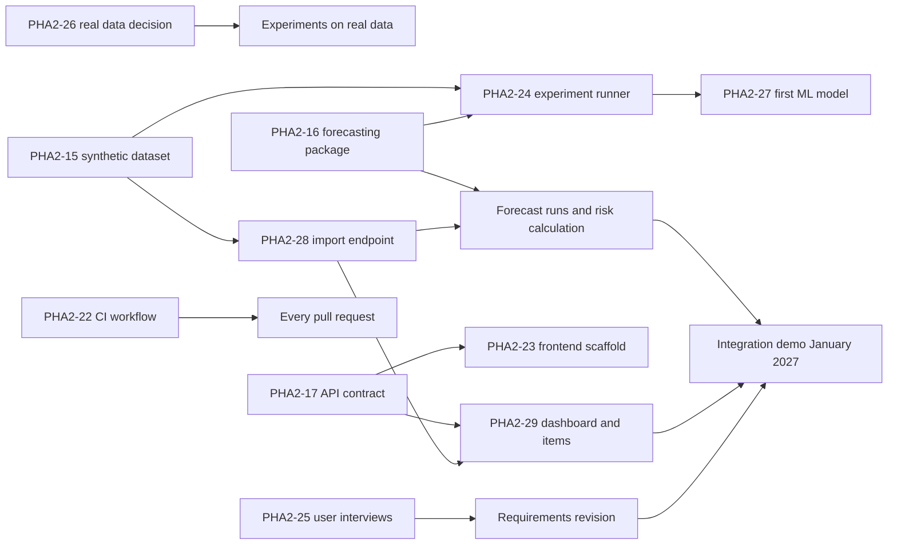

# PharmaStock — Risk Register and Dependencies

_PHA2-20 · Last updated: 2026-10-23 · Author: Birkhanym Kazhymukhamet · Reviewer: Evelina Penkova_

This document lists the risks of the diploma project PharmaStock (academic year 2026–2027), how the team reduces them, who watches each one and what event means that the risk is materialising. It also records the dependencies between the work of the three team members and the supervisor review checkpoints, because most schedule risks come from one module waiting for another. The register is reviewed at the weekly supervisor meeting together with [plan-and-milestones.md](plan-and-milestones.md) and [task-register.md](task-register.md); the constraints and assumptions it builds on are in [proposal.md](../proposal.md) section 8.2.

## 1. Scales

| Scale | Low | Medium | High |
|---|---|---|---|
| Probability | Unlikely in this academic year | Could happen; has happened in comparable student projects | Expected unless prevented; already partly observed |
| Impact | Minor rework inside the month; no milestone moves | A milestone of [plan-and-milestones.md](plan-and-milestones.md) moves within the month, or a Should requirement is dropped | A Must requirement, a pre-defense package or the evaluation on a hold-out period is at risk |

Exposure is read from the two scales together: a risk with High probability or High impact is reviewed every week; the others are reviewed when their trigger is observed or at least once a month.

## 2. Risk register

| ID | Risk | Probability | Impact | Mitigation | Owner | Trigger |
|---|---|---|---|---|---|---|
| R-01 | No access to real data from a partner healthcare organization (constraint C-01) | High | High | Development and the first experiments run on the documented synthetic dataset (PHA2-15), which reproduces intermittent demand, stock-outs, lead times, outlier spikes and censored demand; the request for anonymised, aggregated per-item weekly history is sent through the supervisor with a decision date of 31 October 2026 (PHA2-26); the evaluation design does not depend on the data source, so saved experiment configurations can be re-run if real data arrive later; every result states whether it was obtained on synthetic or real data | Evelina | No written answer by 31 October 2026; the conditions of use exclude the export of history; the partner can provide less than two years of history |
| R-02 | Data quality and gaps in exports: missing periods, duplicate periods, negative quantities, unknown items, inconsistent units | Medium | Medium | Validation rules with clear error reporting (FR-02, NFR-06) and a data-quality summary per import (FR-18) are implemented early (PHA2-28); the synthetic generator produces outlier spikes and stock-out periods on purpose so that their handling is tested before real data arrive; gap handling is specified in `docs/data/data-specification.md` and malformed input is covered by the validation tests of PHA2-16; the data preparation steps are documented in the same specification and applied by a reproducible script | Evelina (preparation), Abzal (validation) | More than 5 percent of rows of a real export fail validation; coverage shorter than two years for most items; units differ between periods for the same item |
| R-03 | Intermittent demand is too noisy for useful forecasts: ML models do not beat the baselines or forecasts are too uncertain for decisions | Medium | High | Baselines designed for intermittent demand (Croston, SBA) are compared with naive, seasonal-naive, moving-average and the ML models on the same rolling-origin split; results are reported per medicine group so that the model can be chosen per group; WAPE is computed only where total actual consumption is greater than zero; the shortage-risk logic uses the forecast interval and the safety stock, not only the point forecast; a negative result is reported honestly as a finding and the system then serves the best baseline per group | Evelina | On the first comparison (PHA2-27) the ML model is not better than the best baseline for the majority of medicine groups; the forecast interval covers the whole range of historical consumption |
| R-04 | Scope creep: features requested during interviews, reviews or pre-defenses that are outside the proposal | Medium | Medium | Scope in and out of scope is fixed in `proposal.md` section 8 and the requirements carry MoSCoW priorities; Could requirements are implemented only if time allows; every new request becomes a Linear issue that is accepted or declined at the weekly meeting; declined items are kept in a future-work list for the thesis | Birkhanym | A request that cannot be mapped to FR-01 to FR-18 appears; the number of tasks planned for a month exceeds the plan by more than a quarter |
| R-05 | Team member overload and examination periods: three students with coursework and examinations, reduced capacity in December–January and May–June | High | Medium | The monthly plan puts no new deliverables into examination weeks beyond revisions and demos; tasks are sized to at most one week so that slippage is visible at the next meeting; each repository area has a default reviewer who can take over urgent fixes (`responsibilities.md` section 4); the thesis draft is due in April to leave a buffer before the defense | Evelina (plan owner) | A task slips by more than one week; a member misses two consecutive weekly meetings; a pull request waits for review longer than two working days |
| R-06 | Integration delays between modules: the backend, the forecasting module and the web interface are developed in parallel and may not fit together | Medium | High | The API contract (PHA2-17) and the forecasting interface `forecast_items(history, horizon, config)` (PHA2-16) were fixed in October; the frontend can start against the contract with placeholder responses; the integration demo in January 2027 is a hard checkpoint; CI runs both Python test suites on every pull request; contract changes need the approval of the provider and a consumer (`responsibilities.md` section 6) | Abzal | A change to the API contract after November 2026; the frontend or the risk calculation is blocked for more than a week waiting for an endpoint or a payload |
| R-07 | Misinterpretation of zero demand versus stock-out: zero consumption during a stock-out is learned as zero demand, which biases forecasts downwards and hides the shortages the system should prevent | Medium | High | Stock-out periods are flagged from stock snapshots (FR-17) and treated as censored demand: excluded from training or treated as missing; the synthetic dataset contains stock-out periods so the handling is tested from the start; forecast quality is reported separately for items affected by stock-outs; the data-quality summary shows the share of flagged periods per item | Evelina | Stock snapshots are missing for an item or a period; an item's forecast drops after a stock-out; the share of flagged periods exceeds a quarter of an item's history |
| R-08 | Infrastructure and deployment issues: Docker Compose, PostgreSQL, CI or the target server do not work as expected | Low | Medium | Docker Compose, `.env.example` and the database session are in place from the scaffold (PHA2-3); CI is added before the first feature work (PHA2-22); the prototype is deployed for the January demo rather than in April, so problems appear early; setup is documented and checked on a clean clone (PHA2-1) | Abzal | CI is red on `main` for more than two days; the demo cannot be started from a clean clone with the documented commands |
| R-09 | Availability of users for interviews and testing: pharmacy and procurement staff have little time | Medium | Medium | The interview guide is ready (PHA2-7) and sessions are short, with a remote option; interviews are scheduled through the supervisor and the team's own contacts (PHA2-25); user testing is planned for March 2027 with the scenarios prepared in advance; fallback is an expert review of the mockups and the prototype with the supervisor and a documented limitation in the thesis | Birkhanym | No interview scheduled by 31 October 2026 for PHA2-25 (due 7 November); fewer than three participants confirmed for user testing by the end of February 2027 |
| R-10 | Regulatory and data-protection constraints: personal data, confidentiality of consumption and procurement data | Low | High | No patient personal data is stored or processed (NFR-04): only aggregated per-item, per-week quantities are imported, and files with person-level columns will be rejected by the import validation (PHA2-28); data received from a partner stays outside Git under its conditions of use (`CONTRIBUTING.md` section 7); item names can be replaced by codes if the partner requires it; access control, hashed passwords and an audit log are Must requirements (FR-14, FR-15, NFR-03) | Abzal | The partner asks for a confidentiality agreement or refuses export; a file with person-level columns appears in an import; a reviewer finds data or credentials in a pull request |

## 3. Status of the main risks (2026-10-20)

| ID | Status | Note |
|---|---|---|
| R-01 | Open, being handled | The request is in progress (PHA2-26, due 31 October 2026); the synthetic dataset and its generator are merged (PHA2-15) |
| R-03 | Open, not yet observable | Baselines and metrics are merged (PHA2-16); the first comparison is planned for November (PHA2-27) |
| R-05 | Open, monitored | Pre-defense 1 tasks are on schedule as of the task register; the examination session dates will be added to the plan when the academic calendar is confirmed |
| R-06 | Reduced | API contract (PHA2-17) and forecasting interface (PHA2-16) merged; frontend scaffold (PHA2-23) and CI (PHA2-22) merged |
| R-07 | Reduced | Stock-out flagging is part of the data specification and the synthetic dataset (PHA2-15) and of the validation module (PHA2-16) |
| R-08 | Reduced | Backend scaffold with Docker Compose merged (PHA2-3); CI workflow merged and green on `main` (PHA2-22) |
| R-02, R-04, R-09, R-10 | Open, monitored | No trigger observed so far |

## 4. Dependencies

### 4.1 Dependency table

| ID | Dependency | Provider (task) | Consumer (task) | Needed by | If late |
|---|---|---|---|---|---|
| D-01 | Data access decision before experiments on real data | Evelina with the supervisor (PHA2-26) | All real-data experiments and the data preparation step (PHA2-27 and later) | 31 October 2026 | Experiments continue on the synthetic dataset; results are labelled as synthetic; real data, if they arrive later, are evaluated with the saved configurations |
| D-02 | API contract before the frontend | Abzal with Evelina (PHA2-17) | Frontend scaffold and views (PHA2-23, PHA2-29), API client | 20 October 2026 (done) | Frontend works against placeholder responses; contract changes are versioned and announced at the weekly meeting |
| D-03 | Forecasting interface before the risk calculation | Evelina (PHA2-16: `forecast_items`, `ForecastResult`) | Integration of the module into the backend, forecast runs and the shortage-risk calculation (Abzal, November–December 2026) | November 2026 | The backend uses a baseline forecast through the same interface until the ML model is ready; the interface itself does not change |
| D-04 | Synthetic dataset before any work that needs data | Evelina (PHA2-15) | Import endpoint tests (PHA2-28), experiments (PHA2-24, PHA2-27), views on real-looking data (PHA2-29) | 18 October 2026 (done) | — |
| D-05 | Import endpoint before forecast runs and views with data | Abzal (PHA2-28) | Forecast runs, risk list, dashboard and item views (PHA2-29) | 20 November 2026 | The frontend reads the sample dataset loaded by a seed script until the import works |
| D-06 | CI before the merge policy can be enforced | Abzal (PHA2-22) | Every pull request (NFR-08) | 23 October 2026 | Reviewers run the test suites locally and state it in the pull request |
| D-07 | Interviews before the requirements revision | Birkhanym (PHA2-25) | Revision of `requirements.md`, use cases and mockups | 7 November 2026 | Requirements stay at the October version with assumptions A-01 to A-03 marked unverified; revision moves to after the integration demo |
| D-08 | Supervisor review checkpoints | Supervisor | Requirements and architecture (October 2026); experiment plan (October 2026); real data decision (31 October 2026); first model comparison (November 2026); integration demo (January 2027); final experiments (March 2027); thesis draft (April 2027) | Per checkpoint | The team proceeds with the current version and records the open points in the feedback log for the next meeting |

### 4.2 Dependency diagram

## 5. Monitoring

- Each risk has one owner who reports its status at the weekly supervisor meeting when a trigger has been observed, and at least once a month otherwise.
- A new risk is added through a DIP task that changes this file; the task description names the risk, the owner and the trigger.
- When a risk materialises, the response is recorded in `docs/supervision/feedback-log.md` and the affected deadlines are changed in Linear and in `task-register.md`.
- Closed risks stay in the register with their status so that the thesis can report how they were handled.
