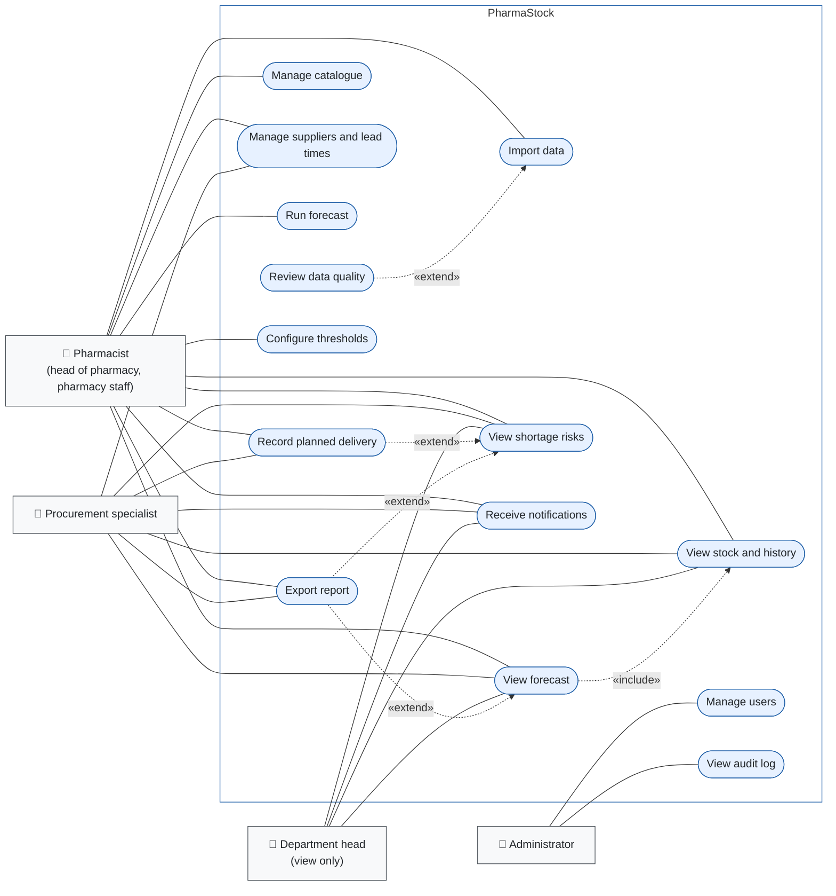

# Use cases

_PHA2-13 · Last updated: 2026-10-18 · Author: Birkhanym Kazhymukhamet_

This document lists the use cases of **PharmaStock**, shows them in a use case diagram and specifies the four use cases that carry the main value of the system in detail. The use cases are derived from the narrative [user scenarios](./user-scenarios.md) and mapped to the functional requirements `FR-01`...`FR-18` in [requirements.md](../requirements.md). Like the scenarios, they describe the team's current understanding of pharmacy work and will be revised after the discussions D-1 to D-5 recorded in the [interview log](../evidence-of-relevance/interview-log.md).

## 1. Purpose and conventions

- A **use case** is a goal that an actor achieves with the system in one session. Use cases are numbered `UC-01`...`UC-14`; the numbers are stable identifiers and are referenced from the requirements, the API contract and the test plan.
- An **actor** is a role, not a person. Actors correspond to the stakeholders `S1`...`S5` in [stakeholders.md](../evidence-of-relevance/stakeholders.md) and to the system roles `pharmacist`, `viewer` and `administrator` of `FR-14`.
- **«include»** means that the base use case always performs the included one; **«extend»** means that the extending use case optionally adds behaviour to the base one at a defined point.
- Authentication (`POST /api/v1/auth/login`, `FR-14`) is a precondition of every use case and is not drawn as a separate use case. Every use case that changes data writes an entry to the audit log (`FR-15`); this is stated in the postconditions rather than drawn as an include relationship, to keep the diagram readable.
- Entity names (`import_batch`, `forecast_run`, `risk_assessment`, `planned_receipt`, ...) and API paths are those of the [architecture](../architecture/architecture.md), the [API contract](../architecture/api-contract.md) and the [database schema](../architecture/database-schema.md).

## 2. Actors

| Actor | Stakeholders | System role | Description |
|---|---|---|---|
| Pharmacist | S1 Head of hospital pharmacy, S2 Pharmacist | `pharmacist` | Owns the data and the forecasting process: imports exports, maintains the catalogue, runs forecasts, reviews risks, configures thresholds, exports reports |
| Procurement specialist | S3 Procurement and supply specialist | `pharmacist` (a narrower role is an open question, see section 8) | Uses the risk list and the item pages (stock, history, forecast) to prepare requests, maintains suppliers and lead times, records planned deliveries |
| Department head | S4 Head of clinical department | `viewer` | Reads stock, forecasts, risks and notifications for the medicines the department uses; cannot change anything |
| Administrator | S5 IT administrator of the organization | `administrator` | Manages users and roles and reviews the audit log; does not work with pharmacy data |

## 3. Use case diagram

Source: [`docs/diagrams/src/use-case-diagram.mmd`](../diagrams/src/use-case-diagram.mmd). Rendered copy: [`docs/diagrams/export/use-case-diagram.svg`](../diagrams/export/use-case-diagram.svg). The diagram uses the Mermaid flowchart notation: actors are rectangles with a person icon, use cases are stadium-shaped nodes inside the system boundary, solid lines are associations, dotted arrows are «include» and «extend» relationships.

## 4. Use case list

| ID | Use case | Actors | Requirements | Brief description |
|---|---|---|---|---|
| UC-01 | Import data | Pharmacist | FR-01, FR-02, FR-03, FR-15, FR-17, FR-18 | Upload a consumption, stock, receipts or planned-receipts file (CSV/XLSX), validate it, and save it as an `import_batch` with its records |
| UC-02 | Review data quality | Pharmacist | FR-17, FR-18 | After an import, inspect coverage per item, gaps, outliers and the weeks flagged as stock-out |
| UC-03 | Manage catalogue | Pharmacist | FR-03 | Create and edit `medicine_item` records: code, name, unit, group, active flag; deactivate items no longer used |
| UC-04 | Manage suppliers and lead times | Pharmacist, Procurement specialist | FR-04 | Maintain `supplier` records and `item_supplier` links with `lead_time_days` and the primary supplier per item |
| UC-05 | View stock and history | Pharmacist, Procurement specialist, Department head | FR-05, FR-17 | Table and chart of weekly consumption and stock level per item, with stock-out weeks marked |
| UC-06 | Run forecast | Pharmacist | FR-06, FR-07, FR-08, FR-12, FR-15, FR-17; NFR-01, NFR-05, NFR-06 | Start a `forecast_run` for all or selected items and a horizon; forecasts, risk assessments and notifications are produced when the run completes |
| UC-07 | View forecast | Pharmacist, Procurement specialist, Department head | FR-07, FR-16 | History, point forecast, interval, projected stock, model name and hold-out MAE/WAPE per item |
| UC-08 | View shortage risks | Pharmacist, Procurement specialist, Department head | FR-08, FR-09, FR-14 | Prioritised list of items at risk with risk level and expected stock-out date; filters by level and group |
| UC-09 | Record planned delivery | Pharmacist, Procurement specialist | FR-04, FR-08, FR-09, FR-10, FR-15 | Enter an expected receipt (`planned_receipt`); projected stock and risk of the item are recalculated |
| UC-10 | Configure thresholds | Pharmacist (head of pharmacy) | FR-11, FR-15 | Set safety-stock rule, default lead time, horizon and notification level (`threshold_config`); risks are recalculated |
| UC-11 | Receive notifications | Pharmacist, Procurement specialist, Department head | FR-12 | See in-app notifications created for high-risk items and mark them as read |
| UC-12 | Export report | Pharmacist, Procurement specialist | FR-13 | Download the risk list or a forecast report as CSV/XLSX |
| UC-13 | Manage users | Administrator | FR-14, FR-15; NFR-03 | Create, edit and deactivate `app_user` records and assign roles |
| UC-14 | View audit log | Administrator | FR-15 | Browse and filter `audit_log` entries by user, action, entity and date |

## 5. Relationships between use cases

| Relationship | Meaning |
|---|---|
| UC-02 Review data quality «extend» UC-01 Import data | After a successful import the pharmacist may open the data-quality summary of the batch; the import is complete without it |
| UC-07 View forecast «include» UC-05 View stock and history | The forecast page always shows the consumption and stock history that the forecast is based on (`FR-07`) |
| UC-09 Record planned delivery «extend» UC-08 View shortage risks | From an item in the risk list the user may record a planned delivery for it; the risk list can also be used without doing so |
| UC-12 Export report «extend» UC-08 View shortage risks | The currently filtered risk list may be exported |
| UC-12 Export report «extend» UC-07 View forecast | The forecast of an item (or of all items of a run) may be exported |

Dependencies that are not drawn: UC-06 Run forecast produces the data that UC-07, UC-08 and UC-11 display; UC-10 Configure thresholds changes the parameters used by UC-06 and UC-08; UC-13 Manage users determines who can perform which use case.

## 6. Detailed use case specifications

### UC-01 Import data

| Field | Content |
|---|---|
| Primary actor | Pharmacist (`pharmacist`) |
| Goal | Load one export file into PharmaStock so that its records are available for history, forecasting and risk calculation, with every error reported before anything is saved |
| Scenario | S-02 Importing the monthly export |
| Requirements | FR-01, FR-02, FR-03, FR-15, FR-17, FR-18; NFR-06 |
| API | `POST /api/v1/imports` (file upload; `validate_only=true` returns the validation report without storing anything, see note), `GET /api/v1/imports/{id}` |
| Entities | `import_batch`, `consumption_record`, `stock_snapshot`, `receipt`, `planned_receipt`, `medicine_item`, `audit_log` |

**Preconditions.** The user is authenticated with the role `pharmacist`. The file is a CSV (UTF-8, header row) or XLSX in one of the formats of the [data specification](../data/data-specification.md): `consumption.csv` (`item_code,item_name,unit,period_start,quantity`), `stock.csv` (`item_code,period_start,quantity_on_hand`), `receipts.csv` (`item_code,received_on,quantity,supplier`) or `planned_receipts.csv` (`item_code,expected_on,quantity,supplier`). `period_start` is the Monday of the week in ISO format.

**Trigger.** A new export from the accounting system is available.

**Main flow.**

1. The pharmacist opens the Imports page and chooses "New import".
2. The pharmacist selects the source type (consumption, stock, receipts, planned receipts) and the file.
3. PharmaStock reads the file and validates it without saving records (`FR-02`): required columns are present; dates are valid ISO dates and, for consumption and stock files, Mondays; quantities are numbers and not negative; every `item_code` exists in the catalogue; no item has two rows for the same period; for receipt files the supplier is known or can be created.
4. PharmaStock shows the validation report: rows read, rows accepted, warnings, and each rejected row with its line number and reason.
5. The pharmacist confirms the import.
6. PharmaStock creates the `import_batch` (`file_name`, `source_type`, `imported_at`, `user_id`, `status`), stores the records linked to the batch, and for stock files sets `is_stock_out` on every `stock_snapshot` whose `quantity_on_hand` is zero (`FR-17`).
7. PharmaStock computes the data-quality summary (coverage per item, gaps, outliers, stock-out weeks) and stores it in `summary_json` (`FR-18`); the batch status becomes `completed` and an `audit_log` entry with action `import.finish` is written (`FR-15`).
8. PharmaStock shows the batch page with the summary; the pharmacist may continue with UC-02 Review data quality.

**Alternative flows.**

- **A1 Missing columns or unreadable file (step 3).** The report names the missing columns or the parsing error; the batch is recorded with status `failed` and no records are saved. The pharmacist corrects the export and restarts at step 2.
- **A2 Unknown item codes in a consumption file (step 3).** The report lists the codes. The pharmacist chooses "create missing items": PharmaStock creates active `medicine_item` records from `item_code`, `item_name` and `unit` (`FR-03`, group left empty) and continues at step 5. Alternatively the pharmacist cancels and corrects the catalogue or the file.
- **A3 Unknown item codes in a stock, receipts or planned-receipts file (step 3).** These files carry no item name, so unknown codes are a blocking error: the batch is recorded with status `failed` as in A1.
- **A4 Negative quantities or duplicate periods (step 3).** Blocking errors; the batch is recorded with status `failed` as in A1. Partial acceptance of a file is deliberately not offered, so that a batch is either fully in the database or not at all.
- **A5 Periods already imported (step 3).** The file overlaps with an earlier batch for the same items and periods. The report shows the overlap; the pharmacist chooses between replacing the earlier records for those item-period pairs (the audit entry records both batch IDs) and cancelling.
- **A6 Warnings only (step 4).** Unusually large quantities or weeks without data are reported as warnings; they do not block the import and are repeated in the data-quality summary.

**Postconditions.** On success: the records of the file are stored and linked to a `completed` batch; stock-out weeks are flagged; the data-quality summary is available; an audit entry with action `import.finish` exists. On failure: no records are stored; the batch exists with status `failed` and the report in `summary_json`; an audit entry with action `import.fail` exists.

**Note on the API.** The two-step flow (report first, then confirmation) is implemented with the same endpoint: the first `POST /api/v1/imports` call is made with the form field `validate_only=true` and returns the report without storing a batch or any rows; the confirmation repeats the call with `validate_only=false` (the default). The parameter, the response and the error codes are defined in the [API contract](../architecture/api-contract.md), section 3.6; the format of the validation report is part of the data specification.

### UC-06 Run forecast

| Field | Content |
|---|---|
| Primary actor | Pharmacist (`pharmacist`) |
| Goal | Produce a weekly consumption forecast for the selected items over the configured horizon, and from it the shortage-risk assessment and notifications |
| Scenario | S-01 Weekly stock review (step 4), S-02 (step 8) |
| Requirements | FR-06, FR-07, FR-08, FR-12, FR-15, FR-17; NFR-01, NFR-05, NFR-06 |
| API | `POST /api/v1/forecast-runs`, `GET /api/v1/forecast-runs/{id}` |
| Entities | `forecast_run`, `forecast`, `risk_assessment`, `notification`, `threshold_config`, `audit_log` |
| Forecasting module | `forecasting.api.forecast_items(history, horizon, config) -> ForecastResult` |

**Preconditions.** The user is authenticated with the role `pharmacist`. The catalogue contains active items with imported consumption history; stock snapshots exist so that stock-out weeks are flagged. Thresholds (safety-stock rule, default lead time, horizon) are configured or have their defaults.

**Trigger.** A new import has been completed, or the pharmacist wants an up-to-date risk list.

**Main flow.**

1. The pharmacist opens the Forecast runs page and chooses "New run".
2. The pharmacist selects the scope (all active items, or a selection by group or by list), the horizon (default 12 weeks from `threshold_config`) and the model (default: the model currently configured as primary; the baselines `naive`, `seasonal_naive`, `moving_average`, `croston`, `sba` are available for comparison).
3. PharmaStock creates the `forecast_run` with `started_at`, `horizon_weeks`, `model_name`, `config_json` (model parameters, random seed, data cut-off date, so that the run is reproducible, `NFR-05`), status `queued` and `user_id`, writes an audit entry with action `forecast_run.create` and returns immediately (`POST /api/v1/forecast-runs` answers `202 Accepted`); the job runner picks the run up and sets its status to `running`.
4. PharmaStock prepares the history per item: weekly consumption with stock-out weeks marked as censored (`FR-17`), and calls `forecasting.api.forecast_items(history, horizon, config)` in a background task.
5. The forecasting module returns a `ForecastResult`; PharmaStock stores one `forecast` row per item and week (`period_start`, `point`, `lower`, `upper`).
6. PharmaStock calculates the risk per item (`FR-08`): projected stock for each week of the horizon as current stock plus planned receipts due by that week minus the cumulative forecast up to that week; the expected stock-out date is the first week in which the projected stock is at or below the safety stock; the risk level is High if that week lies within the item's lead time, Medium if within the horizon, Low otherwise. The result is stored as `risk_assessment` with `projected_stock_json` and `computed_at`.
7. PharmaStock creates a `notification` for every item whose risk level is listed in `threshold_config` (High by default) for each active user with the role `pharmacist` or `viewer` (`FR-12`).
8. PharmaStock sets the run status to `completed` with `finished_at` and writes an audit entry with action `forecast_run.finish`. The run page shows items forecast, items forecast with the fallback model and items without a risk level, with reasons, counts by risk level and the duration, and links to the risk list (UC-08).

**Alternative flows.**

- **A1 Items with insufficient history (step 4).** Items with fewer than `min_history_weeks` non-censored weeks (default 12, `FQ-04` in [requirements.md](../requirements.md)) are not skipped: they are forecast with the fallback baseline (`moving_average`, window 8), flagged `insufficient_history` and `fallback_used`, and listed in the run summary with the number of weeks available. Only items without a stock snapshot (`no_stock_data`) receive no risk level; they are listed in the run summary as well.
- **A2 The forecasting module rejects the input (step 4–5).** The module raises a validation error instead of producing a forecast (`NFR-06`). The run status becomes `failed` with the error message and an audit entry with action `forecast_run.fail` is written; no forecasts, risk assessments or notifications of this run are stored, and the previous completed run remains the current one.
- **A3 A run is already in progress (step 3).** A run with status `queued` or `running` exists; PharmaStock refuses to start a second run (`409 RUN_IN_PROGRESS`) and shows the running one.
- **A4 The pharmacist leaves the page (steps 4–8).** The run continues in the background; its status can be followed on the Forecast runs page (`GET /api/v1/forecast-runs/{id}`).
- **A5 The run exceeds the time budget (step 8).** The run is not interrupted; its duration is recorded in the summary and compared with `NFR-01` in the evaluation.

**Postconditions.** On success: a `completed` run with forecasts and risk assessments for every forecast item, notifications for high-risk items, audit entries with actions `forecast_run.create` and `forecast_run.finish`. On failure: a `failed` run with the error message, an audit entry with action `forecast_run.fail` and no stored forecasts; the risk list still refers to the previous completed run.

### UC-08 View shortage risks

| Field | Content |
|---|---|
| Primary actors | Pharmacist, Procurement specialist (`pharmacist`); Department head (`viewer`) |
| Goal | See which items are at risk of shortage, how severe the risk is and when the stock-out is expected, in order of priority |
| Scenario | S-01 Weekly stock review, S-03 Reacting to a high-risk alert, S-04 Planning a delivery |
| Requirements | FR-08, FR-09, FR-14; NFR-02 |
| API | `GET /api/v1/risks?level=high\|medium\|low` |
| Entities | `risk_assessment`, `forecast_run`, `medicine_item`, `stock_snapshot`, `planned_receipt`, `item_supplier` |

**Preconditions.** The user is authenticated. At least one forecast run has completed.

**Trigger.** The user opens the Risks page from the menu, the dashboard or a notification.

**Main flow.**

1. The user opens the Risks page.
2. PharmaStock shows the risk assessments of the latest completed forecast run as a table: item code and name, group, risk level, expected stock-out date, current stock (latest `stock_snapshot`), lead time in days (primary supplier), planned receipts within the horizon, forecast consumption over the lead time, and the date of the run. Rows are ordered by risk level (High, Medium, Low) and within a level by the earliest expected stock-out date.
3. The user filters the list by risk level (`level=high|medium|low`), by group or by text in the item name, and sorts by any column.
4. The user opens an item from the list; PharmaStock shows the item page with the projected stock chart, the forecast and the history (UC-05, UC-07).
5. Optionally the user records a planned delivery for the item (UC-09) or exports the list (UC-12).

**Alternative flows.**

- **A1 No completed forecast run (step 2).** PharmaStock shows an empty state; for the `pharmacist` role it offers to start a run (UC-06), for the `viewer` role it says that no forecast is available yet.
- **A2 The latest run is older than the latest import (step 2).** PharmaStock shows a warning with the dates of the run and of the import, so that the user knows the list does not reflect the newest data.
- **A3 Viewer role (steps 4–5).** The item page is shown read-only; recording a planned delivery and exporting are not offered (`FR-14`).
- **A4 Thresholds changed after the run (step 2).** Risk assessments are recalculated from the stored forecasts when thresholds change (UC-10); the list shows the `computed_at` time of the assessments.

**Postconditions.** None; the use case reads data only and writes no audit entry.

### UC-09 Record planned delivery

| Field | Content |
|---|---|
| Primary actors | Procurement specialist, Pharmacist (`pharmacist`) |
| Goal | Enter an expected receipt so that the projected stock and the risk of the item reflect it, and see whether the delivery closes the gap |
| Scenario | S-04 Planning a delivery |
| Requirements | FR-04, FR-08, FR-09, FR-10, FR-15 |
| API | `POST /api/v1/planned-receipts` (create), `PUT /api/v1/planned-receipts/{id}` (edit and status change), `GET /api/v1/planned-receipts` (list), listed as proposed additions in the [API contract](../architecture/api-contract.md), section 6; bulk entry through `POST /api/v1/imports` with a `planned_receipts.csv` file |
| Entities | `planned_receipt`, `supplier`, `item_supplier`, `risk_assessment`, `audit_log` |

**Preconditions.** The user is authenticated with the role `pharmacist`. The item exists and is active. The supplier exists, or the user has the right to create it (UC-04).

**Trigger.** A delivery date and quantity have been confirmed by the distributor or by a supplier.

**Main flow.**

1. The user opens the item page (from the risk list or the catalogue) and chooses "Add planned delivery"; alternatively the user opens the Planned deliveries page and chooses "New".
2. PharmaStock shows the form with the item, the expected date, the quantity and the supplier; the primary supplier of the item is preselected.
3. The user enters the date, the quantity and, if different, the supplier, and saves.
4. PharmaStock validates the entry: the item is active, the quantity is positive, the supplier exists; an expected date in the past produces a warning but is accepted (the delivery may have arrived and not yet been imported).
5. PharmaStock stores the `planned_receipt` with status `planned` and writes an audit entry with action `planned_receipt.create` (`FR-15`).
6. PharmaStock recalculates the projected stock and the risk of the item from the latest completed forecast run (`FR-08`), updates the `risk_assessment` (`projected_stock_json`, `risk_level`, `expected_stockout_date`, `computed_at`), and refreshes the item page and the risk list (`FR-09`).
7. If the item is still at High risk, PharmaStock shows the first week in which the projected stock falls to or below the safety stock before the delivery and the quantity missing until the delivery date.

**Alternative flows.**

- **A1 Validation fails (step 4).** PharmaStock shows the error next to the field; nothing is saved.
- **A2 The delivery date or quantity changes.** The user edits the planned receipt (`PUT /api/v1/planned-receipts/{id}`); steps 4–7 are repeated and an audit entry with action `planned_receipt.update` records the old and the new values.
- **A3 The delivery is cancelled.** The user sets the status to `cancelled` (audit action `planned_receipt.update`); the recalculation of step 6 no longer counts the receipt.
- **A4 The delivery arrives.** The receipt appears in the next receipts import (UC-01); the user sets the planned receipt to `received` so that it is no longer counted in projected stock. Automatic matching of planned receipts to imported receipts is planned for a later version.
- **A5 No completed forecast run (step 6).** The planned receipt is saved, but the risk cannot be recalculated; PharmaStock says so and the recalculation happens with the next run.
- **A6 Several deliveries are known at once.** The user imports a `planned_receipts.csv` file through UC-01; each row is validated as in step 4.

**Postconditions.** The planned receipt is stored with its status; the risk assessment of the item reflects it; an audit entry exists.

## 7. Traceability

| Requirement | Priority | Use cases |
|---|---|---|
| FR-01 Import consumption, stock and receipt data from CSV/XLSX files | Must | UC-01 |
| FR-02 Validate imported data and report errors: missing columns, negative quantities, unknown items, duplicate periods | Must | UC-01 |
| FR-03 Maintain the medicine catalogue: code, name, unit, group, active flag | Must | UC-01 (A2), UC-03 |
| FR-04 Maintain suppliers and lead times per item | Should | UC-04, UC-09 |
| FR-05 View current stock and consumption history per item as table and chart | Must | UC-05 |
| FR-06 Run a forecast for all or selected items for a configurable horizon | Must | UC-06 |
| FR-07 View the forecast per item together with history, point forecast, interval and model information | Must | UC-07 |
| FR-08 Calculate shortage risk per item from forecast, current stock, planned receipts and lead time | Must | UC-06, UC-08, UC-09, UC-10 |
| FR-09 Show a prioritised list of items at risk with risk level and expected stock-out date | Must | UC-08, UC-09 |
| FR-10 Record planned deliveries (expected receipts) | Should | UC-09 |
| FR-11 Configure risk thresholds and safety-stock parameters | Should | UC-10 |
| FR-12 Generate in-app notifications for high-risk items | Should | UC-06, UC-11 |
| FR-13 Export forecast and risk reports to CSV/XLSX | Should | UC-12 |
| FR-14 Authenticate users and manage roles: administrator, pharmacist, viewer | Must | all (precondition), UC-08 (A3), UC-13 |
| FR-15 Keep an audit log of imports, forecast runs and configuration changes | Should | UC-01, UC-06, UC-09, UC-10, UC-13, UC-14 |
| FR-16 Compare forecasting models against baselines on a hold-out period and show MAE and WAPE | Should | UC-07 (display); the comparison is run by the team, see the [verification and evaluation plan](../verification-and-evaluation-plan.md) |
| FR-17 Flag stock-out periods so that zero consumption during a stock-out is treated as censored demand | Must | UC-01, UC-02, UC-05, UC-06 |
| FR-18 Show a data-quality summary per import: coverage, gaps, outliers | Should | UC-01, UC-02 |

Every Must requirement is covered by at least one use case. The mapping of use cases to screens is continued in the mockups in `prototype/`; the mapping to tests is continued in the [verification and evaluation plan](../verification-and-evaluation-plan.md).

## 8. Open questions

| # | Question | Affects | How it will be resolved |
|---|---|---|---|
| 1 | Does the procurement specialist need a role narrower than `pharmacist` (for example access to planned deliveries and the risk list only)? | UC-04, UC-09, UC-13, FR-14 | Discussion D-3; decision recorded in `requirements.md` |
| 2 | Should `viewer` users receive notifications, and for which risk levels? | UC-06 (step 7), UC-11, FR-12 | Discussions D-1 and D-5 |
| 3 | Are planned delivery dates known in advance for the centralised supply, and how are partial deliveries handled? | UC-09, FR-10 | Discussion D-3 |
| 4 | Does the accounting system export per item and week or per transaction? | UC-01 (aggregation step), data specification | Discussions D-2 and D-4 |
| 5 | Resolved. Endpoints for single planned receipts, suppliers, users, the audit log and marking notifications as read were missing from the first v1 API draft | UC-04, UC-09, UC-11, UC-13, UC-14 | Listed as proposed additions in the [API contract](../architecture/api-contract.md), section 6: `GET/POST /api/v1/planned-receipts`, `PUT /api/v1/planned-receipts/{id}`, `GET/POST /api/v1/suppliers`, `PUT /api/v1/items/{id}/suppliers`, `GET/POST /api/v1/users`, `PUT /api/v1/users/{id}`, `GET /api/v1/audit-log`, `POST /api/v1/notifications/{id}/read`; each is moved into section 3 of the contract by its own task |

Related tasks: this document is produced under task PHA2-13 of the [Linear project PharmaStock](https://linear.app/pharmacy-kz/project/pharmastock-03a3f33ce30b).
