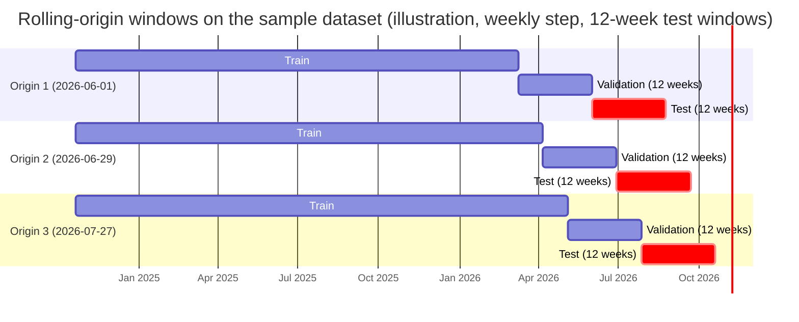

# PharmaStock — Verification and evaluation plan

Task: PHA2-19 · Last updated: 2026-10-20 · Status: draft v0.2.2 (all sections drafted; numeric targets to be confirmed after EXP-01 and the user-testing pilot) · Authors: Evelina Penkova (editor, forecasting evaluation), Abzal Bakhytov (backend and integration testing, section 5), Birkhanym Kazhymukhamet (user testing, section 6)

---

## 1. Purpose and scope

This document defines how the team verifies that PharmaStock meets its requirements and how it evaluates the quality of the forecasting module and the shortage alerts. It is the plan behind success criteria S-01 to S-06 of `docs/proposal.md` and the verification methods fixed in section 7 of `docs/requirements.md`.

The plan covers three areas with one owner each:

| Area | Owner | Section | What is verified or evaluated |
|---|---|---|---|
| Forecasting evaluation | Evelina Penkova | 4 | Forecast accuracy of baselines and candidate models on hold-out windows (FR-16, FR-17, NFR-05, NFR-06), quality of shortage alerts derived from the forecasts (FR-08, FQ-15), run time (NFR-01) |
| Backend and integration testing | Abzal Bakhytov | 5 | Unit, API, database and integration tests of the backend, CI gating (NFR-08), performance (NFR-01, NFR-02), security and data-protection checks (NFR-03, NFR-04), traceability of every requirement to a test |
| User testing and UX evaluation | Birkhanym Kazhymukhamet | 6 | Scenario-based usability sessions with pharmacy staff, acceptance of the main screens (FR-05, FR-07, FR-09), browser compatibility (NFR-09) |

Everything in this document is a plan. Results are not reported here; they are written to the locations named in each section (experiment reports, test runs in CI, the user-testing report) and summarised in the thesis. Where an activity has not started, the status says "planned".

The methodology (time-based hold-out evaluation against baselines with MAE and WAPE, alert precision and recall, user testing) is the one approved by the supervisor in the justification letter of 9 October 2026. Numeric targets are stated in sections 4.8 and 6.6 as working targets to be confirmed after the first baseline run and the user-testing pilot, so that the evaluation is not tuned to a desired result.

## 2. Conventions and related documents

### 2.1 Verification methods

The method codes are the ones of `docs/requirements.md`, section 7, and are used in every table of this plan.

| Code | Method | Where the evidence lives |
|---|---|---|
| T | Automated test (pytest in `backend/tests/` and `forecasting/tests/`, Vitest in `frontend/`: unit tests of the Vite scaffold in review (PHA2-23), component tests of the main screens later), run in CI on every pull request (NFR-08) | Test files named after the scenario IDs of the requirements (for example `test_fr08_s1_high_risk`); CI run on the pull request |
| D | Demonstration to the supervisor following a scripted scenario | Demo script in this plan or in `docs/supervision/feedback-log.md`; feedback recorded there |
| I | Inspection or review of code, configuration or documents | Pull request review; checklist in this plan |
| E | Experiment on hold-out data with saved results | `forecasting/experiments/` (configurations, results, reports) |
| U | User testing with pharmacy staff | `docs/ux/user-testing-report.md` (planned) |
| M | Measurement of time or resource usage on the synthetic dataset | Performance reports in `forecasting/experiments/reports/` |

### 2.2 Identifiers used in this plan

| Prefix | Meaning | Defined in |
|---|---|---|
| FR-xx, NFR-xx | Functional and non-functional requirements | `docs/requirements.md`, sections 3 and 4 |
| FQ-xx | Forecasting requirements | `docs/requirements.md`, section 5.6 |
| FR-xx-Sn, NFR-xx-Sn | Acceptance scenarios (Given / When / Then) | `docs/requirements.md`, section 6 |
| S-01 … S-06 | User scenarios | `docs/ux/user-scenarios.md` |
| UC-01 … UC-14 | Use cases | `docs/ux/use-cases.md` |
| E-xx | Evaluation targets of this plan | Section 4.8 |
| EXP-nn, PERF-nn | Forecasting experiments and performance measurements | Sections 4.9 and 5.6 |
| IT-nn | Steps of the integration scenario | Section 5.3 |
| UT-nn, P-n | User-testing tasks and participants | Sections 6.3 and 6.4 |

### 2.3 Related documents

| Document | Path | Relation to this plan |
|---|---|---|
| Proposal | `docs/proposal.md` | Success criteria S-01 … S-06 that this plan operationalises |
| Requirements | `docs/requirements.md` | Requirement IDs, forecasting requirements FQ-01 … FQ-15, acceptance scenarios, traceability table (section 7) |
| Architecture | `docs/architecture/architecture.md` | Component boundaries that define the test levels; risk-calculation formulas (section 5.2); authentication design (section 8.1) |
| API contract | `docs/architecture/api-contract.md` | Endpoints exercised by API and integration tests |
| Database schema | `docs/architecture/database-schema.md` | Tables used by database tests |
| Data specification | `docs/data/data-specification.md` | Import formats and the synthetic dataset used as test data |
| User scenarios and use cases | `docs/ux/user-scenarios.md`, `docs/ux/use-cases.md` | Tasks of the user-testing sessions |
| Evidence of relevance | `docs/evidence-of-relevance/interview-guide.md`, `interview-log.md`, `stakeholders.md` | Consent rules and the contacts through which user-testing participants are recruited |
| Plan and milestones | `docs/project-management/plan-and-milestones.md` | Dates of the activities in section 7 |
| Contributing guide | `CONTRIBUTING.md` | Pull request rules that CI gating enforces |
| Backend | `backend/README.md` | Setup used by the test environment; status of the backend |
| Forecasting module | `forecasting/README.md` | Module description; the mapping FQ → test file and the experiment command are maintained there |

Tasks are tracked in the [Linear project PharmaStock](https://linear.app/pharmacy-kz/project/pharmastock-03a3f33ce30b); every activity below is or will be a DIP task.

## 3. Overview of activities

| ID | Activity | Method | Owner | Planned period | Status (2026-10-20) |
|---|---|---|---|---|---|
| A-1 | Forecasting unit tests (schema, validation, baselines, metrics, split, censoring, reproducibility) | T | Evelina | Oct 2026 → ongoing | in progress: validation, baselines, metrics, split and API tests done (PHA2-16); schema, censoring, alert and reproducibility tests planned (section 4.12) |
| A-2 | EXP-01: baselines on the synthetic development dataset; first alert evaluation; confirmation of the working targets | E | Evelina | Nov 2026 | planned |
| A-3 | EXP-02: candidate models (statsforecast, LightGBM) against baselines; censoring experiment (open question Q8) | E | Evelina | Dec 2026 | planned |
| A-4 | Backend unit, API and database tests | T | Abzal | Nov 2026 → ongoing | in progress: scaffold tests exist (section 5.2) |
| A-5 | CI workflow gating pull requests | I | Abzal | Oct 2026 → ongoing | in review (PHA2-22, section 5.4) |
| A-6 | Integration scenario import → forecast run → risks, used as the January 2027 demo | T, D | Abzal, Evelina | Jan 2027 | planned (section 5.3) |
| A-7 | Performance measurement NFR-01 (forecast run) and NFR-02 (page response) | M | Abzal, Evelina | Feb 2027 | planned (section 5.6) |
| A-8 | Security and data-protection review NFR-03, NFR-04 | I, T | Abzal | Feb 2027 | planned (section 5.7) |
| A-9 | EXP-03 … : tuning, final experiments on the final hold-out, error analysis | E | Evelina | Feb–Mar 2027 | planned |
| A-10 | User testing with pharmacy staff | U | Birkhanym | Pilot Jan 2027; sessions Feb–Mar 2027 | planned (section 6) |
| A-11 | Browser compatibility check NFR-09 | D | Birkhanym | Feb–Mar 2027, during the sessions | planned (section 6.7) |
| A-12 | Deployment walkthrough NFR-07 on a clean Linux machine | D, I | Abzal | Mar–Apr 2027 | planned (section 5.9) |
| A-13 | Independent re-run of the final experiment by another team member (NFR-05) | E | Abzal or Birkhanym | Apr 2027 | planned |
| A-14 | Mockup walkthrough with prospective participants | D | Birkhanym | Nov 2026 | planned (section 6.2) |

## 4. Forecasting evaluation

Owner: Evelina Penkova. This section is the experiment plan for objective 3 of the proposal (prepare data and build forecasting models compared with baselines) and objective 6 (evaluate on a hold-out period). It implements FR-16, FR-17, NFR-05 and NFR-06 and the forecasting requirements FQ-05 to FQ-11 and FQ-15.

### 4.1 Questions the evaluation must answer

| # | Question | Answered by |
|---|---|---|
| Q-A | Which model forecasts weekly consumption per item best, and does any candidate model beat the baselines by a margin that justifies its complexity? | Accuracy comparison, section 4.5; target E-01 |
| Q-B | How do the models behave on rarely consumed (intermittent and lumpy) items, where most pharmacy items fall? | Per-class metrics, section 4.5; target E-02 |
| Q-C | Do the shortage alerts derived from the forecasts find the stock-outs that actually happened, early enough to act? | Alert evaluation, section 4.6; targets E-03, E-04 |
| Q-D | Does excluding censored (stock-out) weeks improve accuracy compared with treating them as zeros, and is imputation better than exclusion? | Censoring experiment, section 4.5.4; open question Q8 |
| Q-E | Can every reported number be reproduced from the repository? | Reproducibility protocol, section 4.9; target E-05 |
| Q-F | Does a full run fit the time budget of NFR-01? | Measurement, section 4.7; target E-06 |

### 4.2 Data used for evaluation

| Dataset | Identifier (planned form) | Content | Use |
|---|---|---|---|
| Synthetic sample (committed) | `synthetic-0.1.0-i20-w104-s42` | 20 items × 104 weeks (2024-10-21 … 2026-10-12), 78 stock-out weeks in 14 items, demand classes smooth 6 / intermittent 5 / erratic 3 / lumpy 6; files in `forecasting/data/sample/` | Unit tests, worked examples in this plan, integration tests, demos |
| Synthetic development set (generated, not committed) | `synthetic-0.1.0-i30-w156-s42` | Default output of `forecasting/data/generate_synthetic.py` (30 items × 156 weeks, seed 42) | Main experiments EXP-01 … until real data are available |
| Synthetic performance set (generated, not committed) | `synthetic-0.1.0-i1000-w156-s42` | 1,000 items × 156 weeks | NFR-01 measurement (section 4.7) |
| Real data (requested) | to be assigned when received | Consumption, stock and receipt exports of a partner healthcare organization, item level only (NFR-04) | Re-run of the full protocol; final results in the thesis if access is granted |

The dataset identifier is written into every experiment configuration and every result file. The identifier of a synthetic set encodes the generator version, the number of items, the number of weeks and the seed; the generator is deterministic for a given argument set (NFR-05-S5), so the identifier fully determines the data.

Caveat that applies to every result obtained before real data are available: the synthetic generator (task PHA2-15) produces demand classes, seasonality, delivery delays and stock-outs by construction. Rankings of models on synthetic data show that the pipeline works and which methods handle intermittent and censored series correctly; they do not show how the models perform on the consumption of a real organization. Every table produced on synthetic data carries the label "synthetic". Access to real data is tracked as a project risk in `docs/project-management/risks.md`; if it is not granted, the thesis reports synthetic results only and states this limitation.

### 4.3 Series construction and censoring

The backend builds one contiguous weekly series per item (FQ-01, FQ-02): `period_start` is the Monday of the week; weeks without a consumption record receive `quantity = 0`; `is_stock_out` is `true` for weeks whose stock snapshot shows `quantity_on_hand = 0` (FR-17). Experiments read the same CSV formats as the import (`consumption.csv`, `stock.csv`) and build the series with the same rule, implemented once in `forecasting/forecasting/data/validation.py` (`make_regular_weekly`; the column names and the weekly frequency it relies on are defined in `forecasting/forecasting/data/schema.py`) so that the backend and the experiments cannot diverge.

Censored demand (FQ-10): a week with `is_stock_out = true` is never used as an observed zero. The default handling is exclusion (the week is missing for fitting and excluded from the evaluation set); imputation by the item's expected demand is evaluated as an alternative (section 4.5.4). The handling method is a configuration value (`censoring_method`) recorded with every run.

Minimum history (FQ-04): items with fewer than 12 non-censored weeks in the training window are forecast with the fallback (`moving_average`, window 8), flagged `insufficient_history`, and reported separately in the results; `seasonal_naive` requires at least 53 weeks and otherwise falls back to `naive`.

### 4.4 Evaluation design: time-based rolling-origin windows

The evaluation is time-based and never shuffled (FQ-09). The step is one week and the default horizon is 12 weeks (FQ-03).

| Element | Definition |
|---|---|
| Forecast origin | Monday of the first forecast week. All feature computation and fitting use only data before the origin. |
| Test window | The 12 weeks starting at the origin (equal to the default horizon). Metrics are computed on these weeks. |
| Validation window | The 12 weeks before the origin. Used for hyperparameter selection and model selection per medicine group; never for reporting. |
| Training window | All weeks before the validation window. For the test forecast the model is refitted on all data before the origin (training plus validation weeks) with the parameters chosen on the validation window. |
| Origins | At least three, spaced four weeks apart; the last origin is placed so that its test window ends at the last week of the dataset. The last origin's test window is the final hold-out reported in the thesis; the earlier origins show the variability of the results. |
| Rule | A result is only reported when the same origins were used for every model in the comparison. |

The exact origin dates are fixed in the experiment configuration once the dataset is final. For the committed sample dataset they are:



| Origin | Training weeks | Validation weeks | Test weeks (hold-out) |
|---|---|---|---|
| 1: 2026-06-01 | 2024-10-21 … 2026-03-02 (72 weeks) | 2026-03-09 … 2026-05-25 | 2026-06-01 … 2026-08-17 |
| 2: 2026-06-29 | 2024-10-21 … 2026-03-30 (76 weeks) | 2026-04-06 … 2026-06-22 | 2026-06-29 … 2026-09-14 |
| 3: 2026-07-27 | 2024-10-21 … 2026-04-27 (80 weeks) | 2026-05-04 … 2026-07-20 | 2026-07-27 … 2026-10-12 (final hold-out) |

With 104 weeks the training windows contain more than 52 weeks at every origin, so `seasonal_naive` is applicable. The development set (156 weeks) uses the same construction with origins moved to its last 20 weeks; a dataset shorter than 65 weeks (53 weeks for `seasonal_naive` plus a 12-week test window) cannot support `seasonal_naive` and the plan allows for this (proposal, assumption A-02).

Why rolling origins rather than a single split: with 20–30 items a single 12-week window is dominated by a few spikes and stock-out episodes; three origins give three estimates per model and show whether a ranking is stable. The results tables report every origin separately and pooled.

### 4.5 Models and metrics

#### 4.5.1 Baselines (FQ-05)

All five baselines are mandatory in every comparison (FR-16-S4). They are implemented in `forecasting/forecasting/models/baselines.py` and tested in `forecasting/tests/test_baselines.py` (done, PHA2-16).

| Name | Forecast for every horizon week | Parameters | Notes |
|---|---|---|---|
| `naive` | Last non-censored observed value | none | Lower bound that every model must beat |
| `seasonal_naive` | Value observed 52 weeks earlier (non-censored; otherwise the nearest earlier non-censored week of the same season) | `season_length = 52` | Requires at least 53 weeks, else falls back to `naive` |
| `moving_average` | Mean of the last `window` non-censored weeks | `window = 8` (default) | Also the fallback for items with insufficient history; closest to the spreadsheet practice of averaging recent months |
| `croston` | Croston's method: separate exponential smoothing of non-zero demand sizes and of intervals between demands; forecast = size / interval | smoothing parameter `alpha = 0.1` (default), tuned on the validation window | Standard reference for intermittent demand |
| `sba` | Croston with the Syntetos–Boylan bias correction, forecast = (1 − alpha / 2) · size / interval | `alpha = 0.1` (default), tuned on the validation window | Corrects the positive bias of Croston |

#### 4.5.2 Candidate models (FQ-06)

| Family | Models | Features / inputs | Selection |
|---|---|---|---|
| Statistical, per item (`statsforecast`) | Croston variants (classic, optimised, SBA), ADIDA, IMAPA, TSB, AutoETS, AutoARIMA | The item's own series | Model per medicine group chosen on the validation window |
| Global gradient boosting (`LightGBM`) | One model trained across all items | Lags 1, 2, 3, 4, 8, 12, 26, 52; rolling mean and rolling share of non-zero weeks over 4, 8 and 13 weeks; weeks since last non-zero demand; calendar features (ISO week, month); medicine group and demand class as categorical features; all computed strictly from data before the origin | Hyperparameters chosen on the validation window; the final configuration is an explicit value in the experiment file |

The production model used by the backend is an explicit configuration value, not an automatic choice at run time (FQ-06); the choice is made after EXP-02 and revised after the final experiments.

#### 4.5.3 Metrics (FQ-08)

For an item and a test window with non-censored weeks `t = 1 … n`, actual `y_t` and point forecast `ŷ_t`:

| Metric | Definition | Aggregation | Reported where |
|---|---|---|---|
| MAE | `mean(abs(y − ŷ))` | Per item; per medicine group and overall as the pooled mean over all (item, week) pairs | All results tables |
| WAPE | `sum(abs(y − ŷ)) / sum(y)`; `None` ("n/a") when `sum(y) = 0` in the window (FR-16-S2) | Per item; per group and overall pooled (sums over all weeks and items), never an average of per-item WAPE | All results tables |
| Bias | `mean(ŷ − y)` | Per item, group and overall | All results tables; a negative bias (under-forecast) is the dangerous direction for shortages |
| MAE by horizon step | MAE over all items for horizon week `h = 1 … 12` | Overall | `metrics_by_horizon.csv`; shows how fast accuracy degrades |
| Interval coverage (diagnostic) | Share of non-censored test weeks with `lower ≤ y ≤ upper` for the 80 % interval of FQ-07 | Overall and per group | Experiment report; checks that intervals are usable for the conservative risk variant (open question Q6) |
| Win rate against the best baseline | Share of items for which the model's MAE is lower than the MAE of the best baseline for that item | Per group and overall | Experiment report |

Metrics are computed by `forecasting/forecasting/evaluation/metrics.py` and tested in `forecasting/tests/test_metrics.py` against hand-computed values, including the zero-denominator rule and the exclusion of censored weeks (FR-16-S2, FR-16-S3, FR-17-S4).

Breakdowns that every comparison reports:

- **Per medicine group** (`medicine_item.group`): because the proposal commits to error analysis per group and because model selection is per group.
- **Rarely consumed items**: items are classified on the training window with the Syntetos–Boylan scheme used by the synthetic generator (average demand interval ADI > 1.32 → intermittent or lumpy; squared coefficient of variation of non-zero sizes CV² > 0.49 → erratic or lumpy). Metrics are reported separately for the intermittent and lumpy classes ("rarely consumed") and for smooth and erratic, so that a good overall WAPE driven by a few high-volume items cannot hide poor forecasts for the long tail.
- **Items with insufficient history** and **items whose test window is fully censored** are listed and excluded from the accuracy metrics; their number is stated in every table.
- **Censored weeks**: the number of excluded weeks per item and in total (`censored_weeks` column).

Statistical treatment: with 20–30 synthetic items the plan does not claim significance; it reports the spread across origins (minimum and maximum per model) and the win rate. On real data with several hundred items a paired comparison of per-item MAE between the selected model and the best baseline (Wilcoxon signed-rank test) is planned.

#### 4.5.4 Stock-out-aware evaluation

| Check | How | Data |
|---|---|---|
| Censored weeks excluded | Weeks with `is_stock_out = true` are not in the error sums; their count is reported (FR-17-S4) | All datasets |
| Censored zeros not learned | Test FR-17-S3: 16 weeks of 10 and 4 censored zeros give a `moving_average` (window 8) forecast of 10, not the smaller value obtained by treating the censored weeks as observed zeros (5 when the four censored weeks are the last four) | Unit test |
| Censoring experiment (open question Q8) | The same models are run with `censoring_method = exclude`, `impute` and, as a control, `as_zero` (the wrong handling that spreadsheets apply); results are compared on non-censored test weeks | Development set, EXP-02 |
| Recovery of true demand (synthetic only) | The generator writes the uncensored demand (`generate_synthetic.py --write-truth`, file `true_demand.csv`). Forecasts are additionally scored against the true demand on censored weeks to see how much each censoring method recovers. This check is impossible on real data and is reported as a synthetic-only diagnostic | Development set |

### 4.6 Shortage-alert evaluation (FQ-15, success criterion S-02)

Forecast accuracy is the means; the user-facing outcome is the alert. At every origin the risk calculation of FR-08 is replayed with the information that would have been available at that date, and the alerts are compared with the stock-outs that actually occurred in the test window.

**Replay at an origin `o` for item `i`.**

| Input | Taken from |
|---|---|
| `current_stock` | `stock_snapshot.quantity_on_hand` of the week before `o` |
| Point forecast for weeks `o … o + 11` | The model under evaluation, fitted on data before `o` |
| Planned receipts | Primary variant "known deliveries": the receipts that actually arrived in the test window (`receipts.csv`), as if they had been recorded as planned receipts at `o`. Sensitivity variant "no deliveries": none. The primary variant assumes that deliveries are known in advance, which is optimistic; the sensitivity variant is pessimistic. Both are reported. |
| Lead time `L_i`, safety stock `s_i` | `item_supplier.lead_time_days` of the primary supplier; `threshold_config` default (safety stock in weeks of forecast demand, as in the synthetic generator) |
| Risk calculation | `projected_stock(k) = current_stock + receipts due by week k − cumulative forecast up to week k`; expected stock-out week `k*` = first week with `projected_stock(k*) ≤ s_i`; High if `k*` is within `L_i` days of `o`, Medium if within the horizon, Low otherwise (requirements section 6.8, scenarios FR-08-S1 … S3) |

The replay uses a pure function in `forecasting/forecasting/evaluation/alerts.py` (planned) that mirrors the backend formula; the two implementations are tied together by the numeric examples of FR-08-S1 and FR-08-S2, which both test suites must reproduce.

**Ground truth.** The actual first stock-out week of item `i` after `o` is the first test week with `is_stock_out = true` in `stock.csv`. An item is a *lead-time positive* at `o` if that week lies within `L_i` days of `o`, and a *horizon positive* if it lies within the 12-week window.

**Confusion matrix for High alerts (lead-time aware)** over all (item, origin) pairs:

| | Actual stock-out within lead time | No stock-out within lead time |
|---|---|---|
| Predicted High | true positive | false positive |
| Predicted Medium or Low | false negative | true negative |

Reported measures:

| Measure | Definition | Notes |
|---|---|---|
| Precision (High) | TP / (TP + FP) | Share of High alerts that were justified |
| Recall (High) | TP / (TP + FN) | Share of real lead-time stock-outs that were alerted; prioritised, because a missed shortage costs more than a false alert (proposal S-02) |
| F1 (High) | harmonic mean of precision and recall | Single number for model comparison |
| Precision and recall (High or Medium) | Same with "predicted High or Medium" against horizon positives | Secondary; measures the whole risk list rather than the top level |
| Timing error | For true positives: `expected stock-out week − actual first stock-out week` in weeks; reported as MAE in weeks and as the share of true positives where the expected week is not later than the actual week | Answers "early enough to act" |
| Counts | TP, FP, FN, TN and the number of positives per origin | Stock-outs are rare; rates without counts are misleading |

Reference points for the alert evaluation:

| Reference | Purpose |
|---|---|
| Alerts derived from each baseline forecast | Shows whether a better forecast produces better alerts |
| Days-of-supply rule: `current_stock / mean consumption of the last 8 non-censored weeks < L_i` → High | The rule of thumb that staff apply in a spreadsheet; the system must do at least as well |
| Perfect-forecast alerts (synthetic only): the replay with the true demand instead of a forecast | Upper bound that separates forecast error from the limits of the risk formula itself |

Caveat: in the synthetic data every stock-out is caused by a modelled delivery delay, so the "known deliveries" variant has the information needed to reproduce the drain. The evaluation on synthetic data checks the mechanics; the figures that matter are those on real data, where stock-outs also arise from demand spikes and recording errors.

### 4.7 Measurement conditions

| Condition | Value |
|---|---|
| Software | Python 3.12; pandas, numpy, scikit-learn, statsforecast, LightGBM pinned in `forecasting/pyproject.toml`; exact versions written to `metadata.json` of every run |
| Seeds | `seed = 42` by default (FQ-11). numpy `default_rng(seed)`; LightGBM with `seed`, `deterministic = true` and a fixed `num_threads`; statsforecast models are deterministic. A run with a different seed is a different experiment and says so in its identifier |
| Reproducibility check | Every reported experiment is run twice on the same machine before it is reported; metric and forecast files must be equal to at least six decimal places (NFR-05-S1). The final experiment is additionally re-run by another team member from a clean checkout (activity A-13) |
| Development hardware | Team laptops; CPU, RAM and OS are recorded in `metadata.json` so that run times in reports can be interpreted |
| Reference machine for NFR-01 | A Linux virtual machine with 4 vCPU and 8 GB RAM (to be provisioned by Abzal in February 2027; cloud or local virtualisation). Measured value: wall-clock time of a complete forecast run started through `POST /api/v1/forecast-runs` on the performance set (1,000 items × 156 weeks, 12-week horizon, production model configuration), from `forecast_run.started_at` to `finished_at`. Three repetitions; the median and the maximum are reported; the maximum must be within 5 minutes (E-06). Baselines alone are measured first as a lower bound. The procedure is detailed in section 5.6 |
| Data | Dataset identifier and the checksums of the input files recorded in `metadata.json` |
| Synthetic vs real | Every table and figure states which dataset it was produced on; synthetic results are labelled "synthetic" and are never mixed with real results in one table |

### 4.8 Acceptance targets (to be confirmed)

The proposal fixes that numeric targets for accuracy and alert quality are set after the first baseline run (EXP-01, November 2026) and revised when real data become available. The values below are the working targets as of this version; the column "Fixed by" shows when each becomes binding.

| ID | Target | Measure and conditions | Working value | Fixed by |
|---|---|---|---|---|
| E-01 | Forecast accuracy exceeds the baselines (S-01) | Pooled WAPE and MAE on the final hold-out window, selected model vs the best of the five baselines | Selected model not worse than the best baseline in aggregate and lower WAPE in the majority of medicine groups (proposal, section 10); numeric margin to be set after EXP-01 | EXP-01 report |
| E-02 | Rarely consumed items are not worse than the intermittent-demand baseline | Pooled MAE on intermittent and lumpy items, selected model vs `sba` | Not worse than `sba`; to be confirmed | EXP-01 report |
| E-03 | High alerts find real stock-outs (S-02) | Recall and precision of High alerts, "known deliveries" variant, pooled over origins | Recall ≥ 0.80, precision ≥ 0.50; to be confirmed; recall takes priority if both cannot be met | EXP-01 report |
| E-04 | Alerts are early enough | Share of true positives whose expected stock-out week is not later than the actual week | ≥ 0.70; to be confirmed | EXP-01 report |
| E-05 | Experiments are reproducible (S-05, NFR-05) | Repeat run on the same machine; independent re-run by another team member | Metrics and forecasts equal to six decimal places | Fixed (requirement) |
| E-06 | Run time (NFR-01) | Section 4.7 | ≤ 5 minutes, maximum of three repetitions | Fixed (requirement) |
| E-07 | Intervals are usable | Empirical coverage of the 80 % interval on non-censored test weeks | Between 0.70 and 0.90; diagnostic, to be confirmed | EXP-02 report |

A target that is not met is reported as not met, with the error analysis of section 4.11; targets are not lowered after the fact. Changes to this table are recorded in the revision history with the experiment that motivated them.

### 4.9 Experiment protocol (NFR-05)

Every experiment follows the same six steps. Nothing is reported that did not go through them.

1. **Register.** Create a task in Linear (PHA2-n) and a configuration file `forecasting/experiments/configs/EXP-<nn>-<slug>.yaml` (the baseline comparison of the current runner uses `configs/baselines.yaml`). `EXP-nn` is a running number; the file is the single definition of the experiment (dataset, split, censoring method, models and parameters, seed, interval level).
2. **Data.** Generate or locate the dataset by its identifier; record the generator command and the file checksums. Real data, if available, stay outside the repository and are referenced by identifier only.
3. **Run.** Execute the single documented command. The current runner (task PHA2-24, in review) is `python forecasting/experiments/run_baselines.py --config forecasting/experiments/configs/<name>.yaml [--out <directory>]`; a generic entry point `python -m forecasting.experiments.run <config>` for the candidate models is planned, and the exact command is maintained in `forecasting/experiments/README.md`. The run validates the input (NFR-06), refuses a configuration that omits a baseline (FR-16-S4), fits every model at every origin and writes the results directory. No manual step is allowed between the command and the result files (NFR-05-S3).
4. **Repeat.** Run the command a second time and compare the result files (NFR-05-S1). A difference is a defect, not a result.
5. **Report.** Write `forecasting/experiments/reports/EXP-<nn>.md` from the template in section 4.10, with the tables copied from the result files and the error analysis of section 4.11.
6. **Review.** Another team member reviews the report in the pull request; decisions taken from the experiment (model choice, censoring method, confirmed targets) are recorded in the report and, where they change this plan, in its revision history.

Configuration example (sample dataset, baselines and one candidate model). The keys `experiment`, `task`, `dataset.id`, `dataset.path`, `split.horizon_weeks`, `censoring_method`, `min_history_weeks`, `seed` and `models` are those of the current runner (`configs/baselines.yaml`, which places the origins with `split.n_windows` and `split.min_train_weeks` and refuses a configuration without all baselines through `require_all_baselines`); `generator_args`, explicit `split.origins`, `validation_weeks`, `interval_level`, the candidate model and the `alerts` block are the target format for the candidate-model experiments and are added with them:

```yaml
experiment: EXP-01-baselines
task: PHA2-n            # Linear issue of the experiment
dataset:
  id: synthetic-0.1.0-i20-w104-s42
  path: forecasting/data/sample
  generator_args: "--items 20 --weeks 104 --seed 42"
split:
  step: weekly
  horizon_weeks: 12
  validation_weeks: 12
  origins: ["2026-06-01", "2026-06-29", "2026-07-27"]
censoring_method: exclude          # exclude | impute | as_zero (control only)
min_history_weeks: 12
interval_level: 0.8
seed: 42
models:
  - {name: naive}
  - {name: seasonal_naive, params: {season_length: 52}}
  - {name: moving_average, params: {window: 8}}
  - {name: croston, params: {alpha: 0.1}}
  - {name: sba, params: {alpha: 0.1}}
  - name: lightgbm_global
    params:
      lags: [1, 2, 3, 4, 8, 12, 26, 52]
      rolling_windows: [4, 8, 13]
      num_leaves: 31
      n_estimators: 300
      learning_rate: 0.05
alerts:
  variants: [known_deliveries, no_deliveries]
  safety_stock_weeks: 1
```

Results directory. The current runner (PHA2-24) writes `forecasting/experiments/results/<experiment>-<run-timestamp>/` (UTC timestamp; a directory name can be chosen with `--out` for local work) with three files: `config.yaml`, a verbatim copy of the configuration; `metrics.json`, with the run identification, package versions, dataset summary, the windows actually used and `mae`, `wape`, `bias`, `n_weeks`, `censored_weeks` and `n_items` per model overall, per demand class and per origin; and `predictions.csv`, one row per model, origin, item and test week. The target layout for the candidate-model experiments keeps the same directory rule and adds the files marked "target" below when the first candidate model is compared (PHA2-27); until then the tables of section 4.10 are read from `metrics.json`.

| File | Content |
|---|---|
| `config.yaml` | Copy of the configuration used (current runner) |
| `metrics.json` | Metrics per model overall, per demand class and per origin; windows, dataset summary, diagnostics (current runner) |
| `predictions.csv` | `model`, `origin`, `item_code`, `demand_class`, `period_start`, `horizon_step`, `actual`, `is_censored`, `point` (current runner); `lower` and `upper` once intervals are produced (FQ-07) |
| `metadata.json` | Configuration hash, git commit, dataset identifier and checksums, start and end time, machine description, versions of Python, pandas, numpy, scikit-learn, statsforecast and LightGBM (NFR-05-S2); target, partly covered today by the `run` block of `metrics.json` |
| `metrics_overall.csv` | One row per model and origin: `mae`, `wape`, `bias`, `censored_weeks`, `items_evaluated`, `items_insufficient_history`, test window dates (FR-16-S1); target |
| `metrics_by_group.csv` | Same per medicine group and per demand class; target |
| `metrics_by_item.csv` | Same per item, with `demand_class` and `censored_weeks`; target |
| `metrics_by_horizon.csv` | MAE per horizon step; target |
| `alerts.csv` | Per model, origin and variant: TP, FP, FN, TN, precision, recall, F1, timing error; target (alert replay, FQ-15) |
| `figures/` | Residual and example plots used in the report; target |

Run directories are not committed (`forecasting/experiments/results/README.md`; the ignore rule for `results/*/` is added with PHA2-24): a run is rebuilt by the command from its configuration file and dataset identifier, and only the summary tables enter the repository, copied into the experiment report together with the run id and the name of the configuration file.

### 4.10 Reporting template

Every `forecasting/experiments/reports/EXP-<nn>.md` has the following sections, in this order.

```markdown
# EXP-nn — <title>

Task: PHA2-n · Dataset: <identifier> (synthetic | real) · Run: <results path> · Git commit: <hash> · Date: <YYYY-MM-DD>

## 1. Question
What the experiment is meant to decide (one of Q-A … Q-F or a new question).

## 2. Configuration
Origins and window dates; censoring method; models and parameters; seed; link to config.yaml.

## 3. Results
3.1 Overall: table model × origin with MAE, WAPE, bias, censored weeks (plus pooled row).
3.2 Per medicine group and per demand class (rarely consumed items separately).
3.3 By horizon step.
3.4 Alerts: precision, recall, F1, timing error, counts; both delivery variants; reference rules.
3.5 Interval coverage (when intervals are produced).

## 4. Error analysis
Worst items, systematic bias, behaviour around spikes and stock-outs, items with insufficient history (section 4.11 of the plan).

## 5. Reproducibility
Result of the repeat run (identical / differences); machine; run time.

## 6. Decisions
What the team decides on the basis of the experiment (model choice, censoring method, target confirmation) and which DIP tasks follow.

## 7. Limitations
Synthetic data caveat; anything that restricts the conclusions.
```

Tables in the report are copied from the result files, not retyped. The thesis chapter on evaluation is assembled from these reports.

### 4.11 Error analysis plan

After every experiment the following analyses are run on the final hold-out window and summarised in the report; figures go to `figures/` of the results directory.

| Analysis | Question it answers |
|---|---|
| Ranking of models per medicine group and per demand class | Is one model best everywhere, or does the best model depend on the group (which would justify per-group selection)? |
| Ten worst items by MAE and by WAPE for the selected model, with their history plotted against the forecast | Are the largest errors caused by spikes, by stock-outs, by trend changes or by too little history? |
| Sign of the bias per group | Does the model systematically under-forecast (dangerous: late alerts) or over-forecast (costly: overstock)? |
| Error by horizon step | How far ahead is the forecast still better than the baseline? |
| Residuals over time for the items with stock-out episodes | Does the error grow around censored periods, and does the censoring method change that? |
| False positives and false negatives of the alert evaluation listed with their cause (forecast error, unknown delivery, safety-stock setting) | Which part of the risk chain fails: the forecast, the delivery information or the thresholds? |
| Items flagged `insufficient_history` | How many items receive the fallback, and would a lower minimum be acceptable? |

The findings feed back into feature engineering, model selection, the censoring decision (Q8) and the threshold defaults (FR-11), and are written up as the "Error analysis" part of the thesis evaluation chapter.

### 4.12 Forecasting module tests (NFR-06, FR-16, FR-17, NFR-05)

Automated tests of the module live in `forecasting/tests/` and run in CI on every pull request. The mapping FQ → test file is maintained in `forecasting/README.md`; the files and their status on 2026-10-20 are:

| File | Scenarios covered | Status |
|---|---|---|
| `test_validation.py` | NFR-06-S1 … S8 (missing column, invalid quantity, period not Monday, duplicate period, gap, invalid horizon, all problems reported) | partly done (PHA2-16): S1 … S4 and S7 covered (missing column, invalid quantity, period not Monday, duplicate period, combined reporting). S5 and S6 differ from the requirement text and are not covered as written: the module fills a missing week with zero and flags it in `is_filled` (`make_regular_weekly`) instead of raising `ValidationError` with `kind = "gap"`, and an out-of-range horizon raises `ValueError` from `ForecastConfig` (tested in `test_api.py`) instead of `ValidationError` with `kind = "invalid_horizon"`; the requirements (NFR-06-S5, NFR-06-S6, FQ-12) or the module are to be aligned, see FQ-02 on where gap filling belongs. S8 is the backend mapping and belongs to `backend/tests/test_forecast_runs.py` (section 5.2) |
| `test_schema.py` | Series construction from the import formats; `is_stock_out` propagation (FR-17-S2) | planned; series construction (`make_regular_weekly`, `is_stock_out` typing) is currently covered in `test_validation.py` |
| `test_baselines.py` | Hand-computed forecasts of the five baselines; fallbacks of FQ-04 | done (PHA2-16) |
| `test_metrics.py` | MAE, WAPE (`None` on zero sum), bias, pooled aggregation; FR-16-S2, FR-16-S3 | done (PHA2-16) |
| `test_split.py` | Origins, window boundaries, no data from or after the origin in features (FQ-09) | done (PHA2-16) |
| `test_censoring.py` | FR-17-S3, FR-17-S4; the three censoring methods | planned |
| `test_alerts.py` | Replay of FR-08-S1 … S3 numbers in `evaluation/alerts.py`; confusion-matrix arithmetic | planned |
| `test_api.py` | `forecast_items` contract of FQ-13: output columns, `point ≥ 0`, `lower ≥ 0`, `upper ≥ point`, model name and flags per item (FQ-07) | done (PHA2-16) for output columns, `point ≥ 0`, sorting, model name and fallback flag, censored-week count and input rejection; `lower` and `upper` to be added with the intervals (FQ-07) |
| `test_reproducibility.py` | Two calls with the same seed give identical results (NFR-05-S1 at unit level) | planned |

Tests use small hand-written series (under 60 weeks) so that expected values can be verified by hand; the committed sample dataset is used only by a smoke test that runs the full pipeline once.

## 5. Backend and integration testing

Owner: Abzal Bakhytov. This section covers `backend/` (FastAPI service, PostgreSQL, REST API v1, imports, risk calculation, users, audit log) and the integration of the forecasting package into the backend. It implements method T for FR-01 … FR-15, FR-17, FR-18, the measurements for NFR-01 and NFR-02, the checks for NFR-03, NFR-04 and NFR-07, and the CI requirement NFR-08.

Status on 2026-10-20: the backend is a runnable scaffold (task PHA2-3): application factory, settings, `GET /api/v1/health`, PostgreSQL 16 in Docker Compose, the SQLAlchemy session wiring, the models of the catalogue and the imported time series, and the Alembic setup. Three test files exist and pass locally (section 5.2); the CI workflow is in review (PHA2-22, section 5.4). Everything else in this section is planned.

### 5.1 Test levels and tools

| Level | Tool | Scope | Location | When it runs |
|---|---|---|---|---|
| Unit | pytest 8 | Functions and services without I/O: CSV/XLSX parsers and validators (FR-02), weekly series builder (FQ-02), risk calculation (FR-08), data-quality summary (FR-18), permission helpers, password hashing | `backend/tests/test_<area>.py`, one file per requirement area (section 5.2); test functions are named after the acceptance scenarios, for example `test_fr08_s1_high_risk` | Every pull request (CI) and locally with `pytest` from `backend/` |
| API | FastAPI `TestClient` (httpx) against `create_app()` with `APP_ENVIRONMENT=test` | Every endpoint of REST API v1: status codes, response schemas (Pydantic), role enforcement, error mapping (400, 401, 403, 404, 422) | Same files as the unit tests of the area | Every pull request |
| Database | SQLAlchemy 2.x; SQLite in memory for mapping and constraint tests (as in the existing `test_models.py`); PostgreSQL 16 for migrations, JSON columns, ordering and index behaviour | Alembic `upgrade head` → `downgrade base` → `upgrade head` on an empty database; constraints and enums of every entity; queries that back the risk list and the item history | `backend/tests/test_models.py`, `backend/tests/test_migrations.py` (planned) | Locally against `docker compose up -d db`; in CI once the PostgreSQL service container is added to `backend-tests` (planned, section 5.4) |
| Integration | `TestClient` + PostgreSQL + the forecasting package installed in the same environment | The scenario of section 5.3 end to end, including the failure paths | `backend/tests/test_integration_flow.py` (planned), marker `integration` | Every pull request; must stay under one minute on the sample dataset |
| Performance | pytest + httpx, marker `perf` | Section 5.6 | `backend/tests/perf/` (planned) | Manually and before each pre-defense; excluded from the default CI run |
| Frontend | Vitest unit tests of the Vite scaffold (API client, Pinia store), in review (PHA2-23); component tests of the main screens later; Vite build and `npm test` in CI planned (section 5.4) | Main screens (dashboard, risk list, item page, import page) | `frontend/src/**/*.test.ts` (Birkhanym) | Locally with `npm test`; in CI once the `frontend` job exists |

Shared fixtures (`backend/tests/conftest.py`, planned): `app`, `client`, `db_session` (one transaction per test, rolled back afterwards), `admin_token`, `pharmacist_token`, `viewer_token` (users created in the test database), and `sample_files` (paths of `forecasting/data/sample/`). The test database is `pharmastock_test`, taken from `DATABASE_URL` of the test environment; tests never run against the development database.

### 5.2 Test files and status

| File | Requirements / scenarios | Status (2026-10-20) |
|---|---|---|
| `test_health.py` | `GET /api/v1/health` returns 200 with name, version and environment | done |
| `test_session.py` | Engine and session factory built from `DATABASE_URL`; `get_db` yields and closes a session | done |
| `test_models.py` | Tables, constraints and enums of `medicine_item`, `supplier`, `item_supplier`, `import_batch`, `consumption_record`, `stock_snapshot`, `receipt`, `planned_receipt` (SQLite) | done |
| `test_migrations.py` | Alembic upgrade/downgrade on PostgreSQL; schema equals the models | planned (with the first migration) |
| `test_imports.py` | FR-01 (all four file types, CSV and XLSX), FR-17-S1 (flag on import) | planned |
| `test_import_validation.py` | FR-02: missing columns, negative quantities, unknown items, duplicate periods; failed batch leaves no partial rows | planned |
| `test_import_summary.py` | FR-18-S1 … S4 | planned |
| `test_items.py` | FR-03; `GET/POST /api/v1/items`; `GET /api/v1/items/{id}/history` | planned |
| `test_suppliers.py` | FR-04; lead time per item and primary supplier | planned |
| `test_planned_receipts.py` | FR-10; statuses `planned`, `received`, `cancelled` | planned |
| `test_forecast_runs.py` | FR-06; `POST/GET /api/v1/forecast-runs`; background execution; NFR-06-S8 (failed run) ; NFR-05-S4 (identical repeat) | planned |
| `test_forecast_views.py` | FR-07; `GET /api/v1/items/{id}/forecast` with history, point, interval, model information | planned |
| `test_risk.py` | FR-08-S1 … S6; the numbers of FR-08-S1 and FR-08-S2 are shared with `forecasting/tests/test_alerts.py` | planned |
| `test_risks_list.py` | FR-09-S1 … S5; `GET /api/v1/risks?level=` | planned |
| `test_thresholds.py` | FR-11; `GET/PUT /api/v1/config/thresholds`; recalculation after a change (UC-08 A4) | planned (criteria to be added to the requirements) |
| `test_notifications.py` | FR-12; one notification per user and high-risk item; `GET /api/v1/notifications`; mark as read (`POST /api/v1/notifications/{id}/read`, proposed in `docs/architecture/api-contract.md` section 6, not part of the v1 draft) | planned (criteria to be added) |
| `test_reports.py` | FR-13; `GET /api/v1/reports/risks.csv`; XLSX export | planned (criteria to be added) |
| `test_auth.py` | FR-14, NFR-03: login, token expiry, role matrix (section 5.7), password hashing | planned |
| `test_audit_log.py` | FR-15: entries for imports, forecast runs, configuration changes, user management | planned |
| `test_integration_flow.py` | Section 5.3 | planned |
| `perf/test_response_times.py` | NFR-02 (section 5.6) | planned |

### 5.3 Integration scenario: import → forecast run → risks

Purpose: success criterion S-03 of the proposal (the prototype works end to end), the scripted demo for the January 2027 integration demo (activity A-6), and the regression test that guards the whole chain afterwards. Data: the committed synthetic sample (20 items × 104 weeks) and its catalogue file `forecasting/data/sample/items.csv`. The reference counts come from `forecasting/data/sample/dataset.json` and are read from that file in the test, so that regenerating the sample with the same arguments keeps the test valid.

| Step | Action (API) | Expected result (assertion) | Requirements |
|---|---|---|---|
| IT-01 | `POST /api/v1/auth/login` for the pharmacist, the administrator and the viewer | 200 with a bearer token for each; wrong password → 401 | FR-14 |
| IT-02 | `POST /api/v1/items` as pharmacist, one call per row of `forecasting/data/sample/items.csv` (`code`, `name`, `unit`, `group`, `is_active`); the supplier and `lead_time_days` of each row are then recorded through the supplier endpoints proposed in `docs/architecture/api-contract.md` section 6 (`POST /api/v1/suppliers`, `PUT /api/v1/items/{id}/suppliers`) or, until they exist, written by the test fixture into `supplier` and `item_supplier` | 201 per item; 20 active `medicine_item` rows; `GET /api/v1/items` lists all 20; one `item_supplier` row per item with `is_primary = true` and the lead time of the file; a repeated code → `409 ITEM_CODE_EXISTS` | FR-03, FR-04 |
| IT-03 | `POST /api/v1/imports` with `consumption.csv` (source type consumption) as pharmacist | Batch created; `GET /api/v1/imports/{id}` → `status = completed`; `summary_json`: `rows_imported = 2080`, `items_affected = 20`, `period_from = 2024-10-21`, `period_to = 2026-10-12`, `weeks_total = 104`; all 2080 rows accepted and no `unknown_item` error, because every code was created in IT-02 (unknown codes are rejected: FR-02, FR-01-S1, rule V-05 of `docs/data/data-specification.md`; the import option `create_items` is only planned, open question Q2) | FR-01, FR-18 |
| IT-04 | Import `stock.csv` | `status = completed`; `stock_out_weeks = 78`, `items_with_stock_out = 14`; `stock_snapshot.is_stock_out = true` exactly for rows with `quantity_on_hand = 0` | FR-01, FR-17-S1, FR-18-S4 |
| IT-05 | Import `receipts.csv` and `planned_receipts.csv` | 330 `receipt` rows; 18 `planned_receipt` rows with `status = planned`; every row linked to the `supplier` recorded in IT-02 whose name matches the file (the v1 contract rejects an unknown supplier name with `unknown_supplier`; automatic creation is open question Q-2 of the data specification) | FR-01, FR-04, FR-10 |
| IT-06 | `POST /api/v1/forecast-runs` with `horizon_weeks = 12` for all items | 202 with the run id and `status = queued`; polling `GET /api/v1/forecast-runs/{id}` ends with `status = completed` (the job runner executes synchronously in tests); 20 × 12 = 240 `forecast` rows; every row has `point ≥ 0`, `lower ≥ 0`, `upper ≥ point`; `config_json` holds model name, seed and censoring method | FR-06, FQ-07, FQ-11 |
| IT-07 | `GET /api/v1/risks` | 20 `risk_assessment` rows (every item has stock data), ordered High → Medium → Low and by expected stock-out date; `expected_stockout_date` is `null` only for Low; `GET /api/v1/risks?level=high` returns the High subset; `?level=urgent` → 400 | FR-08, FR-09-S1 … S3 |
| IT-08 | `GET /api/v1/items/{id}/history` and `GET /api/v1/items/{id}/forecast` for one High item | 104 history weeks with the `is_stock_out` flags; 12 forecast rows, model name, projected stock series | FR-05, FR-07, FR-17 |
| IT-09 | `GET /api/v1/notifications` as pharmacist and as viewer | One unread notification per High item for each user; marking one as read sets `read_at` (through `POST /api/v1/notifications/{id}/read`, an endpoint proposed in `docs/architecture/api-contract.md` section 6 and not part of the v1 draft) | FR-12 |
| IT-10 | `GET /api/v1/reports/risks.csv` | CSV with a header row and one row per assessment; the same filter as the risk list | FR-13 |
| IT-11 | Read `audit_log` | Entries for the four completed imports and `forecast_run.completed`, each with the acting user id | FR-15 |
| IT-12 | `POST /api/v1/imports` and `POST /api/v1/forecast-runs` as viewer; any endpoint without a token | 403 for the viewer; 401 without a token | FR-14, NFR-03 |
| IT-13 | Import a consumption file with a negative quantity and a missing column; then import a receipts file whose `item_code` is not in the catalogue (FR-02-S3) | Each batch `status = failed` with its error list; no `consumption_record` or `receipt` rows added; the summary names the problems, and the unknown code is reported with the row, the column `item_code` and the value (`unknown_item`) | FR-02 |
| IT-14 | Start a run whose history fails the forecasting validation (a series with a gap introduced through a test fixture) | `status = failed`, message lists the problems, no `forecast` or `risk_assessment` rows for the run, the previous run remains the default | NFR-06-S8 |
| IT-15 | Start a second run with the `config_json` of IT-06 | `point`, `lower`, `upper` identical to the first run for every item and week | NFR-05-S4 |

Exact counts per risk level are not asserted; they depend on the production model and are reported in the experiment results instead. The test asserts structure, counts, ordering and the failure paths.

Demo version: the same steps performed in the web interface by Birkhanym (import page, forecast view, risk list, item page, notifications, export) with the API steps shown in the interactive API documentation at `/docs`; the supervisor's feedback is recorded in `docs/supervision/feedback-log.md`.

### 5.4 CI gating (NFR-08)

Workflow `.github/workflows/ci.yml` (task PHA2-22, in review; described in `docs/project-management/ci.md`) runs on every pull request and on every push to `main`. A new push to the same branch cancels the run still in progress.

| Job | Steps | Gate |
|---|---|---|
| `backend-tests` | Ubuntu runner, Python 3.12; in `backend/`: `pip install -e ".[dev]"`, `pytest -q`; the tests use SQLite in memory, so no database service is started | Required status check |
| `forecasting-tests` | Ubuntu runner, Python 3.12; in `forecasting/`: `pip install -e ".[dev]"`, `pytest -q` | Required status check |
| `lint` | `pip install ruff`; `ruff check backend/ forecasting/` with the default rule set; `continue-on-error: true` | Advisory: the result is shown in the run and does not block the merge |

Planned extensions, added with the tasks that need them:

| Extension | Needed by | Status |
|---|---|---|
| PostgreSQL 16 service container with the test database and `alembic upgrade head` in `backend-tests` | `test_migrations.py` and the PostgreSQL-specific tests of section 5.1 | planned (`ci.md`, section 6) |
| Installation of `forecasting/` in `backend-tests` and the marker exclusion `pytest -m "not perf"` | Integration test IT-01 … IT-15; `backend/tests/perf/` | planned, together with those tests |
| `frontend` job: Node LTS, `npm ci`, `npm run build`, `npm test` (Vitest) | `frontend/` (PHA2-23, in review) | planned; required status check once added |
| Coverage with `pytest-cov` as a workflow artifact for `backend/app` and `forecasting/forecasting` | Working target 80 % line coverage; informational until pre-defense 2, after which the team decides whether to make it a gate | planned |
| `lint` as a required check | A shared `[tool.ruff]` configuration in both `pyproject.toml` files and the current findings fixed | planned follow-up (`ci.md`, section 2.3) |

Rules:

- Branch protection on `main` lists `backend-tests` and `forecasting-tests` as required checks (configured by the repository owner after the first run of the workflow on `main`); a pull request cannot be merged while a required check is red or missing, in addition to the review rule of `CONTRIBUTING.md` (one approving review by another team member).
- Time budget: each job under 10 minutes (`timeout-minutes: 15` is the hard limit in the workflow); the integration test under one minute. Performance tests (`perf` marker) never run in CI.
- A failing test on `main` is treated as the highest-priority task until `main` is green again.
- Lint findings are reviewed but do not gate merges until the follow-up above is done; style checks are not part of NFR-08.

### 5.5 Test data strategy

| Tier | Data | Use | Location |
|---|---|---|---|
| 1 | Hand-written minimal CSV/XLSX files (5–20 rows) for each validation case: missing column, negative quantity, unknown item, duplicate period, non-Monday date, outlier of FR-18-S2, stock-out row of FR-17-S1 | Unit and API tests of FR-01, FR-02, FR-17, FR-18 | `backend/tests/data/` (committed) |
| 2 | The committed synthetic sample (20 items × 104 weeks, seed 42) with `dataset.json` as the source of reference counts | Integration scenario (section 5.3), demos | `forecasting/data/sample/` (committed) |
| 3 | Generated sets of 1,000 and 5,000 items × 156 weeks (`generate_synthetic.py --items 1000 --weeks 156 --seed 42`, and `--items 5000`) | Performance measurements (section 5.6) | Generated inside the measurement job; never committed |

Principles: no real data in tests or fixtures (NFR-04; real exports, if received, stay outside the repository); every test starts from an empty schema (migrations applied once per session, one rolled-back transaction per test; the integration test truncates between phases); expected values are derived from the fixture files or `dataset.json`, not typed into the tests twice; fixture users have placeholder names and e-mail addresses on a reserved test domain.

### 5.6 Performance checks (NFR-01, NFR-02)

**PERF-01 — forecast run time (NFR-01).** Owner of the machine and the API path: Abzal; owner of the measurement and its report: Evelina (section 4.7).

1. Provision a Linux virtual machine with 4 vCPU and 8 GB RAM and deploy the full stack with `docker compose up` (also the first NFR-07 rehearsal).
2. Generate the 1,000-item performance set and import the four files through the API; import durations are recorded as an informational figure.
3. Start `POST /api/v1/forecast-runs` with the production model configuration and `horizon_weeks = 12`; read `started_at` and `finished_at` from `GET /api/v1/forecast-runs/{id}`.
4. Repeat three times; record median and maximum, CPU and memory from `docker stats`, and the versions in use.
5. Pass if the maximum is ≤ 300 s (E-06). If not: profile the three phases (history load, model fitting, insertion of forecast and risk rows), optimise, measure again. Working budget per phase: history load ≤ 30 s, forecasting ≤ 180 s, risk calculation and inserts ≤ 60 s.
6. Write `forecasting/experiments/reports/PERF-01.md` with the machine description, the dataset identifier and all three timings.

**PERF-02 — page response time (NFR-02).**

1. Load the 5,000-item performance set into the same deployment.
2. For each of `GET /api/v1/items` (page of 50), `GET /api/v1/items/{id}/history`, `GET /api/v1/items/{id}/forecast`, `GET /api/v1/risks`, `GET /api/v1/risks?level=high`, `GET /api/v1/notifications` and a dashboard summary endpoint, if one is added to the API contract: 5 warm-up requests, then 20 timed requests with httpx; record the 95th percentile.
3. Measure the end-to-end load of the dashboard, the risk list and an item page in the browser developer tools (three loads each, median).
4. Pass if every server-side p95 is ≤ 1 s (leaving one second for network and rendering) and every page load median is ≤ 2 s.
5. The script is `backend/tests/perf/test_response_times.py` (marker `perf`); results go to `forecasting/experiments/reports/PERF-02.md`. Run before pre-defense 2 and before the final pre-defense.

### 5.7 Security and data-protection checks (NFR-03, NFR-04)

NFR-03 (role-based access control, hashed passwords, HTTPS):

| Check | Method | Evidence |
|---|---|---|
| Role matrix: every endpoint × role (anonymous, viewer, pharmacist, administrator) → expected status (200/201/202, 401, 403) | T: one parametrised test generated from a table kept in `test_auth.py`; the same table is published in `docs/architecture/api-contract.md` | `backend/tests/test_auth.py` |
| Password storage: `app_user.password_hash` holds a salted hash produced by the algorithm chosen for the backend (`docs/architecture/architecture.md` section 8.1 states only that passwords are stored as salted hashes; the algorithm decision is to be recorded there); the plaintext is never stored; verification succeeds for the right password and fails for a wrong or changed one | T | `test_auth.py` |
| `password_hash` never appears in an API response | T: schema assertion on every user-returning endpoint | `test_auth.py`, `test_items.py` (user references) |
| Tokens: signed with `SECRET_KEY`, expiry enforced; expired or tampered token → 401; application refuses to start with the placeholder `SECRET_KEY` when `APP_ENVIRONMENT = production` | T, I | `test_auth.py`; startup check in `app/core/config.py` |
| HTTPS: TLS terminated by the reverse proxy in front of Docker Compose; HTTP redirected to HTTPS; the backend and database ports are not published outside the host | I, D: deployment checklist of section 5.9 | NFR-07 walkthrough record |
| Secrets: `.env` is ignored by Git, `.env.example` contains placeholders only; no credentials in code, tests or CI logs | I: pull request review; CI uses repository secrets only for the test database | Pull requests |
| Dependency vulnerabilities: `pip-audit` on backend and forecasting dependencies as a non-blocking CI step | I | CI logs (planned) |
| Audit coverage: imports, forecast runs, configuration changes and user management write `audit_log` entries with the acting user | T | `test_audit_log.py` |

NFR-04 (no patient personal data) — inspection checklist, signed off by Abzal and Evelina before pre-defense 2 and again before the final pre-defense; the sign-off is a row in the revision history of this plan:

- [ ] No entity in `backend/app/db/models.py` and `docs/architecture/database-schema.md` carries patient attributes; the only personal data are the e-mail and full name of application users (`app_user`).
- [ ] Import parsers accept only the columns of `docs/data/data-specification.md`; unknown columns are reported in the import summary and never stored.
- [ ] The synthetic generator, the test fixtures and the user-testing materials contain no personal data.
- [ ] Application logs do not print import file contents or request bodies.
- [ ] Real data, if received, are stored outside the repository, under the conditions agreed with the organization, and are item-level exports only.

### 5.8 Traceability: requirement → test type → status

Status values: **done** (tests exist and pass), **in progress** (part of the evidence exists), **planned**. The evidence column matches section 7 of `docs/requirements.md`; both tables are updated together.

| Requirement | Test type(s) | Evidence (file / activity) | Status (2026-10-20) |
|---|---|---|---|
| FR-01 Import consumption, stock and receipt data from CSV/XLSX files | Unit, API, integration (IT-03 … IT-05); demo | `test_imports.py`; `test_integration_flow.py` | in progress: entity models tested in `test_models.py`; parsers and endpoint planned |
| FR-02 Validate imported data and report errors: missing columns, negative quantities, unknown items, duplicate periods | Unit, API (IT-13) | `test_import_validation.py` | planned |
| FR-03 Maintain the medicine catalogue: code, name, unit, group, active flag | Unit, API, integration (IT-02); demo | `test_items.py` | in progress: `medicine_item` mapping tested in `test_models.py` |
| FR-04 Maintain suppliers and lead times per item | Unit, API, integration (IT-02, IT-05) | `test_suppliers.py` | in progress: `supplier` and `item_supplier` mapping tested in `test_models.py` |
| FR-05 View current stock and consumption history per item as table and chart | API (IT-08); demo; user testing | `test_items.py`; section 6 | planned |
| FR-06 Run a forecast for all or selected items for a configurable horizon | API, integration (IT-06, IT-14); demo | `test_forecast_runs.py`; `forecasting/tests/test_api.py` | in progress: `forecasting/tests/test_api.py` done (PHA2-16); `test_forecast_runs.py` planned |
| FR-07 View the forecast per item together with history, point forecast, interval and model information | API (IT-08); demo; user testing | `test_forecast_views.py`; section 6 | planned |
| FR-08 Calculate shortage risk per item from forecast, current stock, planned receipts and lead time | Unit (FR-08-S1 … S6); experiment (section 4.6) | `test_risk.py`; `forecasting/tests/test_alerts.py` | planned |
| FR-09 Show a prioritised list of items at risk with risk level and expected stock-out date | API (IT-07); demo; user testing | `test_risks_list.py`; section 6 | planned |
| FR-10 Record planned deliveries (expected receipts) | Unit, API (IT-05) | `test_planned_receipts.py` | in progress: `planned_receipt` mapping and status enum tested in `test_models.py` |
| FR-11 Configure risk thresholds and safety-stock parameters | API; demo | `test_thresholds.py` | planned; acceptance criteria to be added |
| FR-12 Generate in-app notifications for high-risk items | API (IT-09); demo | `test_notifications.py` | planned; acceptance criteria to be added |
| FR-13 Export forecast and risk reports to CSV/XLSX | API (IT-10); demo | `test_reports.py` | planned; acceptance criteria to be added |
| FR-14 Authenticate users and manage roles: administrator, pharmacist, viewer | API (IT-01, IT-12); inspection | `test_auth.py`; section 5.7 | planned |
| FR-15 Keep an audit log of imports, forecast runs and configuration changes | API (IT-11); inspection | `test_audit_log.py` | planned |
| FR-16 Compare forecasting models against baselines on a hold-out period and show MAE and WAPE | Experiment; unit | `forecasting/experiments/` (runner `run_baselines.py`, PHA2-24 in review); `forecasting/tests/test_metrics.py`, `test_split.py` | in progress: `test_metrics.py` and `test_split.py` done (PHA2-16); EXP-01 planned (Nov 2026) |
| FR-17 Flag stock-out periods so that zero consumption during a stock-out is treated as censored demand | Unit, API (IT-04); experiment | `test_imports.py`; `forecasting/tests/test_censoring.py`; EXP-02 | in progress: `stock_snapshot.is_stock_out` column tested in `test_models.py` |
| FR-18 Show a data-quality summary per import: coverage, gaps, outliers | Unit, API (IT-03, IT-04); demo | `test_import_summary.py` | planned |
| NFR-01 A forecast run for 1,000 items with 3 years of weekly history completes within 5 minutes on a 4 vCPU / 8 GB server | Measurement | PERF-01 (section 5.6) | planned (Feb 2027) |
| NFR-02 Typical pages respond within 2 seconds with up to 5,000 items | Measurement | PERF-02 (section 5.6) | planned (Feb 2027) |
| NFR-03 Role-based access control; passwords stored hashed; HTTPS in deployment | API; inspection; demo | `test_auth.py`; section 5.7; section 5.9 | planned |
| NFR-04 No patient personal data is stored or processed | Inspection | Checklist of section 5.7 | in progress: schema review during PHA2-14/PHA2-3 |
| NFR-05 Forecast experiments are reproducible: fixed seeds, versioned configurations, saved results | Unit; experiment; integration (IT-15) | `forecasting/tests/test_reproducibility.py`; repeat runs; `test_forecast_runs.py` | planned |
| NFR-06 The forecasting module rejects malformed input with a clear error instead of producing a wrong forecast | Unit (NFR-06-S1 … S8); integration (IT-14) | `forecasting/tests/test_validation.py`; `test_forecast_runs.py` | in progress: `forecasting/tests/test_validation.py` covers S1 … S4 and S7 (PHA2-16; S5 and S6 differ from the requirement text, section 4.12); `test_forecast_runs.py` planned |
| NFR-07 Deployable with Docker Compose on Linux with documented setup | Demo; inspection | Section 5.9 | in progress: `docker-compose.yml` with the `db` service exists; backend and frontend services planned |
| NFR-08 Automated tests for backend and forecasting run in CI on every pull request | Inspection | `.github/workflows/ci.yml`; CI status on pull requests | in review (PHA2-22): `backend-tests` and `forecasting-tests` required, `lint` advisory; `frontend` job planned |
| NFR-09 UI works in current Chrome, Firefox and Edge on desktop, responsive down to 1280 px | Demo during user testing | Section 6.7 | planned |
| NFR-10 Interface in English first; Russian localisation planned | Inspection | Interface strings in message files | planned |

### 5.9 Deployment check (NFR-07)

Performed by Abzal on a clean Linux virtual machine (first rehearsal with PERF-01 in February 2027, final walkthrough in March–April 2027), following only the repository documentation (`README.md`, `backend/README.md`, `frontend/README.md`, `.env.example`):

1. Clone the repository at the tagged commit; copy `.env.example` to `.env` and fill in the values.
2. `docker compose up -d`; all three services report healthy; migrations applied on start.
3. `GET /api/v1/health` returns 200 through the reverse proxy over HTTPS; HTTP is redirected; the database port is not reachable from outside the host.
4. Log in, import the sample dataset, run a forecast, open the risk list and an item page in the browser.
5. Record the elapsed time, every step that needed information not in the documentation, and the fixes made; the record goes to `docs/supervision/feedback-log.md` and the documentation is corrected in the same task.

## 6. User testing and UX evaluation

To be completed by Birkhanym Kazhymukhamet (planned content: scenario-based usability sessions with 3–5 pharmacy staff, task list mapped to the user scenarios, metrics (task completion, time on task, SUS questionnaire, error count), acceptance criteria for FR-05, FR-07 and FR-09, schedule after prototype integration in February–March 2027).

## 7. Schedule

Aligned with `docs/project-management/plan-and-milestones.md`.

| Period | Verification and evaluation activities | Deliverable |
|---|---|---|
| Oct 2026 | This plan (PHA2-19); synthetic sample dataset (PHA2-15); experiment plan agreed with the supervisor | Plan in the pre-defense-1 materials (tag `pre-defense-1`) |
| Nov 2026 | Forecasting module tests (A-1); EXP-01 baselines and first alert evaluation (A-2); working targets confirmed; backend tests and CI (A-4, A-5); mockup walkthrough (A-14) | `EXP-01.md`; CI green on pull requests; walkthrough findings in the interview log |
| Dec 2026 | EXP-02 candidate models and censoring experiment (A-3); API tests for imports, items, forecast runs, risks | `EXP-02.md`; decision on the censoring method |
| Jan 2027 | Integration scenario and end-to-end demo (A-6); backend run reproducibility (NFR-05-S4); user-testing pilot (A-10) | Demo recorded in `docs/supervision/feedback-log.md`; pre-defense-2 materials (tag `pre-defense-2`, date to be confirmed by the School) |
| Feb 2027 | Tuning experiments (A-9); PERF-01 and PERF-02 measurements (A-7); security review (A-8); first user-testing sessions (A-10, A-11) | Performance reports; tuning reports |
| Mar 2027 | Final experiments on the final hold-out, comparison and error analysis (A-9); integration testing; remaining user-testing sessions and report (A-10, A-11); deployment rehearsal (A-12) | Final `EXP-nn.md`; `docs/ux/user-testing-report.md` |
| Apr 2027 | Independent re-run of the final experiment (A-13); final deployment walkthrough (A-12); re-test of user-testing fixes; NFR-04 sign-off; results written into the thesis and the article | Evaluation chapter; deployed prototype |
| May–Jun 2027 | Revisions after pre-defense feedback; final pre-defense (tag `final-pre-defense`) and defense | Final thesis |

## 8. Revision history

| Date | Version | Author | Change |
|---|---|---|---|
| 2026-10-19 | 0.1 | Evelina Penkova | First version: purpose, conventions, overview of activities, forecasting evaluation design (sections 4.1–4.12), schedule; sections 5 and 6 reserved for their owners |
| 2026-10-20 | 0.2 | Abzal Bakhytov, Birkhanym Kazhymukhamet | Section 5 "Backend and integration testing" (test levels, test files and status, integration scenario IT-01 … IT-14, CI gating, test data strategy, PERF-01/PERF-02, security and NFR-04 checklist, traceability table, deployment check); section 6 "User testing and UX evaluation" (two stages, participants, tasks UT-01 … UT-10, metrics, acceptance criteria, procedure, reporting, schedule); overview of activities and schedule updated |
| 2026-10-20 | 0.2.1 | Evelina Penkova | Statuses aligned with the merged forecasting package (PHA2-16) and the tasks in review (PHA2-22 CI workflow, PHA2-23 frontend scaffold, PHA2-24 experiment runner); run command and results layout of section 4.9 aligned with `forecasting/experiments/README.md`; FR-17-S3 check and the minimum dataset length of section 4.4 corrected |
| 2026-10-20 | 0.2.2 | Evelina Penkova | Review fixes: catalogue step IT-02 inserted before the first import so that the integration scenario follows FR-02, FR-01-S1 and rule V-05 (unknown item codes are rejected, no automatic creation), later steps renumbered IT-03 … IT-15 and the unknown-item case added to IT-13; coverage of NFR-06-S5 and S6 by the merged package stated in section 4.12; notification read endpoint and password-hash decision marked as proposed / to be recorded (sections 5.2, 5.3, 5.7); recruitment reference of section 6.3 corrected |
