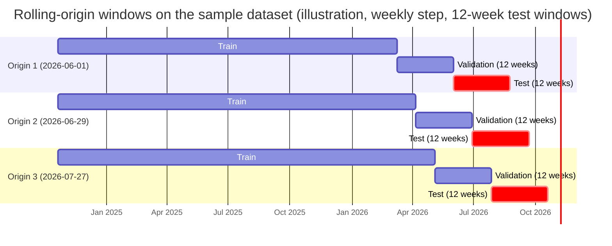

# PharmaStock — Verification and evaluation plan

Task: PHA2-19 · Last updated: 2026-10-19 · Status: draft v0.1 (section 4 complete; sections 5 and 6 to be completed by their owners) · Authors: Evelina Penkova (editor, forecasting evaluation), Abzal Bakhytov (backend and integration testing, section 5), Birkhanym Kazhymukhamet (user testing, section 6)

---

## 1. Purpose and scope

This document defines how the team verifies that PharmaStock meets its requirements and how it evaluates the quality of the forecasting module and the shortage alerts. It is the plan behind success criteria S-01 to S-06 of `docs/proposal.md` and the verification methods fixed in section 7 of `docs/requirements.md`.

The plan covers three areas with one owner each:

| Area | Owner | Section | What is verified or evaluated |
|---|---|---|---|
| Forecasting evaluation | Evelina Penkova | 4 | Forecast accuracy of baselines and candidate models on hold-out windows (FR-16, FR-17, NFR-05, NFR-06), quality of shortage alerts derived from the forecasts (FR-08, FQ-15), run time (NFR-01) |
| Backend and integration testing | Abzal Bakhytov | 5 | Unit, API, database and integration tests of the backend, CI gating (NFR-08), performance (NFR-01, NFR-02), security and data-protection checks (NFR-03, NFR-04), traceability of every requirement to a test |
| User testing and UX evaluation | Birkhanym Kazhymukhamet | 6 | Scenario-based usability sessions with pharmacy staff, acceptance of the main screens (FR-05, FR-07, FR-09), browser compatibility (NFR-09) |

Everything in this document is a plan. Results are not reported here; they are written to the locations named in each section (experiment reports, test runs in CI, the user-testing report) and summarised in the thesis. Where an activity has not started, the status says "planned".

The methodology (time-based hold-out evaluation against baselines with MAE and WAPE, alert precision and recall, user testing) is the one approved by the supervisor in the justification letter of 9 October 2026. Numeric targets are stated in section 4.8 as working targets to be confirmed after the first baseline run, so that the evaluation is not tuned to a desired result.

## 2. Conventions and related documents

### 2.1 Verification methods

The method codes are the ones of `docs/requirements.md`, section 7, and are used in every table of this plan.

| Code | Method | Where the evidence lives |
|---|---|---|
| T | Automated test (pytest in `backend/tests/` and `forecasting/tests/`, Vitest in `frontend/` later), run in CI on every pull request (NFR-08) | Test files named after the scenario IDs of the requirements (for example `test_fr08_s1_high_risk`); CI run on the pull request |
| D | Demonstration to the supervisor following a scripted scenario | Demo script in this plan or in `docs/supervision/feedback-log.md`; feedback recorded there |
| I | Inspection or review of code, configuration or documents | Pull request review; checklist in this plan |
| E | Experiment on hold-out data with saved results | `forecasting/experiments/` (configurations, results, reports) |
| U | User testing with pharmacy staff | `docs/ux/user-testing-report.md` (planned) |
| M | Measurement of time or resource usage on the synthetic dataset | Performance report in `forecasting/experiments/reports/` |

### 2.2 Identifiers used in this plan

| Prefix | Meaning | Defined in |
|---|---|---|
| FR-xx, NFR-xx | Functional and non-functional requirements | `docs/requirements.md`, sections 3 and 4 |
| FQ-xx | Forecasting requirements | `docs/requirements.md`, section 5.6 |
| FR-xx-Sn, NFR-xx-Sn | Acceptance scenarios (Given / When / Then) | `docs/requirements.md`, section 6 |
| S-01 … S-06 | User scenarios | `docs/ux/user-scenarios.md` |
| UC-01 … UC-14 | Use cases | `docs/ux/use-cases.md` |
| E-xx | Evaluation targets of this plan | Section 4.8 |
| EXP-nn | Forecasting experiments | Section 4.9 |
| UT-nn | User-testing tasks | Section 6 (to be completed) |

### 2.3 Related documents

| Document | Path | Relation to this plan |
|---|---|---|
| Proposal | `docs/proposal.md` | Success criteria S-01 … S-06 that this plan operationalises |
| Requirements | `docs/requirements.md` | Requirement IDs, forecasting requirements FQ-01 … FQ-15, acceptance scenarios, traceability table (section 7) |
| Architecture | `docs/architecture/architecture.md` | Component boundaries that define the test levels; risk-calculation formulas (section 5.2) |
| API contract | `docs/architecture/api-contract.md` | Endpoints exercised by API and integration tests |
| Database schema | `docs/architecture/database-schema.md` | Tables used by database tests |
| Data specification | `docs/data/data-specification.md` | Import formats and the synthetic dataset used as test data |
| User scenarios and use cases | `docs/ux/user-scenarios.md`, `docs/ux/use-cases.md` | Tasks of the user-testing sessions |
| Plan and milestones | `docs/project-management/plan-and-milestones.md` | Dates of the activities in section 7 |
| Forecasting module | `forecasting/README.md` | Module description; the mapping FQ → test file and the experiment command are maintained there |

Tasks are tracked in the [Linear project PharmaStock](https://linear.app/pharmacy-kz/project/pharmastock-03a3f33ce30b); every activity below is or will be a DIP task.

## 3. Overview of activities

| ID | Activity | Method | Owner | Planned period | Status (2026-10-19) |
|---|---|---|---|---|---|
| A-1 | Forecasting unit tests (schema, validation, baselines, metrics, split, censoring, reproducibility) | T | Evelina | Nov 2026 → ongoing | planned |
| A-2 | EXP-01: baselines on the synthetic development dataset; first alert evaluation; confirmation of the working targets | E | Evelina | Nov 2026 | planned |
| A-3 | EXP-02: candidate models (statsforecast, LightGBM) against baselines; censoring experiment (open question Q8) | E | Evelina | Dec 2026 | planned |
| A-4 | Backend unit, API and database tests | T | Abzal | Nov 2026 → ongoing | planned (section 5) |
| A-5 | CI workflow gating pull requests | I | Abzal | Nov 2026 | planned (section 5) |
| A-6 | Integration scenario import → forecast run → risks, used as the January 2027 demo | T, D | Abzal, Evelina | Jan 2027 | planned (section 5) |
| A-7 | Performance measurement NFR-01 (forecast run) and NFR-02 (page response) | M | Abzal, Evelina | Feb 2027 | planned (section 5) |
| A-8 | Security and data-protection review NFR-03, NFR-04 | I, T | Abzal | Feb 2027 | planned (section 5) |
| A-9 | EXP-03 … : tuning, final experiments on the final hold-out, error analysis | E | Evelina | Feb–Mar 2027 | planned |
| A-10 | User testing with pharmacy staff | U | Birkhanym | Feb–Mar 2027 | planned (section 6) |
| A-11 | Browser compatibility check NFR-09 | D | Birkhanym | Mar 2027 | planned (section 6) |
| A-12 | Deployment walkthrough NFR-07 on a clean Linux machine | D, I | Abzal | Mar–Apr 2027 | planned (section 5) |
| A-13 | Independent re-run of the final experiment by another team member (NFR-05) | E | Abzal or Birkhanym | Apr 2027 | planned |

## 4. Forecasting evaluation

Owner: Evelina Penkova. This section is the experiment plan for objective 3 of the proposal (prepare data and build forecasting models compared with baselines) and objective 6 (evaluate on a hold-out period). It implements FR-16, FR-17, NFR-05 and NFR-06 and the forecasting requirements FQ-05 to FQ-11 and FQ-15.

### 4.1 Questions the evaluation must answer

| # | Question | Answered by |
|---|---|---|
| Q-A | Which model forecasts weekly consumption per item best, and does any candidate model beat the baselines by a margin that justifies its complexity? | Accuracy comparison, section 4.5; target E-01 |
| Q-B | How do the models behave on rarely consumed (intermittent and lumpy) items, where most pharmacy items fall? | Per-class metrics, section 4.5; target E-02 |
| Q-C | Do the shortage alerts derived from the forecasts find the stock-outs that actually happened, early enough to act? | Alert evaluation, section 4.6; targets E-03, E-04 |
| Q-D | Does excluding censored (stock-out) weeks improve accuracy compared with treating them as zeros, and is imputation better than exclusion? | Censoring experiment, section 4.5.4; open question Q8 |
| Q-E | Can every reported number be reproduced from the repository? | Reproducibility protocol, section 4.9; target E-05 |
| Q-F | Does a full run fit the time budget of NFR-01? | Measurement, section 4.7; target E-06 |

### 4.2 Data used for evaluation

| Dataset | Identifier (planned form) | Content | Use |
|---|---|---|---|
| Synthetic sample (committed) | `synthetic-0.1.0-i20-w104-s42` | 20 items × 104 weeks (2024-10-21 … 2026-10-12), 78 stock-out weeks in 14 items, demand classes smooth 6 / intermittent 5 / erratic 3 / lumpy 6; files in `forecasting/data/sample/` | Unit tests, worked examples in this plan, integration tests, demos |
| Synthetic development set (generated, not committed) | `synthetic-0.1.0-i30-w156-s42` | Default output of `forecasting/data/generate_synthetic.py` (30 items × 156 weeks, seed 42) | Main experiments EXP-01 … until real data are available |
| Synthetic performance set (generated, not committed) | `synthetic-0.1.0-i1000-w156-s42` | 1,000 items × 156 weeks | NFR-01 measurement (section 4.7) |
| Real data (requested) | to be assigned when received | Consumption, stock and receipt exports of a partner healthcare organization, item level only (NFR-04) | Re-run of the full protocol; final results in the thesis if access is granted |

The dataset identifier is written into every experiment configuration and every result file. The identifier of a synthetic set encodes the generator version, the number of items, the number of weeks and the seed; the generator is deterministic for a given argument set (NFR-05-S5), so the identifier fully determines the data.

Caveat that applies to every result obtained before real data are available: the synthetic generator (task PHA2-15) produces demand classes, seasonality, delivery delays and stock-outs by construction. Rankings of models on synthetic data show that the pipeline works and which methods handle intermittent and censored series correctly; they do not show how the models perform on the consumption of a real organization. Every table produced on synthetic data carries the label "synthetic". Access to real data is tracked as a project risk in `docs/project-management/risks.md`; if it is not granted, the thesis reports synthetic results only and states this limitation.

### 4.3 Series construction and censoring

The backend builds one contiguous weekly series per item (FQ-01, FQ-02): `period_start` is the Monday of the week; weeks without a consumption record receive `quantity = 0`; `is_stock_out` is `true` for weeks whose stock snapshot shows `quantity_on_hand = 0` (FR-17). Experiments read the same CSV formats as the import (`consumption.csv`, `stock.csv`) and build the series with the same rule, implemented once in `forecasting/forecasting/data/validation.py` (`make_regular_weekly`; the column names and the weekly frequency it relies on are defined in `forecasting/forecasting/data/schema.py`) so that the backend and the experiments cannot diverge.

Censored demand (FQ-10): a week with `is_stock_out = true` is never used as an observed zero. The default handling is exclusion (the week is missing for fitting and excluded from the evaluation set); imputation by the item's expected demand is evaluated as an alternative (section 4.5.4). The handling method is a configuration value (`censoring_method`) recorded with every run.

Minimum history (FQ-04): items with fewer than 12 non-censored weeks in the training window are forecast with the fallback (`moving_average`, window 8), flagged `insufficient_history`, and reported separately in the results; `seasonal_naive` requires at least 53 weeks and otherwise falls back to `naive`.

### 4.4 Evaluation design: time-based rolling-origin windows

The evaluation is time-based and never shuffled (FQ-09). The step is one week and the default horizon is 12 weeks (FQ-03).

| Element | Definition |
|---|---|
| Forecast origin | Monday of the first forecast week. All feature computation and fitting use only data before the origin. |
| Test window | The 12 weeks starting at the origin (equal to the default horizon). Metrics are computed on these weeks. |
| Validation window | The 12 weeks before the origin. Used for hyperparameter selection and model selection per medicine group; never for reporting. |
| Training window | All weeks before the validation window. For the test forecast the model is refitted on all data before the origin (training plus validation weeks) with the parameters chosen on the validation window. |
| Origins | At least three, spaced four weeks apart; the last origin is placed so that its test window ends at the last week of the dataset. The last origin's test window is the final hold-out reported in the thesis; the earlier origins show the variability of the results. |
| Rule | A result is only reported when the same origins were used for every model in the comparison. |

The exact origin dates are fixed in the experiment configuration once the dataset is final. For the committed sample dataset they are:



| Origin | Training weeks | Validation weeks | Test weeks (hold-out) |
|---|---|---|---|
| 1: 2026-06-01 | 2024-10-21 … 2026-03-02 (72 weeks) | 2026-03-09 … 2026-05-25 | 2026-06-01 … 2026-08-17 |
| 2: 2026-06-29 | 2024-10-21 … 2026-03-30 (76 weeks) | 2026-04-06 … 2026-06-22 | 2026-06-29 … 2026-09-14 |
| 3: 2026-07-27 | 2024-10-21 … 2026-04-27 (80 weeks) | 2026-05-04 … 2026-07-20 | 2026-07-27 … 2026-10-12 (final hold-out) |

With 104 weeks the training windows contain more than 52 weeks at every origin, so `seasonal_naive` is applicable. The development set (156 weeks) uses the same construction with origins moved to its last 20 weeks; a dataset shorter than 65 weeks (53 weeks for `seasonal_naive` plus a 12-week test window) cannot support `seasonal_naive` and the plan allows for this (proposal, assumption A-02).

Why rolling origins rather than a single split: with 20–30 items a single 12-week window is dominated by a few spikes and stock-out episodes; three origins give three estimates per model and show whether a ranking is stable. The results tables report every origin separately and pooled.

### 4.5 Models and metrics

#### 4.5.1 Baselines (FQ-05)

All five baselines are mandatory in every comparison (FR-16-S4). They are implemented in `forecasting/forecasting/models/baselines.py` and tested in `forecasting/tests/test_baselines.py` (planned).

| Name | Forecast for every horizon week | Parameters | Notes |
|---|---|---|---|
| `naive` | Last non-censored observed value | none | Lower bound that every model must beat |
| `seasonal_naive` | Value observed 52 weeks earlier (non-censored; otherwise the nearest earlier non-censored week of the same season) | `season_length = 52` | Requires at least 53 weeks, else falls back to `naive` |
| `moving_average` | Mean of the last `window` non-censored weeks | `window = 8` (default) | Also the fallback for items with insufficient history; closest to the spreadsheet practice of averaging recent months |
| `croston` | Croston's method: separate exponential smoothing of non-zero demand sizes and of intervals between demands; forecast = size / interval | smoothing parameter `alpha = 0.1` (default), tuned on the validation window | Standard reference for intermittent demand |
| `sba` | Croston with the Syntetos–Boylan bias correction, forecast = (1 − alpha / 2) · size / interval | `alpha = 0.1` (default), tuned on the validation window | Corrects the positive bias of Croston |

#### 4.5.2 Candidate models (FQ-06)

| Family | Models | Features / inputs | Selection |
|---|---|---|---|
| Statistical, per item (`statsforecast`) | Croston variants (classic, optimised, SBA), ADIDA, IMAPA, TSB, AutoETS, AutoARIMA | The item's own series | Model per medicine group chosen on the validation window |
| Global gradient boosting (`LightGBM`) | One model trained across all items | Lags 1, 2, 3, 4, 8, 12, 26, 52; rolling mean and rolling share of non-zero weeks over 4, 8 and 13 weeks; weeks since last non-zero demand; calendar features (ISO week, month); medicine group and demand class as categorical features; all computed strictly from data before the origin | Hyperparameters chosen on the validation window; the final configuration is an explicit value in the experiment file |

The production model used by the backend is an explicit configuration value, not an automatic choice at run time (FQ-06); the choice is made after EXP-02 and revised after the final experiments.

#### 4.5.3 Metrics (FQ-08)

For an item and a test window with non-censored weeks `t = 1 … n`, actual `y_t` and point forecast `ŷ_t`:

| Metric | Definition | Aggregation | Reported where |
|---|---|---|---|
| MAE | `mean(abs(y − ŷ))` | Per item; per medicine group and overall as the pooled mean over all (item, week) pairs | All results tables |
| WAPE | `sum(abs(y − ŷ)) / sum(y)`; `None` ("n/a") when `sum(y) = 0` in the window (FR-16-S2) | Per item; per group and overall pooled (sums over all weeks and items), never an average of per-item WAPE | All results tables |
| Bias | `mean(ŷ − y)` | Per item, group and overall | All results tables; a negative bias (under-forecast) is the dangerous direction for shortages |
| MAE by horizon step | MAE over all items for horizon week `h = 1 … 12` | Overall | `metrics_by_horizon.csv`; shows how fast accuracy degrades |
| Interval coverage (diagnostic) | Share of non-censored test weeks with `lower ≤ y ≤ upper` for the 80 % interval of FQ-07 | Overall and per group | Experiment report; checks that intervals are usable for the conservative risk variant (open question Q6) |
| Win rate against the best baseline | Share of items for which the model's MAE is lower than the MAE of the best baseline for that item | Per group and overall | Experiment report |

Metrics are computed by `forecasting/forecasting/evaluation/metrics.py` and tested in `forecasting/tests/test_metrics.py` against hand-computed values, including the zero-denominator rule and the exclusion of censored weeks (FR-16-S2, FR-16-S3, FR-17-S4).

Breakdowns that every comparison reports:

- **Per medicine group** (`medicine_item.group`): because the proposal commits to error analysis per group and because model selection is per group.
- **Rarely consumed items**: items are classified on the training window with the Syntetos–Boylan scheme used by the synthetic generator (average demand interval ADI > 1.32 → intermittent or lumpy; squared coefficient of variation of non-zero sizes CV² > 0.49 → erratic or lumpy). Metrics are reported separately for the intermittent and lumpy classes ("rarely consumed") and for smooth and erratic, so that a good overall WAPE driven by a few high-volume items cannot hide poor forecasts for the long tail.
- **Items with insufficient history** and **items whose test window is fully censored** are listed and excluded from the accuracy metrics; their number is stated in every table.
- **Censored weeks**: the number of excluded weeks per item and in total (`censored_weeks` column).

Statistical treatment: with 20–30 synthetic items the plan does not claim significance; it reports the spread across origins (minimum and maximum per model) and the win rate. On real data with several hundred items a paired comparison of per-item MAE between the selected model and the best baseline (Wilcoxon signed-rank test) is planned.

#### 4.5.4 Stock-out-aware evaluation

| Check | How | Data |
|---|---|---|
| Censored weeks excluded | Weeks with `is_stock_out = true` are not in the error sums; their count is reported (FR-17-S4) | All datasets |
| Censored zeros not learned | Test FR-17-S3: 16 weeks of 10 and 4 censored zeros give a `moving_average` (window 8) forecast of 10, not the smaller value obtained by treating the censored weeks as observed zeros (5 when the four censored weeks are the last four) | Unit test |
| Censoring experiment (open question Q8) | The same models are run with `censoring_method = exclude`, `impute` and, as a control, `as_zero` (the wrong handling that spreadsheets apply); results are compared on non-censored test weeks | Development set, EXP-02 |
| Recovery of true demand (synthetic only) | The generator writes the uncensored demand (`generate_synthetic.py --write-truth`, file `true_demand.csv`). Forecasts are additionally scored against the true demand on censored weeks to see how much each censoring method recovers. This check is impossible on real data and is reported as a synthetic-only diagnostic | Development set |

### 4.6 Shortage-alert evaluation (FQ-15, success criterion S-02)

Forecast accuracy is the means; the user-facing outcome is the alert. At every origin the risk calculation of FR-08 is replayed with the information that would have been available at that date, and the alerts are compared with the stock-outs that actually occurred in the test window.

**Replay at an origin `o` for item `i`.**

| Input | Taken from |
|---|---|
| `current_stock` | `stock_snapshot.quantity_on_hand` of the week before `o` |
| Point forecast for weeks `o … o + 11` | The model under evaluation, fitted on data before `o` |
| Planned receipts | Primary variant "known deliveries": the receipts that actually arrived in the test window (`receipts.csv`), as if they had been recorded as planned receipts at `o`. Sensitivity variant "no deliveries": none. The primary variant assumes that deliveries are known in advance, which is optimistic; the sensitivity variant is pessimistic. Both are reported. |
| Lead time `L_i`, safety stock `s_i` | `item_supplier.lead_time_days` of the primary supplier; `threshold_config` default (safety stock in weeks of forecast demand, as in the synthetic generator) |
| Risk calculation | `projected_stock(k) = current_stock + receipts due by week k − cumulative forecast up to week k`; expected stock-out week `k*` = first week with `projected_stock(k*) ≤ s_i`; High if `k*` is within `L_i` days of `o`, Medium if within the horizon, Low otherwise (requirements section 6.8, scenarios FR-08-S1 … S3) |

The replay uses a pure function in `forecasting/forecasting/evaluation/alerts.py` (planned) that mirrors the backend formula; the two implementations are tied together by the numeric examples of FR-08-S1 and FR-08-S2, which both test suites must reproduce.

**Ground truth.** The actual first stock-out week of item `i` after `o` is the first test week with `is_stock_out = true` in `stock.csv`. An item is a *lead-time positive* at `o` if that week lies within `L_i` days of `o`, and a *horizon positive* if it lies within the 12-week window.

**Confusion matrix for High alerts (lead-time aware)** over all (item, origin) pairs:

| | Actual stock-out within lead time | No stock-out within lead time |
|---|---|---|
| Predicted High | true positive | false positive |
| Predicted Medium or Low | false negative | true negative |

Reported measures:

| Measure | Definition | Notes |
|---|---|---|
| Precision (High) | TP / (TP + FP) | Share of High alerts that were justified |
| Recall (High) | TP / (TP + FN) | Share of real lead-time stock-outs that were alerted; prioritised, because a missed shortage costs more than a false alert (proposal S-02) |
| F1 (High) | harmonic mean of precision and recall | Single number for model comparison |
| Precision and recall (High or Medium) | Same with "predicted High or Medium" against horizon positives | Secondary; measures the whole risk list rather than the top level |
| Timing error | For true positives: `expected stock-out week − actual first stock-out week` in weeks; reported as MAE in weeks and as the share of true positives where the expected week is not later than the actual week | Answers "early enough to act" |
| Counts | TP, FP, FN, TN and the number of positives per origin | Stock-outs are rare; rates without counts are misleading |

Reference points for the alert evaluation:

| Reference | Purpose |
|---|---|
| Alerts derived from each baseline forecast | Shows whether a better forecast produces better alerts |
| Days-of-supply rule: `current_stock / mean consumption of the last 8 non-censored weeks < L_i` → High | The rule of thumb that staff apply in a spreadsheet; the system must do at least as well |
| Perfect-forecast alerts (synthetic only): the replay with the true demand instead of a forecast | Upper bound that separates forecast error from the limits of the risk formula itself |

Caveat: in the synthetic data every stock-out is caused by a modelled delivery delay, so the "known deliveries" variant has the information needed to reproduce the drain. The evaluation on synthetic data checks the mechanics; the figures that matter are those on real data, where stock-outs also arise from demand spikes and recording errors.

### 4.7 Measurement conditions

| Condition | Value |
|---|---|
| Software | Python 3.12; pandas, numpy, scikit-learn, statsforecast, LightGBM pinned in `forecasting/pyproject.toml`; exact versions written to `metadata.json` of every run |
| Seeds | `seed = 42` by default (FQ-11). numpy `default_rng(seed)`; LightGBM with `seed`, `deterministic = true` and a fixed `num_threads`; statsforecast models are deterministic. A run with a different seed is a different experiment and says so in its identifier |
| Reproducibility check | Every reported experiment is run twice on the same machine before it is reported; metric and forecast files must be equal to at least six decimal places (NFR-05-S1). The final experiment is additionally re-run by another team member from a clean checkout (activity A-13) |
| Development hardware | Team laptops; CPU, RAM and OS are recorded in `metadata.json` so that run times in reports can be interpreted |
| Reference machine for NFR-01 | A Linux virtual machine with 4 vCPU and 8 GB RAM (to be provisioned by Abzal in February 2027; cloud or local virtualisation). Measured value: wall-clock time of a complete forecast run started through `POST /api/v1/forecast-runs` on the performance set (1,000 items × 156 weeks, 12-week horizon, production model configuration), from `forecast_run.started_at` to `finished_at`. Three repetitions; the median and the maximum are reported; the maximum must be within 5 minutes (E-06). Baselines alone are measured first as a lower bound |
| Data | Dataset identifier and the checksums of the input files recorded in `metadata.json` |
| Synthetic vs real | Every table and figure states which dataset it was produced on; synthetic results are labelled "synthetic" and are never mixed with real results in one table |

### 4.8 Acceptance targets (to be confirmed)

The proposal fixes that numeric targets for accuracy and alert quality are set after the first baseline run (EXP-01, November 2026) and revised when real data become available. The values below are the working targets as of this version; the column "Fixed by" shows when each becomes binding.

| ID | Target | Measure and conditions | Working value | Fixed by |
|---|---|---|---|---|
| E-01 | Forecast accuracy exceeds the baselines (S-01) | Pooled WAPE and MAE on the final hold-out window, selected model vs the best of the five baselines | Selected model not worse than the best baseline in aggregate and lower WAPE in the majority of medicine groups (proposal, section 10); numeric margin to be set after EXP-01 | EXP-01 report |
| E-02 | Rarely consumed items are not worse than the intermittent-demand baseline | Pooled MAE on intermittent and lumpy items, selected model vs `sba` | Not worse than `sba`; to be confirmed | EXP-01 report |
| E-03 | High alerts find real stock-outs (S-02) | Recall and precision of High alerts, "known deliveries" variant, pooled over origins | Recall ≥ 0.80, precision ≥ 0.50; to be confirmed; recall takes priority if both cannot be met | EXP-01 report |
| E-04 | Alerts are early enough | Share of true positives whose expected stock-out week is not later than the actual week | ≥ 0.70; to be confirmed | EXP-01 report |
| E-05 | Experiments are reproducible (S-05, NFR-05) | Repeat run on the same machine; independent re-run by another team member | Metrics and forecasts equal to six decimal places | Fixed (requirement) |
| E-06 | Run time (NFR-01) | Section 4.7 | ≤ 5 minutes, maximum of three repetitions | Fixed (requirement) |
| E-07 | Intervals are usable | Empirical coverage of the 80 % interval on non-censored test weeks | Between 0.70 and 0.90; diagnostic, to be confirmed | EXP-02 report |

A target that is not met is reported as not met, with the error analysis of section 4.11; targets are not lowered after the fact. Changes to this table are recorded in the revision history with the experiment that motivated them.

### 4.9 Experiment protocol (NFR-05)

Every experiment follows the same six steps. Nothing is reported that did not go through them.

1. **Register.** Create a task in Linear (PHA2-n) and a configuration file `forecasting/experiments/EXP-<nn>-<slug>.yaml`. `EXP-nn` is a running number; the file is the single definition of the experiment (dataset, split, censoring method, models and parameters, seed, interval level).
2. **Data.** Generate or locate the dataset by its identifier; record the generator command and the file checksums. Real data, if available, stay outside the repository and are referenced by identifier only.
3. **Run.** Execute the single documented command (planned entry point `python -m forecasting.experiments.run <config>`; the exact command is maintained in `forecasting/README.md` once implemented). The run validates the input (NFR-06), refuses a configuration that omits a baseline (FR-16-S4), fits every model at every origin and writes the results directory. No manual step is allowed between the command and the result files (NFR-05-S3).
4. **Repeat.** Run the command a second time and compare the result files (NFR-05-S1). A difference is a defect, not a result.
5. **Report.** Write `forecasting/experiments/reports/EXP-<nn>.md` from the template in section 4.10, with the tables copied from the result files and the error analysis of section 4.11.
6. **Review.** Another team member reviews the report in the pull request; decisions taken from the experiment (model choice, censoring method, confirmed targets) are recorded in the report and, where they change this plan, in its revision history.

Configuration example (sample dataset, baselines and one candidate model):

```yaml
experiment: EXP-01-baselines
task: PHA2-n            # Linear issue of the experiment
dataset:
  id: synthetic-0.1.0-i20-w104-s42
  path: forecasting/data/sample
  generator_args: "--items 20 --weeks 104 --seed 42"
split:
  step: weekly
  horizon_weeks: 12
  validation_weeks: 12
  origins: ["2026-06-01", "2026-06-29", "2026-07-27"]
censoring_method: exclude          # exclude | impute | as_zero (control only)
min_history_weeks: 12
interval_level: 0.8
seed: 42
models:
  - {name: naive}
  - {name: seasonal_naive, params: {season_length: 52}}
  - {name: moving_average, params: {window: 8}}
  - {name: croston, params: {alpha: 0.1}}
  - {name: sba, params: {alpha: 0.1}}
  - name: lightgbm_global
    params:
      lags: [1, 2, 3, 4, 8, 12, 26, 52]
      rolling_windows: [4, 8, 13]
      num_leaves: 31
      n_estimators: 300
      learning_rate: 0.05
alerts:
  variants: [known_deliveries, no_deliveries]
  safety_stock_weeks: 1
```

Results directory (planned layout) `forecasting/experiments/results/EXP-<nn>/<run-timestamp>/`:

| File | Content |
|---|---|
| `config.yaml` | Copy of the configuration used |
| `metadata.json` | Configuration hash, git commit, dataset identifier and checksums, start and end time, machine description, versions of Python, pandas, numpy, scikit-learn, statsforecast and LightGBM (NFR-05-S2) |
| `metrics_overall.csv` | One row per model and origin: `mae`, `wape`, `bias`, `censored_weeks`, `items_evaluated`, `items_insufficient_history`, test window dates (FR-16-S1) |
| `metrics_by_group.csv` | Same per medicine group and per demand class |
| `metrics_by_item.csv` | Same per item, with `demand_class` and `censored_weeks` |
| `metrics_by_horizon.csv` | MAE per horizon step |
| `alerts.csv` | Per model, origin and variant: TP, FP, FN, TN, precision, recall, F1, timing error |
| `forecasts.csv` | `model`, `origin`, `item_code`, `period_start`, `point`, `lower`, `upper` |
| `figures/` | Residual and example plots used in the report |

Metric files and `metadata.json` are committed; `forecasts.csv` is committed only for the sample dataset (larger forecast files are excluded through `.gitignore` and rebuilt by the command).

### 4.10 Reporting template

Every `forecasting/experiments/reports/EXP-<nn>.md` has the following sections, in this order.

```markdown
# EXP-nn — <title>

Task: PHA2-n · Dataset: <identifier> (synthetic | real) · Run: <results path> · Git commit: <hash> · Date: <YYYY-MM-DD>

## 1. Question
What the experiment is meant to decide (one of Q-A … Q-F or a new question).

## 2. Configuration
Origins and window dates; censoring method; models and parameters; seed; link to config.yaml.

## 3. Results
3.1 Overall: table model × origin with MAE, WAPE, bias, censored weeks (plus pooled row).
3.2 Per medicine group and per demand class (rarely consumed items separately).
3.3 By horizon step.
3.4 Alerts: precision, recall, F1, timing error, counts; both delivery variants; reference rules.
3.5 Interval coverage (when intervals are produced).

## 4. Error analysis
Worst items, systematic bias, behaviour around spikes and stock-outs, items with insufficient history (section 4.11 of the plan).

## 5. Reproducibility
Result of the repeat run (identical / differences); machine; run time.

## 6. Decisions
What the team decides on the basis of the experiment (model choice, censoring method, target confirmation) and which DIP tasks follow.

## 7. Limitations
Synthetic data caveat; anything that restricts the conclusions.
```

Tables in the report are copied from the result files, not retyped. The thesis chapter on evaluation is assembled from these reports.

### 4.11 Error analysis plan

After every experiment the following analyses are run on the final hold-out window and summarised in the report; figures go to `figures/` of the results directory.

| Analysis | Question it answers |
|---|---|
| Ranking of models per medicine group and per demand class | Is one model best everywhere, or does the best model depend on the group (which would justify per-group selection)? |
| Ten worst items by MAE and by WAPE for the selected model, with their history plotted against the forecast | Are the largest errors caused by spikes, by stock-outs, by trend changes or by too little history? |
| Sign of the bias per group | Does the model systematically under-forecast (dangerous: late alerts) or over-forecast (costly: overstock)? |
| Error by horizon step | How far ahead is the forecast still better than the baseline? |
| Residuals over time for the items with stock-out episodes | Does the error grow around censored periods, and does the censoring method change that? |
| False positives and false negatives of the alert evaluation listed with their cause (forecast error, unknown delivery, safety-stock setting) | Which part of the risk chain fails: the forecast, the delivery information or the thresholds? |
| Items flagged `insufficient_history` | How many items receive the fallback, and would a lower minimum be acceptable? |

The findings feed back into feature engineering, model selection, the censoring decision (Q8) and the threshold defaults (FR-11), and are written up as the "Error analysis" part of the thesis evaluation chapter.

### 4.12 Forecasting module tests (NFR-06, FR-16, FR-17, NFR-05)

Automated tests of the module live in `forecasting/tests/` and run in CI on every pull request. The mapping FQ → test file is maintained in `forecasting/README.md`; the planned files are:

| File | Scenarios covered | Status |
|---|---|---|
| `test_validation.py` | NFR-06-S1 … S8 (missing column, invalid quantity, period not Monday, duplicate period, gap, invalid horizon, all problems reported) | planned |
| `test_schema.py` | Series construction from the import formats; `is_stock_out` propagation (FR-17-S2) | planned |
| `test_baselines.py` | Hand-computed forecasts of the five baselines; fallbacks of FQ-04 | planned |
| `test_metrics.py` | MAE, WAPE (`None` on zero sum), bias, pooled aggregation; FR-16-S2, FR-16-S3 | planned |
| `test_split.py` | Origins, window boundaries, no data from or after the origin in features (FQ-09) | planned |
| `test_censoring.py` | FR-17-S3, FR-17-S4; the three censoring methods | planned |
| `test_alerts.py` | Replay of FR-08-S1 … S3 numbers in `evaluation/alerts.py`; confusion-matrix arithmetic | planned |
| `test_api.py` | `forecast_items` contract of FQ-13: output columns, `point ≥ 0`, `lower ≥ 0`, `upper ≥ point`, model name and flags per item (FQ-07) | planned |
| `test_reproducibility.py` | Two calls with the same seed give identical results (NFR-05-S1 at unit level) | planned |

Tests use small hand-written series (under 60 weeks) so that expected values can be verified by hand; the committed sample dataset is used only by a smoke test that runs the full pipeline once.

## 5. Backend and integration testing

To be completed by Abzal Bakhytov (planned content: unit tests with pytest, API tests with the FastAPI TestClient, database tests, the integration scenario import → forecast run → risks, CI gating, test data strategy, performance checks for NFR-01 and NFR-02, security checks for NFR-03 and NFR-04, and the traceability table requirement → test type → status).

## 6. User testing and UX evaluation

To be completed by Birkhanym Kazhymukhamet (planned content: scenario-based usability sessions with 3–5 pharmacy staff, task list mapped to the user scenarios, metrics (task completion, time on task, SUS questionnaire, error count), acceptance criteria for FR-05, FR-07 and FR-09, schedule after prototype integration in February–March 2027).

## 7. Schedule

Aligned with `docs/project-management/plan-and-milestones.md`.

| Period | Verification and evaluation activities | Deliverable |
|---|---|---|
| Oct 2026 | This plan (PHA2-19); synthetic sample dataset (PHA2-15); experiment plan agreed with the supervisor | Plan in the pre-defense-1 materials (tag `pre-defense-1`) |
| Nov 2026 | Forecasting module tests (A-1); EXP-01 baselines and first alert evaluation (A-2); working targets confirmed; backend tests and CI start (A-4, A-5) | `EXP-01.md`; CI green on pull requests |
| Dec 2026 | EXP-02 candidate models and censoring experiment (A-3); API tests for imports, items, forecast runs, risks | `EXP-02.md`; decision on the censoring method |
| Jan 2027 | Integration scenario and end-to-end demo (A-6); backend run reproducibility (NFR-05-S4) | Demo recorded in `docs/supervision/feedback-log.md`; pre-defense-2 materials (tag `pre-defense-2`, date to be confirmed by the School) |
| Feb 2027 | Tuning experiments (A-9); NFR-01 and NFR-02 measurements (A-7); security review (A-8); user-testing pilot and first sessions (A-10) | Performance report; tuning reports |
| Mar 2027 | Final experiments on the final hold-out, comparison and error analysis (A-9); integration testing; user-testing sessions and report (A-10, A-11) | Final `EXP-nn.md`; `docs/ux/user-testing-report.md` |
| Apr 2027 | Independent re-run of the final experiment (A-13); deployment walkthrough (A-12); results written into the thesis and the article | Evaluation chapter; deployed prototype |
| May–Jun 2027 | Revisions after pre-defense feedback; final pre-defense (tag `final-pre-defense`) and defense | Final thesis |

## 8. Revision history

| Date | Version | Author | Change |
|---|---|---|---|
| 2026-10-19 | 0.1 | Evelina Penkova | First version: purpose, conventions, overview of activities, forecasting evaluation design (sections 4.1–4.12), schedule; sections 5 and 6 reserved for their owners |
